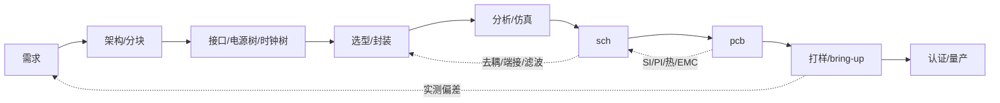

# TextEDA — Agent 工作指南

> **本文件怎么读（2026-10-21 起）**：这里混了三类东西，效力不同：
> - **不变量**（§2）——少而硬，破坏要写 ADR 并说明为什么值得破坏。
> - **方向**（§1、§3、§4、§5）——设计意图，**可被 ADR 推翻**；推翻时改本文件，不算"违反规矩"。
> - **实现现状**——**以代码、测试、ADR、backlog 为准**，本文件只标注"已落地 / 只有设计 / 未落地"，不复制细节。细节过期不算违规，但标注错了要改。
>
> 状态（2026-10-26）：**工具链起步**。已落地：`packages/ir`（IR 与契约，11 份 schema；契约 **v0.14**，`instance.component` 是裸 `device_ref`、`instance.uid` 是稳定身份）、**外部库是模板**（`texteda lib import` 拷进 `assets/`、限定符重写、来源头注释、`provenance generated`，见 §4.5.1）、`packages/parser`（`footprint` / `symbol` 解析 + 对应 `fmt`；`pcb` 解析（12 段 → `pcb` IR，`texteda compile --pcb`）+ `pcb` canonical formatter（`fmt --check` 已覆盖）+ sch↔pcb 绑定校验（`packages/core`）；`schematic` 解析（实例、net、port、约束、bus；板内不再有 `page` 类型，语言 0.7 撤销，见 [ADR-0025](docs/adr/0025-flat-board-and-print-pages.md)；实例可带稳定 `uid`，见 [ADR-0051](docs/adr/0051-instances-have-a-stable-project-local-uid.md)）+ 对应 `fmt`（连通性 ERC 已移出，见 `packages/core`）；`view` 解析（S1 打印页：摆位、走线、标签、端口、注释 → `schematic-view` IR）+ 对应 `fmt`，板 ↔ 打印页交叉校验与可读性检查均已落地（`packages/core/src/view/`，见 `spec/schematic-view.md` §9）；`module` 解析（板内层次：模块文件 + 板级 `modules` 段 + 端口绑定 → 展平进板级 IR，IR 契约不变，[ADR-0026](docs/adr/0026-modules-compose-boards.md)、`spec/module.md`）+ 对应 `fmt`；`system` 解析（多板连接：板列表 + 跨板 net（成员是 `<board_id>.<port_id>`）→ `system` IR）+ 对应 `fmt` + 跨板校验（板不存在 / port 未声明 / 一个板内 net 被并进两条系统 net / 两侧电压区间不相交，`packages/core`）；`project.toml` 解析（项目元数据：名称 / 版本 / 格式 / 板列表 / 变体 / 库引用 / 合规 → `project` IR）；`component` 解析（**part / generic 两种显式种类**：`kind` + `construction` + `polarized`，引脚表是身份分界；件与通用器件同在 `assets/components/`（`kind` 只写在文件里），见 [ADR-0027](docs/adr/0027-device-parts-families-and-library-dependencies.md) 与 [ADR-0037](docs/adr/0037-device-kind-vocabulary-and-one-device-directory.md)；事实读取 `readComponentFacts`；**件用自己的 `ratings` 段写额定值**，通用件的 `params` 是设计的要求（[ADR-0039](docs/adr/0039-a-part-states-its-own-ratings.md)））、`packages/core`（纯规则：连通性 ERC，不碰 fs，解析器与 LSP 共用）、`packages/exporter`（封装/符号 → KiCad `.kicad_mod` / `.kicad_sym`；网表 = IR 的连通性投影）、`packages/renderer`（符号/封装/原理图打印页 → SVG，并支持三者的反解校验，[ADR-0014](docs/adr/0014-reference-renderer.md)）、`packages/geom`（受限 2D 几何内核）、`packages/core` 的铜皮填充策略（ADR-0054）与 `texteda export gerbers`（分层 RS-274X + Excellon，F15 第一段）、`packages/cli`（`texteda init` / `compile` / `check` / `netlist` / `ir` / `bom` / `id` / `renumber` / `export gerbers`，[ADR-0019](docs/adr/0019-agent-contract-reference-and-check-entry.md)、[ADR-0023](docs/adr/0023-ir-layer-on-disk.md)）、**IR 分片树**（`texteda ir` 写 `dist/ir/`：每片 canonical JSON + `manifest.json` + 每片 sha256 + **分类（规范 / 附注）** + 工程哈希 / 板哈希 / `advisory_hash`；打印页是附注类，移动标签不改构建身份，见 [ADR-0023](docs/adr/0023-ir-layer-on-disk.md) decision 4 的 2026-10-22 修订；`component` 分片还没有生产者；**采购层已落地**（`procurement` 描述类型：主料分片规范、备料分片附注，解析 + `fmt` + 契约 v0.7 + 选料检查 + `texteda bom`，见 [ADR-0030](docs/adr/0030-procurement-layer.md)、`spec/procurement.md`））、**诊断错误码注册表**（`域.slug`，[ADR-0016](docs/adr/0016-diagnostic-error-codes.md)；真源 `packages/ir/src/diagnostics/codes.ts`，文档 `docs/error-codes.md` 由 `bun run gen` 生成，双向完整性检查见 `packages/ir/test/codes.test.ts`）。**未落地**：遮蔽件的选料检查、KiCad 原理图导出、sch 规范文件（`spec/` 现只有 `symbol` / `footprint` / `pcb` / `schematic-view` / `module`）、**原理图视图层 S1**（描述类型 `view` 的规范 + IR 契约 + 解析 + `fmt` 已落地；板 ↔ 打印页交叉校验、可读性检查、sch 的 round-trip 反解）、**评审 GUI**（`review` 模式**已落地** 2026-10-24：`texteda review`，见 §1 与 ADR-0021 的 2026-10-24 附录；双击/`Enter` 跳源码已落地（F11 D6：`dist/ir/identity.json`），`layout` / `placement` / `edit` 三模式与桌面壳仍未建，见 `docs/backlog.md` F34）、层次（模块参数、模块嵌套、跨工程模块库）、`fab` 描述、**布局布线**（agent 驱动、检查器把关，无内建求解器，[ADR-0053](docs/adr/0053-layout-and-routing-are-agent-driven.md)）、conformance / binding / 十用例语料。**仓库已公开**（`luffffyz/TextEDA`，2026-10-21），**CI 已落地**（`.github/workflows/ci.yml` 必过段零外部依赖；KiCad 互操作段是独立可选 workflow）。
> 标记约定：**已定** = 不再讨论；**提议** = 默认按此执行，可被 ADR 推翻；**待定** = 未决定，不要擅自选边。**未落地** = 只有设计，没有实现。

---

## 0. TL;DR

给**整个硬件项目**造一套人写的文本描述语言、一个类型化 IR、和一组校验器。

- 项目 = 需求 / 分块 / 接口 / 板 / 原理图 / PCB / 制造 / 变体，语言描述的是这个整体，不是单块 PCB。
- **原理图（sch）与 PCB 是两个独立描述**，互为兄弟，不互为父子：共享身份空间，各自可单独存在。
- 第一阶段只做 sch；PCB 描述晚于 sch，且不要求由 sch 派生。
- 语法只占 10%，真正的工作是语义、约束、错误模型、跨描述一致性。
- IR 是唯一真源；源码语法和任何渲染结果都是派生物。
- 渲染可以自由、可以非确定，但**不得改变连通性**，且必须能被反解校验。
- 不自研布局布线内核、不自研器件库、不自研制造出口（项目可自带**自建封装与符号**，但不做通用库；见 `docs/adr/0010-footprint-and-3d-model-ownership.md`）。
- 目标用户是 agent，但产出物要人读得懂：**Agent 优先，人来评审**。机器负责读设计、查错误、改设计；人负责在东西交付前读一遍。所有东西都是纯文本——包括错误本身，会指到具体哪个文件、哪一行。

---

## 1. 项目是什么 / 不是什么

**是**：

- 一套面向硬件项目的领域语言：`project`、`board`、`schematic`、`pcb`、`fab`、`variant`；需求/分块/分析证据为可选的轻量实体。
- 一个类型化中间表示（IR）及其 schema。
- 一个检查器：单位/量纲、引脚存在性、电气类型、net 完整性、约束断言、**sch↔pcb 一致性**、**器件额定值 vs 声明窗口**。**现状：已落地**——契约层（Ajv + schema）、连通性 ERC 与器件规则在 `packages/core`，绑定校验（sch↔pcb，含铜箔兑现）、跨板系统校验、采购选料校验；额定值比对只做了两引脚器件的**电压**（`design.rating-exceeded` / `design.stress-unknown`，[ADR-0043](docs/adr/0043-ratings-are-compared-against-declared-windows.md)）与**耗散**（`ΔV²/R` 比设计的耗散上限 / 行的功率要求 / 件的功率额定值，取最紧那条；未比较的计数在 `design.power-unknown`，[ADR-0044](docs/adr/0044-dissipation-is-checked-against-declared-limits.md)），多引脚端子语法与方向已定（[ADR-0052](docs/adr/0052-a-rating-names-its-terminals.md)）但检查器未实现；电流仍未定。
- 一个参考渲染器和一个导出器（KiCad，见 `docs/adr/0005-manufacturing-output.md`）。**现状：渲染器覆盖符号、封装与原理图打印页（打印页从 `view` 描述 + 符号事实画，[ADR-0014](docs/adr/0014-reference-renderer.md)、[ADR-0021](docs/adr/0021-schematic-view-layer.md)），板 ↔ 打印页交叉校验与可读性检查已落地（`packages/core`，F3）；导出器出 `.kicad_mod` / `.kicad_sym` 与**分层 Gerber + Excellon**（铜/阻焊/锡膏/丝印/板框 + 钻孔，[ADR-0054](docs/adr/0054-copper-fill-uses-a-constrained-geometry-kernel.md) 的 2026-10-26c / 2026-10-26d 附录），网表与 BOM 未落地。**
- 一套一致性测试（conformance），让别人能独立实现渲染器。

**不是**：

- 不是内建布局布线求解器的 EDA GUI。**布局与布线在路线图内，但由 agent 驱动、检查器把关**。**评审 GUI 是导航器 + 批注器 + 受限摆位器**：`review` 只读画面（hover 高亮、写意见）；`layout` 的拖动/旋转只改 S1 打印页的 `place` 行（选中、拖拽、90° 旋转，不画线）；`placement` 是 PCB 摆位画布；`edit` 在文本里改；布线在 sandbox 里通过结构化工具发生，agent 是搜索策略，连通性/DRC/指标是反馈，人审通过后才写 `design/pcb/`。**不内建自动布局器或自动布线器**（[ADR-0053](docs/adr/0053-layout-and-routing-are-agent-driven.md)）。**选中只选中；双击/`Enter` 跳源码**。**S1 打印页的走线不在拖动中实时算**：它是 `place` + 逻辑网表的派生物，在 Apply 时由 agent/生成器只重算受影响的 net，旧线标 stale；`layout` 不写 `design/**`，不碰 IR 与构建哈希。见 [ADR-0021](docs/adr/0021-schematic-view-layer.md) 的 2026-10-22、2026-10-24、2026-10-25 与 2026-10-26 附录。**现状：`review` 模式已落地**（`texteda review <工程目录>`，`packages/viewer` + `packages/cli/src/review.ts`）：渲染器出的打印页 SVG 原样插入、hover 高亮与点击选身份都是 DOM 层（不重绘），`--out` 写出同一份自包含 HTML；**跳进源码已落地（F11 D6，`dist/ir/identity.json`；`Enter`/双击打开定义菜单）**，`layout` / `placement` / `edit` 三模式未建，见 [ADR-0021](docs/adr/0021-schematic-view-layer.md) 的 2026-10-24、2026-10-25 与 2026-10-26 附录与 `docs/backlog.md` F34。
- 不是布局布线求解器：**不内建 placer / router**；agent 是搜索策略，工具与检查器是底座（[ADR-0053](docs/adr/0053-layout-and-routing-are-agent-driven.md)）。
- 不是器件库维护者（借 KiCad 符号库、嘉立创料号）；项目自己的封装可以自建，但那是项目产物，不是库产品。
- 不是 KiCad 的替代品；KiCad 降级为**可选后端**：库、DRC 对照与制造出口，不是布局布线的决策程序。
- 不是制造工具：不自研 CAM 级 DFM 判定（那是规则工程，不是格式工程），也不做工艺规则库；**但格式层的写出器自研**——Gerber / Excellon 是派生层图像，RS-274X 是行式文本格式，工作量已知（[ADR-0018](docs/adr/0018-zero-dependency-and-manufacturing-target.md)、backlog F15）。派生层 policy（铜皮填充、阻焊与锡膏开窗规则、丝印 policy）由我们定规则、判定交给专业 CAM。路径见 `docs/adr/0005-manufacturing-output.md`（当前实现路径）与 `docs/adr/0018-zero-dependency-and-manufacturing-target.md`（目标形态与依赖边界）。**`fab` 的默认产物是制造中立的数据**（描述层：装配意图、BOM、坐标），不是 Gerber 本身，见 backlog F14。
- 不描述固件、外壳结构、供应链流程（后续可作为引用/接口，不进入第一阶段）。

### 1.1 实现路线（工具侧）

| 阶段 | 内容 | 说明 |
|---|---|---|
| P0 | `schematic` | 器件、引脚、net、约束、ERC；先跑通 |
| P1 | 渲染 + 导出 | sch SVG、netlist、KiCad 原理图 |
| P2 | `pcb` | 叠层、放置、走线、物理专属件 + 与 sch 的绑定校验；布局布线由 agent 在 sandbox 中驱动，检查器把关（[ADR-0053](docs/adr/0053-layout-and-routing-are-agent-driven.md)） |
| P3 | `fab` / BOM / 变体 | 制造出口、DNP、装配变体 |
| P4 | 多板系统 | 板间连接器、系统级 net、共享 BOM |

原则：**每一步都能单独使用**。只有 sch 也要能完成设计、评审、导出网表。

### 1.2 设计流程（用户侧，提议）

工程实际流程不是瀑布，而是带反馈的环：



| 阶段 | 产物 | 出口准则 |
|---|---|---|
| 需求 | 可测的需求列表 + 验收条件 | 每条有判据，含环境/合规/成本 |
| 架构 | 功能块图 + 接口表 + 电源树 + 时钟树 | 每个接口有电平/速率/方向/端接 |
| 选型 | MPN + 封装 + 生命周期 + 替代料 | 可采购、非 EOL、参数有裕量 |
| 分析 | 仿真报告 + 假设 + 结论 | 最坏情况通过，或显式接受风险 |
| sch | 网表 + ERC + 评审记录 | ERC 零错误，关键 net 有约束 |
| pcb | 叠层 + 放置 + 走线 + DRC | DRC 零错误，SI/PI/热复检 |
| 打样 | 测试计划 + 实测数据 | 关键指标达标 |
| 认证/量产 | 合规报告 + DFM/DFA | 通过 |

四条与直觉不同的判断：

1. **流程是环，不是线**。PCB 的 SI/PI/热/EMC 结论会打回 sch（端接、去耦、滤波），sch 又打回选型。成本随阶段上升，所以前期分析是省钱，不是形式。
2. **数字分两层**。逻辑不用板级仿真（有 FPGA/ASIC 则另做 RTL 仿真）；物理层必须算：接口时序预算、SI、PI、复位与电源序列。高速数字（DDR/USB/PCIe/以太网）本质是模拟问题。
3. **尺寸不是到 PCB 才出现**。封装、引脚间距、散热焊盘、电流/电压额定、爬电距离在选型与 sch 阶段就锁定；PCB 阶段定的是坐标、外形、间距、可装配性。机械/外壳可能更早锁定板框与连接器位置。
4. **仿真不“定”电路**。它用来排除拓扑、量化裕量、找最坏角；模型有误差，最终由样机实测闭环。

常被跳过但必须补的一步：**接口表**。块与块之间的电平、方向、端接、电源序列是集成 bug 的主要来源；没有接口表，分块只是画方框。

---

## 2. 不可协商的不变量

1. **IR 是唯一真源**。语法可以换、渲染器可以换、导出器可以换，IR 语义不变。
2. **连通性只由逻辑模型决定**，绝不允许从几何反推连通性作为权威结果。几何反解只用于**校验**渲染是否失真。
3. **渲染器只读**。渲染器输入 IR，输出几何/图片；不得增删器件、引脚、net。
4. **渲染必须可校验**：存在 `extract(render(ir)) == ir` 的检查路径。做不到就不要提交该渲染器。**现状：符号、封装与原理图打印页都已成立**（按"语义投影"两端对比，覆盖整个参考库与参考工程的两张打印页，[ADR-0014](docs/adr/0014-reference-renderer.md) decision 5；打印页的口径见 `spec/schematic-view.md` §9.5）。
5. **每个元素有稳定 ID**。显示名（`R1`、`VCC`）可以改，ID 不变；diff 与增量更新依赖这一点。**现状：部分兑现**——器件实例与模块实例有显式、不可变的 `uid`（`ID` + 6 位，工程内唯一，见 [ADR-0051](docs/adr/0051-instances-have-a-stable-project-local-uid.md)）；**引用仍是名字**（net 成员、view/pcb 摆位、引脚引用），所以改 refdes 仍会改源码与 `source_hash`，只是不改 `uid`。net / port 的名字仍是身份；把引用整体重键到 UID（并做身份哈希）是后续决策。
6. **没有隐式类型、没有有效缩进**。`no` 不是布尔，缩进不表达层级。这一条直接排除了 YAML 作为语言层。
7. **未知构造默认报错**，不静默忽略。需要放宽时用显式开关（`--allow-unknown`）。
8. **单位进字面量**（`3.3V`、`100nF`、`90Ω`）；语义位置上没有单位来源的数字必须报错。
9. **默认值必须写进规范**，并且可以省略。不允许“必须显式写默认值”的设计。
10. **版本化**：语言和 IR 都有版本号；破坏性变更必须附迁移脚本与迁移说明。**每种描述类型一条版本线**（`component 0.1`、`footprint 0.4`、`module 0.9`、`pcb 0.7`、`procurement 0.9`、`schematic 0.1..0.9`、`symbol 0.5`、`system 0.2`、`view 0.7`；表在 `packages/parser/src/version.ts`，被接受的上界是**该类型**的当前号，不是全语言的 `0.9`）；`project.toml` 的 `format` 才是全语言号。版本号是 `MAJOR.MINOR[.PATCH]`：**MAJOR** = 老文件不再合法，**MINOR** = 加了描述类型/段/字段，**PATCH** = 不改变“哪些文件合法”的改动（加诊断码、改文案、澄清规则）——PATCH 永不破坏兼容性，判定时忽略。**0.x 阶段每种描述类型一条版本线、只走 PATCH 位**（加段加字段也不抬 MINOR；安全依据是“未知构造默认报错”）：全局号停在 `0.9`（新描述类型也诞生在 `0.9`），号码按类型独立、彼此不可比；**`1.0` 是保留号**，只能由显式决策产生（收敛条件：所有类型没有待做的表面变更 + 十用例语料存在），之后全语言一个号、只出 PATCH；**`1.0` 之后要改表面是新的 MAJOR（`2.0`）**，所以不会有 `1.1`–`1.9`。`0.x` 期间号码可以重新给（那条线不承诺任何东西），`1.0` 之后不行。决策见 [ADR-0022](docs/adr/0022-language-versioning.md) 及其 2026-10-22 / 2026-10-22b 附录。
11. **产物可追溯**：导出的 Gerber/图/网表携带 `source_hash + tool_version`（+ 渲染 seed，如适用）。
12. **sch 与 pcb 是两个独立描述**，共享同一身份空间（`component_id`、`pin_number`、`net_id`）。
13. **pcb 不得隐式增删逻辑连接**。任何偏差（net tie、测试点、缝合孔、分地）必须显式声明，并出现在校验报告里。
14. **逻辑专属 / 物理专属元素必须显式标记**（`logical_only` / `physical_only`），不得靠“缺省即某一边”推断。
15. **板间连接只在 `system` 描述里声明**。`sch` 不引用别的板，`system` 也不改写板内连通性；删掉 `system` 后各板依然独立成立。决策见 `docs/adr/0001-board-linking.md`。
16. **一块板 = 一份原理图描述、一个 BOM、一个 PCB**。板内不再有 `page` 描述类型与 `pages` 段（语言 0.7 撤销）；评审时的分块由 S1 视图层的**打印页**承担——它只画板级 net，不产生独立 BOM，也不改写连通性。决策见 `docs/adr/0025-flat-board-and-print-pages.md`。
17. **pcb 描述只存物理事实与规则意图**。不存绘图参数、丝印排版、编辑器状态与派生缓存（铜皮填充、量测文本、UUID、net 序号）；连通性由 `connect` 段与 sch 决定，不由几何反推。人在 KiCad 里的改动**不回写** IR。决策见 `docs/adr/0003-agent-first-pcb-ir.md`。
18. **IR 的对外表示是 canonical JSON，契约是 JSON Schema**。数值只用整数（长度 nm、角度毫度、比例 ppm…完整换算表见 [ADR-0008](docs/adr/0008-ir-shard-identity-and-hash.md)），不写浮点；缺省字段省略而不是写 `null`；落盘必须字节可复现，`source_hash` = SHA-256(canonical 字节)。决策见 `docs/adr/0004-ir-representation.md`；分片、身份键与哈希粒度见 `docs/adr/0008-ir-shard-identity-and-hash.md`（**已接受**）；分片树落在 `dist/ir/`、谁写、怎么哈希见 [ADR-0023](docs/adr/0023-ir-layer-on-disk.md)；契约在 `schemas/ir/v0.14/`。
19. **契约层永久开源**。`spec/**`（含 `spec/teda.md`）、`schemas/ir/**`、`examples/**`、`tests/**` 永远公开、可实现、可再分发，**不得改为闭源或加附加限制**；实现层（`packages/**`）可另行许可，但不得把"只有官方实现能读"的私有扩展混进契约层。项目按**纯开源技术规范**定位：**没有商业计划与收入模型**，没有付费服务、没有咨询或培训，也没有要加的打算——一切实现契约所需的东西都免费且不受限制，且不会变。回报方式只有一种：**被采用**（规范被引用、被实现、被别人的工具链依赖）。决策见 `docs/adr/0015-licensing-and-open-standard.md`。
20. **核心链路零外部依赖**。装 TextEDA 就能走完"描述 → 校验 → 渲染 → 制造包"，**不得要求用户安装 KiCad 或任何其他外部工具**。KiCad 降级为**可选后端**：互操作导出、对照验证、制造出口兜底。**任何门禁都不得依赖外部工具**——KiCad 的读入与 DRC 是"第三方接受我们"的**观测**，不是我们的正确性定义。边界：**格式与描述自己写，判定与工艺规则借专业工具**。决策见 `docs/adr/0018-zero-dependency-and-manufacturing-target.md`。

---

## 3. 分层：哪一层能自由

| 层 | 内容 | 能否自由/交给 AI | 原因 |
|---|---|---|---|
| PRJ | 项目：系统、板、变体、元数据（原记号 P0，与 §1.1 的阶段 P0 冲突，改用 PRJ） | **不能** | 结构化程度低，但身份与版本必须精确 |
| S0 | 原理图逻辑：器件、引脚、net、约束 | **不能** | 唯一逻辑真源，必须精确可校验 |
| S1 | 原理图视图：符号位置、走线、标签 | **可以**，不进构建身份（但文件必须留） | 给人评审用。**独立描述类型** `view`（`views/<board_id>/<page_id>.view.teda`，打印页，**独立根目录**，不进 `design/`）+ 独立 IR 分片；它是**手写的源文件、进仓库**（渲染器只画不摆，生成不出来），但**不参与构建身份**（分片是附注类，移动标签不改工程哈希与板哈希），决策见 [ADR-0021](docs/adr/0021-schematic-view-layer.md) 与 [ADR-0032](docs/adr/0032-view-is-a-drawing-not-a-build-input.md) |
| B0 | PCB 物理：叠层、坐标、层、过孔、走线 | **不能**自由 | 决定阻抗、串扰、回流、散热、爬电 |
| B1 | PCB 预览/3D/走线检查视图 | **可以** | 派生 |
| M0 | 制造：Gerber/钻孔/BOM/贴片 | **不能** | 校验后冻结，带版本与哈希（**冻结的是发布，不是每一次构建**：每个制造包带 `source_hash`，构建是设计某一状态的快照；见 [ADR-0034](docs/adr/0034-manufacturing-output-target-form.md) D6） |

推论：讨论“渲染自由”时先问是哪一层。S1 随便画，B0 不行；S0 与 B0 之间的一致性由校验器保证，不由渲染器保证。

---

## 4. 语义模型（IR）

### 4.1 项目层

- `Project`：名称、版本、许可证、状态、所属板列表、变体列表、库引用（含版本锁定）。
- `Board`：一块物理板，挂 `schematic`（可选）、`pcb`（可选）、`fab`（可选）。
- `Variant`：DNP / 不贴 / 替代料的具名集合；只覆盖“装不装/装什么”，不改变连通性。作用域：引用 `component_id` 作用于该型号的所有实例，引用稳定 id 只作用于该实例；不影响 ERC 结果（§11 Q8 已定，决策见 `docs/adr/0002-board-pages-and-bom.md`）。
- `System`（P4）：板在 `sch` 的 `ports` 段声明对外暴露的节点；独立的 `system` 描述把两块板以上的 `port` 对成系统级 net。板内 `net` 名不参与跨板对齐，跨板只靠 `port`。决策见 `docs/adr/0001-board-linking.md`，语法见 `spec/teda.md` §7.5、§8。**现状：已落地**——`system` 描述类型（`design/system/<system_id>.teda`）有解析器、`fmt`、`system` IR 分片与跨板校验（板 / port / net 归属 / 电压区间）；`system` 不改写板内连通性（不变量 15）。
- `Procurement`（P3）：采购层——**一块板的「通用器件 → 买哪颗」**。每块板两个文件（`assets/procurement/primary/<board_id>.teda` 规范、`alternatives/<board_id>.teda` 附注），行是 `<通用器件> <参数…> -> <件>`；主料进工程哈希与板哈希，备料只进 `advisory_hash`（换第二货源不作废制造包）。决策见 `docs/adr/0030-procurement-layer.md`，语法见 `spec/procurement.md`（语言 0.9 新增）。**现状：格式已定并落档，无解析器、无 IR 分片、无 BOM 输出**（backlog F35）。
- `fab`（P3）：制造出口描述。**现状：形态已定，实现为零**——[ADR-0034](docs/adr/0034-manufacturing-output-target-form.md) 定了数据形状（派生为主、按板×变体、规范分片、自描述的制造包）、边界（不含铜箔图形、不含订单、不含评审状态）与门（试产不阻断，量产要评审有交代）；**没有** spec、schema、类型、例子。制造附加的来源位置随实现定（同上 D8）。

**流程相关实体（已定：都不进语言，[ADR-0036](docs/adr/0036-process-entities-outside-the-language.md) D1/D2）**：

- `Requirement`：`id`、文本、验收条件、优先级、`links`（到 block/component/constraint/test）。
- `Block`：`id`、名称、父块、接口（power/clock/bus/analog）、关键器件；块是 sch 层次的骨架。
- `Analysis`：工具与版本、模型/工艺角/温度、假设、`source_hash`、结论、产物路径。结论必须绑定到它验证的那个设计版本，否则视为未验证。

**关键决定**：`schematic` 和 `pcb` 都是 `Board` 的可选子描述，**平级**。允许：

| 组合 | 场景 |
|---|---|
| sch only | 逻辑设计阶段、评审、出网表给别人布线 |
| pcb only | **不存在**——板必须有原理图；逆向工程/外部网表走导入器（[ADR-0035](docs/adr/0035-connectivity-authority-and-reverse-engineering.md) D5/D6；**导入器整体延后**，见 `docs/backlog.md` F36） |
| sch + pcb | 常规；校验器检查一致性 |

### 4.2 原理图（S0）

**ComponentInstance**（放置实例）
- `id`（稳定）、`ref`（可改名）、`part`（MPN）、`symbol`、`footprint`（可选，逻辑阶段可缺）
- `dnp`、`unit`（多单元器件）、`logical_only`（如 power flag）、`properties`

**Pin**
- `number`（与 pad 对应的键）、`name`（功能名）、`electrical_type`
- `unit`、`alternates`（复用功能，如 `GPIO0/BOOT`）
- **必须同时有 number 和 name**：只有 name 会在复用功能上歧义，只有 number 人不可读。

**Net**
- `id`、`name`（可自动生成）、`members`（pin 引用列表）
- `class`（power/signal/diff/bus）、`attributes`（电压、电流、阻抗、等长）
- 显式区分三种“没连”：**floating（漏连，错误） / no_connect（有意悬空） / dnp（不贴）**。

**Constraint / Assertion**
- 量纲比较（`in 3.0V..3.6V`）、差分、等长、去耦距离、最大压降。

**Hierarchy（模块，源码层）**
- **现状：模块层已落地**（语言 0.8）：板文件用 `modules` 段实例化模块（`M1 charger-power`），模块文件 `design/modules/<module_id>.teda` 声明自己的 `ports` / `instances` / `nets`；解析时展平进板级 IR——实例 id 带模块前缀（`M1.R1`），模块内部 net 带前缀（`M1.VFB`），端口按板级 net 绑定合并。**IR 契约不变**（IR 仍是平表，没有层次字段），层次只存在于源码层。规范见 `spec/module.md`，决策见 [ADR-0026](docs/adr/0026-modules-compose-boards.md)。
- **没落地的部分**：模块参数（只做字面量替换）、模块嵌套（模块引用模块）、跨工程模块库（`use` / `import`）、版本锁定与循环检测。参数化结构不藏事实、参数化取值藏事实（所以不做），触发条件见 `docs/backlog.md` F13。
- **id 形状**：模块实例用 `M` 开头（`M1.R1`）；`P`（页面）随页面机制一起撤销，`MOD` 不用（[ADR-0024](docs/adr/0024-level-tags-in-flattened-names.md)、[ADR-0025](docs/adr/0025-flat-board-and-print-pages.md) decision 5）。

**Print page（打印页，S1）**
- 一块板可以拆成多个**打印页**（画布放不下、评审要分块看）。打印页是**绘制/打印单元**，不是逻辑划分：不产生独立 PCB，不产生独立 BOM，也不改变连通性。
- 打印页文件 `views/<board_id>/<page_id>.view.teda`（`view` 描述类型，**独立根目录**：画不进 `design/`，因为 `design/` 是电路真源），画的是**板级**实例与网名——与板文件逐字对齐，不需要名字解析。名字的**形状**也照搬板级：`instance_id` / `net_id` 是什么形状就写什么形状（模块实例是 `M1.R1` / `M1.VCC`）。
- **板内只有一套命名空间**：板 = 一份 `design/sch/<board_id>.teda`，`refdes` 与 net 名在板内唯一；跨"页"的 net 就是板 net，只声明一次。决策见 [ADR-0025](docs/adr/0025-flat-board-and-print-pages.md)。
- 旧的页面机制（`page` 描述类型、`pages` 段、页面端口、页内 net 命名）已在语言 0.7 撤销，迁移说明见 `teda.md` §13.4；机械迁移用 `bun run migrate:0.7 <项目目录>`（重名由作者决定，脚本不替人命名）。
- **实例 id** = 板内唯一的 `refdes`（`R1`）；模块实例用 `M1.R1`（[ADR-0024](docs/adr/0024-level-tags-in-flattened-names.md)）。**实例 `uid`** 是稳定身份：板级实例 `ID7k3m9q`，模块实例 `IDp8x2n4/ID7k3m9q`（[ADR-0051](docs/adr/0051-instances-have-a-stable-project-local-uid.md)）。
- **BOM 计数**：BOM 行 = (`component_id`, 参数字典, 变体状态)，聚合键不含 `refdes`；数量 = 板级实例表的实物数。

**View（原理图视图，S1）**
- 原理图的"画"（符号位置、走线、标签）**不在 S0 IR 里**——`schematic` IR 只有实例 / net / 端口 / 约束，没有任何坐标。因此**没有视图文件就没有图**。
- S1 是**独立描述类型**：文件 `views/<board_id>/<page_id>.view.teda`，独立 IR 分片（**附注类**：不进工程哈希与板哈希；渲染出的页面盖该分片自己的 `sha256`），独立 schema 与 spec。决策与理由见 [ADR-0021](docs/adr/0021-schematic-view-layer.md)；它与板的关系（打印页、引用板级 id）见 [ADR-0025](docs/adr/0025-flat-board-and-print-pages.md) decision 4。
- 视图只记"画"的事：符号摆在哪、走线怎么走、标签与端口在哪。**不重复电气事实**——引脚电气类型、net 成员、器件身份仍在 S0，视图按同样的身份键（`instance_id` / `pin_number` / `net_id`）引用**板级** id；视图与逻辑不一致是缺陷，要报出来，不是第二个真源。
- **视图用的是板的身份语言，不是它的一部分**：板级 `instance_id` / `net_id` 是什么形状，视图里就是什么形状——模块实例是 `M1.R1`、模块内部 net 是 `M1.VCC`，视图直接写这些名字（引脚引用 `M1.R1.5`）。视图只**引用**身份，不定义身份。
- **渲染器只画不摆**：没有视图文件就没有图，评审界面要如实报"此页无视图"，不能自己排一张。**画布只导航不编辑**：hover 给出跟随鼠标的高亮（CSS/SVG 层，不重绘不重排），`Enter`/双击按「身份 → 定义它的所有位置」打开定义菜单（`dist/ir/identity.json`，附注类，见 `docs/backlog.md` F11 / F34）。每次渲染的图不同 → 人无法把重叠的标签挪开 → §6 的可读性检查（文字重叠、线压引脚、标签碰撞、越界）就检查不出任何东西。
- **有逻辑、无视图**是合法状态：逻辑仍然可校验、可导网表，只是不可画。
- **有视图就必须留**：视图是人写的源文件，进仓库；它不可按需生成、不可当缓存丢弃——人挪开标签的功夫只存在那一个文件里。损坏了由人重做：工具只报不一致（板 ↔ 打印页交叉校验，`docs/backlog.md` F3），**不得用重绘覆盖 view 文件**。决策见 [ADR-0032](docs/adr/0032-view-is-a-drawing-not-a-build-input.md) 的 2026-10-22 附录。

### 4.3 PCB（B0）

- `Stackup`：层数、厚度、材料、阻抗目标。
- `Placement`：**稳定实例 ID** → 坐标、旋转、面；可带布局约束（区域、邻接、禁布；v0.4 未表达）。
- `Routing`：net → 走线几何、层、线宽、过孔；差分对**不是几何对象**，由规则声明。
- `Connect`：**显式声明**哪两个 pad 之间有连续铜箔。连通性的真源是它与 sch，不是几何。
- `Rules`：默认间距/线宽/过孔、按 net 的覆盖、差分对、等长。规则必须进 IR——KiCad 把它们放在工程文件里，只拿 `.kicad_pcb` 的 agent 无法自查。
- `PhysicalOnly`：安装孔、基准点、测试点、屏蔽罩、缝合孔、丝印图形。
- `Deviation`：`net_tie` / `split_ground` 等受控逻辑偏差。
- `Pad/Pin` 绑定：pad 号来自封装，必须与 sch pin `number` 对上。

段与语法见 `spec/pcb.md`；取舍与决策见 `docs/adr/0003-agent-first-pcb-ir.md`。

**布局与布线**：`place` / `trace` / `via` 是 B0 事实，但生成它们的过程不由内建求解器负责；agent 在 sandbox 里通过结构化工具搜索，`check` 的连通性 / DRC / 指标是反馈，人审后写回源码并冻结（[ADR-0053](docs/adr/0053-layout-and-routing-are-agent-driven.md)）。

**铜皮填充**：`zone` 只存意图；Gerber 导出时由受限 2D 几何内核从轮廓 + `rules` 重算，结果**不进 IR、不进工程哈希**（[ADR-0054](docs/adr/0054-copper-fill-uses-a-constrained-geometry-kernel.md)、`docs/backlog.md` F49）。内核只认形状（polygon / rect / roundrect / oval / circle / capsule 的 offset 与 boolean），net、clearance、thermal 属于策略层（`packages/core/src/fill/`）；不支持圆弧、自定义 pad 或 HDI——遇到就报错，不近似。**已落地**（2026-10-26 / 2026-10-27）：`texteda export gerbers <工程目录> <board_id>` 写分层 RS-274X（铜 / 阻焊 / 锡膏 / 丝印 / 板框）+ 一份 Excellon，格式条款冻结在 ADR-0054 的 2026-10-26c 与 2026-10-26d 附录，开窗与丝印语义见 `spec/pcb.md` §4.9 / §4.10，入口与文件清单见 `spec/pcb.md` §8；`check` 跑同一条填充链并报 `drc.zone-*`（含同层不同 net 重叠的 `drc.zone-overlap`）。

**pcb 可以声明 net，但只能引用已有的 `net_id`**；不能创建新的逻辑连接。**没有 pcb-only 模式**：板必须有 sch，逆向工程与外部网表走导入器（[ADR-0035](docs/adr/0035-connectivity-authority-and-reverse-engineering.md) D5/D6）。

### 4.4 绑定与一致性（核心）

身份键：

- 器件：`component_id`（不是 refdes；refdes 可改名，由映射表维护）
- 引脚：`(component_id, pin_number)`
- net：`net_id`（不是网络名）

校验规则（sch + pcb 同时存在时）：

1. 每个 pcb 器件必须绑定到一个 sch 器件，或标记 `physical_only`。
2. 每个 sch 器件的 pin 必须能映射到封装 pad，或显式 `no_connect` / `dnp`。
3. pcb 中每个 net 的成员集合，必须等于 sch net 成员集合在“已放置器件”上的投影，**除非**声明了受控偏差。
4. pcb 的 `connect` 段显式声明哪两个 pad 之间有连续铜箔：每一对必须落在 sch 的同一 net 内（除非声明了受控偏差）；sch 每个 net 的每个成员 pad 至少出现在一个 `connect` 对里，否则报“该 net 未布线”。
5. 受控偏差只有白名单类型：`net_tie`、`stitching`、`split_ground`、`fiducial`，**封闭**（加类要另起 ADR）。偏差进入报告，不隐藏；白名单是给物理特性与拆分/短接机制用的，**不是给“sch 没写”兜底的**（同上 D2；`test_point` 已于 2026-10-22b 退役，见第 8 条）。**声明了也要按危险程度分级**：`net_tie` 是 note（常见且有意的声明），`split_ground` 是 warning（地网被拆开 = 回流路径断开，每一处都要看一眼，[ADR-0035](docs/adr/0035-connectivity-authority-and-reverse-engineering.md) D10）。
6. 缺 `pcb` 时跳过 pcb 相关检查，并在报告里说明“未校验”；**缺 `sch` 是错误**——板必须有原理图（[ADR-0035](docs/adr/0035-connectivity-authority-and-reverse-engineering.md) D5）。
7. **形状归封装库**：板描述存坐标，不存几何（§4.5）。要在板上画一个自己的形状，就得给它一个 land pattern，就得把它写成器件。
8. **逻辑存在的，必须在原理图里看得见**（[ADR-0035](docs/adr/0035-connectivity-authority-and-reverse-engineering.md) D8/D9）：分界线是“**它是不是某个 net 上的焊盘**”。是 → 它是 `sch` 里的器件（测试点 = 单引脚器件，generic 或 part），有位号、有封装、走普通 net 成员规则；不是 → 它是 `pcb` 的 `physical_only` 实体（过孔、安装孔、基准点、挖槽）。只活在 `pcb` 里的逻辑事实，对网表、BOM、制造数据和评审都是不可见的——看不见的东西会被忘掉。

### 4.5 器件描述（`assets/components/`）

> **已落地**（2026-10-22，语言的 `component` 线 `0.1` → `0.1.1` → `0.1.2`）：[ADR-0027](docs/adr/0027-device-parts-families-and-library-dependencies.md) 把 `component` 拆成两种显式种类——`kind: part`（具体料，`mpn` 必填，身份闭合）与 `kind: generic`（通用器件，`mpn` 必省，`value` 等取值落在实例行，id 不带值）；通用器件另加 `construction` / `polarized` 两个事实字段。**引脚表是身份分界**：引脚表变了就是另一个器件，只有不改引脚表/引脚行为的属性才允许进 `params`；`footprint` 是固定属性，不是参数（`package` 字段已删除，代号下沉到 land pattern 的 `package_code`，[ADR-0029](docs/adr/0029-package-code-footprint-and-3d-model-ownership.md) decision 1）；同一 die 的多个封装 = 多个 part 文件，各写完整引脚表（不合成引脚表、不做多封装 part）。**`die` 不进语言**：die 是硅的事实，不是可采购器件的事实；ERC / BOM / 布局 / 网表都不读它，它只对生成器与库自身的封装一致性检查有用（都在语言之外）。工程若要写"U1 与 U2 是同一 die"，那是 `docs/` 里的装配说明，不是 IR 里的断言。决策见 [ADR-0027](docs/adr/0027-device-parts-families-and-library-dependencies.md) 的 2026-10-22 附录。目录改为**按归属分组**（[ADR-0031](docs/adr/0031-project-tree-ownership-model.md)）：本工程自有的器件资产放 `assets/`（`assets/symbols/` `assets/footprints/` `assets/components/`；件与通用器件同在 `assets/components/`），外部库只作**模板**（`texteda lib import` 拷进 `assets/` 后成为自有资产；工程不读 `external/libs/**`），器件引用一律裸 id。采购绑定（厂商 / MPN）只出现在项目本地的 `assets/procurement/` 层（**语法初稿见 [ADR-0030](docs/adr/0030-procurement-layer.md)，状态 Proposed，未定稿**）。**`package` 字段删除**（封装代号下沉到 footprint 的 `package_code`），**3D 模型改挂 part**（land pattern 与厂商无关、body 与厂商有关），**不做装配约束**（限高要配合外壳，外壳不在项目里）——见 [ADR-0029](docs/adr/0029-package-code-footprint-and-3d-model-ownership.md)。库的信任模型（`provenance` 的 generated/reviewed、免责条款；派生覆盖已撤销）见 [ADR-0028](docs/adr/0028-library-trust-and-derived-overrides.md) 与 [ADR-0047](docs/adr/0047-an-external-library-is-a-template-not-a-dependency.md)。**下面各条描述的是当前已落地的现状**，迁移尚未开始。

- 一个器件一个文件，可放子目录；`component_id` 取文件名（去掉 `.teda`），不取相对路径：`assets/components/regulators/tps7a02.teda` ↔ `tps7a02`、`assets/components/passives/res-thick-0402.teda` ↔ `res-thick-0402`。同一 `component_id` 在 `assets/components/` 树内必须唯一；文件头 `component <id>` 必须与文件名一致，否则报错。**目录不再推断 `kind`**（2026-10-23，[ADR-0037](docs/adr/0037-device-kind-vocabulary-and-one-device-directory.md)）：件与通用器件同在 `assets/components/**`（可按类别进子目录），`kind` 只写在文件里。
- `kind: part`（具体料）声明 `mpn`、`symbol`、`footprint`，**不写** `params` 段（料号已经定死身份）；`kind: generic`（通用器件）**禁止**写 `mpn`，必须写 `construction` 与 `polarized`，并且 `params` 里至少有一列必填的 `value`。`kind` 永远不推断：文件里没有 `kind` 就是错（`value.component-kind-invalid`）。`pins` 对指向**自建符号**的器件必填（自建 `symbol` 只存视图，[ADR-0012](docs/adr/0012-symbol-description.md)）；只有 `symbol` 指向自带引脚事实的第三方库（KiCad `.kicad_sym`）时才能省略、由库展开。两种来源同时存在时**内联优先**，用于修正库里的错误或描述库外器件。
- `params` 声明该器件在 `instances` 行里允许的额外列（名称、类型、required/optional）。`instances` 行的列语义由被引用器件决定。**列名是"角色"、类型是"量纲"**：角色写 `value` / `tolerance` / `voltage` / `dielectric` / `esr` / `dcr` / `rated_current` / `sat_current`，量纲写 `resistance` / `capacitance` / `inductance` / `voltage` / `current` / `percent` / `string` …（电感写 `value inductance required`，不写 `inductance value required`）。角色词表与判据见 `spec/teda.md` §6.2.1，必填列按 `construction` 收紧见 §6.2.2，决策见 [ADR-0038](docs/adr/0038-device-vocabulary-and-parameter-roles.md)。**数据手册的符号不进语言**（`I_sat` → `sat_current`）。**`construction` 与 `dielectric` 是封闭取值集**，规则表在 `packages/core` 的 `devices/rules.ts`，由 `texteda check` 执行（决策见 [ADR-0038](docs/adr/0038-device-vocabulary-and-parameter-roles.md)）。
- `sch` 不得内联定义器件，只能引用 `assets/components/`（件与通用器件）中的 id；找不到即报错，不自动联网、不静默降级。
- 通用无源件是**通用器件**（如 `res-thick-0402`），用 `params` 承载 value/tolerance/power，封装只写在文件里，不写在 `instances` 行；通用器件 id 不带值、不带耐压（`cap-mlcc-0402`、`cap-tantalum-7343`）。**引脚表是身份分界**：改了引脚表就是另一个器件，只有不改引脚电气行为的属性才可以进 `params`；`footprint` 是固定属性，永远不是参数列；封装代号由 land pattern 自己写（`package_code`），器件不重复。
- 引脚列至少包含：编号、名称、电气类型；多单元器件用 `unit` 区分，复用功能用 `alt` 标注。
- **封装几何与 3D 模型不进语言**：`footprint` 是几何的唯一引用点（`lib:name`）；焊盘尺寸、courtyard、3D 尺寸属于器件库而非板描述，写进板里就是每块板抄一份库（§7 重复描述坑）。项目可自建封装库（agent 从 datasheet 生成），见 `docs/adr/0010-footprint-and-3d-model-ownership.md` 与 `docs/guides/footprint-authoring.md`。**3D 模型挂在 part 上**（厂商件）；**通用身体挂在 land pattern 上**（`envelope` = 封装标准外形，IPC/JEDEC 通用件），但只在"身体由封装决定"时允许——MLCC、贴片电阻电感、标准封装的集成电路可以；钽电解薄膜电容、模压屏蔽电感、连接器不行（身体随额定值变，通用身体等于什么都没说），后者由 part 自己带模型。`generic` **不再**挂通用身体：一个通用器件只有一个 land pattern，身体写两处就是两个源。决策见 [ADR-0029](docs/adr/0029-package-code-footprint-and-3d-model-ownership.md) 的 2026-10-22 附录。**KiCad 输出是给板厂的派生产物**（最多给人 review，不当工作环境——KiCad 自己的 footprint 也不绑 part），所以导出的 `.kicad_mod` 是**纯 2D land pattern**：不带 3D 模型、一个 land pattern 一个文件、**没有封装变体**，导出器保持 footprint IR 的纯函数；身体信息只在有 part 上下文的地方用（我们自己的 3D 预览与装配层、板级导出的实例）。
- **自建封装库用 `.teda` 写**（`footprint` 描述类型，语法见 `spec/footprint.md`），编译成 IR（`schemas/ir/v0.14/footprint.schema.json`），`.kicad_mod` 是导出产物（`packages/exporter`）。决策见 `docs/adr/0011-library-format-and-footprint-ir.md`，流程见 `docs/guides/footprint-authoring.md`。
- **自建符号库同样用 `.teda` 写**（`symbol` 描述类型，语法见 `spec/symbol.md`），编译成 IR（`schemas/ir/v0.14/symbol.schema.json`），`.kicad_sym` 是导出产物。**引脚的电学事实（号、名字、电气类型）只写在 `component` 里**——符号只写"画在哪、怎么画"；导出时按引脚号合并，两边引脚号集合必须对齐（少一个报错，多一个警告）。决策见 `docs/adr/0012-symbol-description.md`，流程见 `docs/guides/symbol-authoring.md`。
- **参考工程全部自建**：23 个器件的 `symbol` / `footprint` 全部指向项目自有的资产（目标路径 `examples/reference-project/assets/symbols/`、`assets/footprints/`，`project:` 前缀作历史写法保留），**不引用任何外部库**，所以它没有 `external/` 目录；库级校验 `bun run lib:verify` 是门槛（引用可解析、无孤儿、引脚号与焊盘号对齐、KiCad 能读能渲染、合并板 DRC 0 违规）。决策见 `docs/adr/0013-reference-project-self-built-libraries.md`。
- **器件库是工程内容，因此要被点名**：一个既没被任何板子放置、也没被任何采购文件选中的器件文件是允许的（备料），但 `check` 报 `library.device-unused`（warning）——分片集合是工程内容而不是可达性闭包，孤儿器件照样改工程哈希（[ADR-0023](docs/adr/0023-ir-layer-on-disk.md) decision 2），所以不能沉默。

### 4.5.1 外部库是**模板**，不是依赖（`texteda lib import`）

> **已落地**（2026-10-24，[ADR-0047](docs/adr/0047-an-external-library-is-a-template-not-a-dependency.md)，取代 [ADR-0046](docs/adr/0046-vendored-libraries-are-verified-by-their-hash.md)）：`texteda lib import` 拷贝 + 限定符重写 + 来源头注释 + `provenance generated`；`external/libs/**` 不再被读取；`ref.library-in-tree` / `ref.library-qualified-id` / `value.provenance-invalid` 三条诊断。做法见 `docs/guides/library-import.md`。

- **工程里没有"外部依赖"这一层**。构建只读 `assets/**` 与 `design/**`。工程树里**没有** `external/libs/`（`init` 也不建它）；真有人把一棵库树塞进去，`components/` / `symbols/` / `footprints/` 就是 **error**（`ref.library-in-tree`），且解析器**不会**从那里找器件——否则"这台机器上刚好有个 checkout"就成了隐式依赖。
- **唯一入口是 `texteda lib import <name> --from <dir> --rev <tag> [--only <id>,…] [--dest <lib>] [--force]`**：离线、单向、拷进 `assets/` 并写成**裸 id**。`--rev` 必须是标签或提交哈希（分支名描述的是"某一刻"）；`--only` 允许只拿几个件，但选择必须**对引用闭合**（器件 → 它的 symbol + footprint 一起进来）。
- **来源是注释，不是门禁**：每个被拷贝的文件头写 `# imported from <name>@<rev> on <date>: …`。注释不进 IR、不改哈希；"我落后上游多少"由 `git log` 回答，不靠锚点。**没有任何后续校验**——副本是可编辑的，哈希一旦说谎就比不说更糟。
- **副本就是本工程的器件**：改它就是正常改设计，没有派生件、没有覆盖机制（[ADR-0028](docs/adr/0028-library-trust-and-derived-overrides.md) 的 D3/D4 已撤销）。撞 id 时 `lib add` 拒绝覆盖（`--force` 才覆盖），因为覆盖会吃掉你已经做过的修正。
- **库的 trust record 是 `library.toml`（库根，一份）**：`[[trust]]` 每行 = **一个动作**（`by` / `on`）+ `components` / `symbols` / `footprints` 三组 `id@rev` 条目（没有行级 `rev`；一次复核覆盖几个发布就只付一次署名，见 [ADR-0049](docs/adr/0049-a-file-carries-its-own-revision.md)）。条目与副本自己的 `rev` 逐字相等才决定 claim：列出的器件写 `provenance reviewed` + 归属（覆盖 `generated`，保留文件自己的 `reviewed`），列出的 symbol / footprint 只能把 claim 写进来源头注释（几何在 IR 里没有 claim 字段，这是语言层的决定，不是注释能补的）；另一 revision 导入 = 未审并在输出里说明。缺 `by` / `on`、id 不在库里、同 rev 两条、未知键——都拒绝导入。**record 只在导入时读**：构建期没人看它，所以导入后改过的副本藏不到"当年审过"后面。做法见 `docs/guides/library-import.md` §3。
- **背书别人的库：`lib import --trust <file>`（消费者侧 trust 表，[ADR-0048](docs/adr/0048-trust-in-a-library-you-do-not-own.md)）**：上游/官方库不会带我们的 `library.toml`，所以「我们在某个 revision 看过这些 id」写在**消费方**的表里——`[[trust]]` 每行 = `library` + `rev` + `by` / `on` + 三组 id（**没有整库开关**：一行只说明验证过什么，一条不给 id 就拒收；没验证过就不写行，副本保持 `generated` 并带来源头注释的免责句——「没看但要照发」是流程决定，不是关于库的事实）。路径是**显式给的**：没有默认位置、不读环境变量；表不进工程树（一份管多个工程）、不进构建——它的效果落进副本（`provenance reviewed` + 归属，几何只进来源头注释），所以 reviewed 的件照样改工程哈希。**消费方的行优先**于库自己的 record（同一 revision 同时存在时），来源头注释写明是哪一份（`as <file> says` / `as the library's trust record says`）；另一 revision 导入 = 未审。缺 `by` / `on`、日期形状不对、同 `library@rev` 两条、未知键、id 不在库里——都拒绝导入且不写任何文件。**它仍是声明而不是门禁**：没有哈希、导入后不校验（ADR-0046 保持撤销）。
- **每文件 `rev` 与按条目匹配（2026-10-24 已落地，[ADR-0049](docs/adr/0049-a-file-carries-its-own-revision.md)）**：`component` / `symbol` / `footprint` 可带 `rev`（该文件事实最后确立的发布名；`component 0.1.7` / `symbol 0.5.1` / `footprint 0.4.2`）；`[[trust]]` 的行是**一个动作**（`by` / `on` + 三组 `id@rev` 条目），条目与文件自己的 `rev` 逐字相等才算背书；`lib import --rev` 只选树，文件自带 `rev` 原样保留、没有才盖章，重导时**事实未变则保留旧 `rev`**（比的是去掉头注释 / `rev` / `version` / provenance 块之后的文本，本地、不落盘、不留哈希）；`[library] rev` 删除（树级版本对没变的文件必然说谎）；副本事实偏离来源时写 `+local.N`，事实又对上了就随重导并回库版本。**所有权按库划分**：别人的库（上游/官方）不 fork、不镜像，只有消费方的那张表；公司自有的私有库有树，复核写在它自己的 `library.toml`——同一个库只留一份记录；两份记录覆盖同一 `(library, id, rev)` 而归属不同 = error，不是"谁优先"。契约随之到 **v0.13**（三份 schema 多一个可选 `rev`）。实现见 `packages/cli/src/lib-import.ts`（`factsOf` / `claimFor` / `fileRev`）与 `trust-record.ts`。
- **核对状态写在文件里**：`provenance generated|reviewed`（+ `verified_by` / `verified_on`）。导入只给**没声明过**的件写 `generated`；模板里已经 `provenance reviewed` 的件**原样继承**（副本是逐字的，归属就是那条声明的归属），来源头注释照抄它声称的状态（`the template declares provenance reviewed (tz)`）；模板里带 error 的件拒绝导入（含 `reviewed` 缺归属）。人对照数据手册核过之后**就地**改 `reviewed`；**`verified_by` 是能被读者找到的账号名（GitHub handle），不是邮箱、不是签名**——提交身份由 git 记，公开树门禁拒绝邮箱形状。`reviewed` 缺归属 = error（`value.provenance-invalid`）：不可归属的声明比没有声明更糟。
- **器件引用只有裸 id**：`<lib>:<id>` 已撤销，报 `ref.library-qualified-id`（提示去 `lib import`）。`assets/symbols/<lib>/` 的 `<lib>:` 仍然存在——那是**资产目录名**，不是库依赖。
- **跨工程共享自己的库**：等你真有第二个工程要用同一批器件时再回来做（锚点那套以"自己维护的库"的身份回来，见 `docs/backlog.md` F29）。

---

### 4.6 评审记录（`docs/reviews/`）

- **评审是工程里的一等产物，不只是库的事**。库里复核一件料，在器件文件里写 `provenance` / `verified_by` / `verified_on`；**评审一块设计**，在 `docs/reviews/` 留下一轮记录：**谁看了什么、什么时候、说了什么、谁定的、定的什么**。决策见 [ADR-0033](docs/adr/0033-review-records-and-attribution.md)。
- **评审不是一种描述类型**：意见是散文，一个工程可能有几百条——不进语言、不进 IR、无 schema、无分片、**不改任何哈希**。约定见 `docs/guides/review-records.md`。
  - **意见 = Markdown**：一轮一个文件 `docs/reviews/<round_id>.md`，一行一条（作者 + 日期 + 观察）。**工具不解析散文**。
  - **处置 = 一份小 TOML**：`docs/reviews/<round_id>.decision.toml`（`target` / `owner` / `date` / `verdict`）。机器只需要这几个事实。
- **一个工程只有一个责任人**：创建者，或半路接手的人。记在 `project.toml` 的 `[project] owner`；**换人 = 改这个字段**（不改任何哈希——责任人是工程的事实，不是设计的事实）。
- **别人评审只写意见，接受与否由责任人决定**：意见**不带 verdict**；`verdict` ∈ `accepted` / `declined` / `deferred`，只由责任人写（理由也是责任人自己写的一条意见）。工具不替任何人拍板。
- **闭环 = 这一轮有了 decision**：有意见没有处置就是**未闭环**；处置之后再来意见，另起一轮。`check` 报两条 warning：**未闭环**（带 target、作者、日期、意见）与**处置人不是当前责任人**（要么越权，要么换人没更新 `project.toml`）。**不让构建失败**。
- **不签名**：归属由版本控制给出，作者与责任人字段是给读者看的。签名至多在**库分发**里有意义（库级、覆盖 `content_hash`），现在不做。

## 5. Surface syntax（**提议**，未冻结）

具体格式见 `teda.md`；本节只记录决策与边界。

### 5.1 硬规则

1. 一行一个事实；禁止需要跨行阅读的结构。
2. **表格优先，但不是纯表格**：事实（器件、net 成员、引脚绑定）用表；组合（module/实例）用带端口的块；规则归检查器。边界见 5.3。**主形式只有表格一种，不引入链式记法**（[ADR-0017](docs/adr/0017-fact-layer-no-expressions.md) D7）。
3. 只保留最少的符号：`:` 分隔名字与成员，`.` 访问引脚，`=` 绑定类型/值。其余靠空格与列。**冒号与续行同域**：只有“名字 + 不定长列表”的行（`nets`、`bus` 成员）才用冒号，也只有它们支持续行（首列是裸 `:`）；列固定的段（`instances`/`ports`/`constraints`）与成对坐标的段（`trace`/`zone`/`keepout`/`outline`，拆行会断配对）都不用。
4. 列的含义由器件类型定义，因此不用写 `value=`、`footprint=`（封装代号在 land pattern 里，见 [ADR-0029](docs/adr/0029-package-code-footprint-and-3d-model-ownership.md) decision 1）。
5. 必须有 canonical formatter。列对齐、排序、空行规则写进规范；没有规范格式就没有有意义的 diff。
6. 运算符尽量 ASCII（`+-5%`），单位允许 Unicode（`Ω`、`±`）。
7. **事实层没有表达式**：值是终值字面量（带单位），没有控制流、循环、条件；生成器在语言之外、产物是表。判据与修订条件见 [ADR-0017](docs/adr/0017-fact-layer-no-expressions.md)。
8. 每种描述有独立的文件类型和 `version` 头；跨文件引用只走显式 `use`/`import`。**现状：未落地**——现有引用机制是 `component_id`（裸 id；外部库拷贝进 `assets/` 后就是自有器件，不存在跨工程库引用，见 [ADR-0047](docs/adr/0047-an-external-library-is-a-template-not-a-dependency.md)）；`use`/`import` 属层次设计的一部分（§4.2 Hierarchy），仓库里尚无此语法。

### 5.2 语法特性准入规则

每个新特性必须满足**全部**三条，否则不加：

1. 在 `examples/` 的十个困难用例中至少有一个必须用它；
2. 能用一段 EBNF + 一段语义说明 + 一个正例 + 一个反例说清；
3. 有明确的错误信息文案（含行列与修复建议）。

**现状：第 1 条可以问了，但答案集还小**——`examples/cases/` 已有 4 个用例（`dual-opamp-multi-unit`、`nc-pins`、`bus`、`diff-pair`，见 §10），另 6 个未写，所以"哪个用例用到这个新特性"现在能答，但"没有用例用到"还不足以下结论：6 个空位里的任何一个都可能本该用它。剩下的用例没补齐前，仍**同时**要求 ADR 写清"这个特性解决哪个具体硬件问题"并给最小片段。补语料见 `docs/backlog.md` F12。

### 5.3 表格的边界（提议）

表格只负责“事实”，不负责“组合”和“规则”：

| 内容 | 记法 | 理由 |
|---|---|---|
| 器件清单、net 成员、引脚绑定、变体 | 表 | 二分图/映射；一行一事实，diff 最干净 |
| 层次与复用 | `module` 定义 + 实例表（**已落地**，见 §4.2 Hierarchy） | 表能列实例，但表达不了端口契约——端口是模块自己的 `ports` 段 |
| 计算值 | **不进语言**（值必须是终值字面量） | 表达式属于生成器，而生成器在语言之外、产物是表；`10k * 2` 这样的过程值会让评审从"读"变成"验算"。判据与修订条件见 `docs/backlog.md` F9 / ADR-0017 |
| 量词规则（“所有去耦电容距引脚 <2mm”） | 检查器规则 | 是断言，不是设计事实 |
| 生成器/循环 | 不支持 | 显式重复优于隐式生成；生成器在语言之外，产物是表（[ADR-0017](docs/adr/0017-fact-layer-no-expressions.md) D3） |

不同描述可以用不同记法：`project` 用 TOML，`sch` 用表，`pcb` 用几何记录；共享的是 IR 与校验，不是同一套标点。

表格的两个已知风险：

- **宽行**（例如 40 个 GND 引脚）。**已定**：net 行按 80 列折行，续行的首列是裸 `:`（延续上一行命名的 net）；同名 net 行仍可重复出现并合并成员。折行只影响排版——同一份描述无论写成几行，编译出的 IR 相同（成员按引脚引用自然序排序，见 `teda.md` §7.2 / §12）。标志是显式符号而不是缩进，因为缩进在本语言里不表达任何含义（§2 不变量 6）。
- **稀疏元数据**。不要给主表加十几个空列；放旁表（`props`），主表只保留每个类型都有的列。

---

## 6. 渲染与确定性

三种“确定性”必须分开，别混为一谈：

| 性质 | 要求 | 手段 |
|---|---|---|
| 语义确定性（渲染不改变连通性） | **必需** | `extract(render(ir)) == ir` |
| 布局稳定性（小改动 → 小移动） | **强烈建议** | 锚定未变器件、增量布局 |
| 像素可复现（同输入同输出） | 可选 | 保存已接受的渲染 + seed + 版本 |

策略：

- 接受的渲染存为产物，记录 `source_hash + renderer_version + seed`，只读。
- 重新渲染不得覆盖人工调整；需要人工编辑时走显式 patch/merge，不靠“重画一遍”。
- sch 视图与 pcb 视图是**两个独立的渲染目标**，可以分别实现、分别替换。
- 可读性检查自动化：文字重叠、线压引脚、标签碰撞、越界、连线穿过符号、走线穿过引脚、走线穿过文字（含符号自己画的 Reference / Value 字段——`schematicGeometry` 把它们和视图的记录一起交给检查器）、**走线斜段**（走线只走 90 度：每一段平行于坐标轴，`view.wire-diagonal`；视图坐标因此是 0.01 mm 网格——1.27 mm 引脚偏置在 0.1 mm 上落不下去）。可测；“好看”不可测。
- AI 渲染的三种形态：
  - AI 写渲染器代码（人审后固化）→ **推荐**；
  - AI 在若干确定性候选里挑选/调样式 → 可用；
  - AI 每次运行时生成坐标 → 允许，但产物必须冻结并校验，且不得回写 S0/B0。

---

## 7. 已知坑（按出现顺序）

| 坑 | 表现 | 对策 |
|---|---|---|
| 语义不足 | 只有 pins+nets，没有电气类型/net class/NC | 第四节的最小模型，第一天就上 |
| 器件身份断裂 | symbol ↔ footprint ↔ pad 号对不上 | 强制 `part` 引用 + 引脚映射校验 |
| 器件描述漂移 | `assets/components/` 内联的引脚与库符号不一致 | 内联优先；校验时输出差异报告（自建符号没有这份重复：引脚事实只在 `component`） |
| 逻辑/几何混淆 | 图上看连着，实际不连 | 连通性只由逻辑模型判定 |
| **sch/pcb 漂移** | 两份描述各自演化，谁对说不清 | 明确权威（S0 定逻辑），偏差白名单 + 报告 |
| **重复描述** | 同一个连接写两遍，改一处漏一处 | pcb 只引用 `net_id`，不重写成员表 |
| 非确定性渲染 | 每版图都变，评审失效 | 冻结产物 + 锚定布局 |
| 回写覆盖 | 重渲染冲掉手工调整 | 稳定 ID + patch 模型 |
| 规模 | >100 器件后上下文爆炸 | 层次化（模块）+ 生成器；分块只归 S1 打印页，不进逻辑 |
| **绘制分块被当成逻辑分块** | 评审要分块看，于是给逻辑加了页面、端口与限定名，源码比不分块更难读 | 分块归 S1 打印页（可丢弃）；逻辑只有一份板文件，层次留给模块（[ADR-0025](docs/adr/0025-flat-board-and-print-pages.md)） |
| **pcb 变成 KiCad 的翻版** | 段集照抄 `.kicad_pcb`，继承绘图参数、丝印排版、填充缓存 | 丢弃清单与段集见 `docs/adr/0003-agent-first-pcb-ir.md`；规则必须进 IR |
| 假验证 | “图好看”当成“电路对” | 机器校验等价是硬门槛 |
| 导出边界 | 非网格坐标导入 KiCad 后断网 | 导出前量化/吸附，导出后跑连通性比对 |
| 同一器件两个源 | 项目派生覆盖库的件，等于同一个器件有两份描述，BOM / ERC / 导出器都要回答"这个件到底是哪一份" | 覆盖是最后手段：首选上游修好 + 抬 pin；派生件**遮蔽**库件（项目里只留一个源，被遮蔽的库件不得再被引用），几何（symbol / footprint）不覆盖——共享几何的爆炸半径太大。决策见 [ADR-0028](docs/adr/0028-library-trust-and-derived-overrides.md) 的 2026-10-22 附录 |
| 库缺失 | 第一颗 BGA 就卡住 | 通用库借 KiCad + 嘉立创；**项目自建库是另一条路且是一等产物**（[ADR-0010](docs/adr/0010-footprint-and-3d-model-ownership.md) / 0011 / 0012 / 0013），两者不是二选一 |
| **agent 直接写板绕过检查** | 生成的 `pcb` 看起来能读，但连通性/DRC 没跑过，源码被污染 | agent 只改 sandbox；工具层先拒绝非法动作，`check` 通过才 `apply`，接受后冻结（[ADR-0053](docs/adr/0053-layout-and-routing-are-agent-driven.md)） |
| **DRC 全绿但板很差** | 绕远路、堆过孔、回流断裂、去耦乱放；硬约束全过 | DRC 不是目标函数：线长/过孔/面积/电流密度等指标 + 人审；接受记录可追溯 |
| **skill 与 rules 漂移** | skill 写死 0.2mm，`pcb.rules` 写 0.15mm，agent 收到矛盾指令 | 数值只进 `pcb.rules`；skill 引用规则与诊断码，不复制数值（[ADR-0053](docs/adr/0053-layout-and-routing-are-agent-driven.md) D6） |

---

## 8. 造 vs 借

| 层 | 自己造 | 说明 |
|---|---|---|
| 语法、parser、IR | ✅ | 这是产品本体 |
| 类型/量纲/约束求解 | ✅ | 差异化在这里 |
| ERC / 规则检查 / 绑定校验 | ✅ | 规则自己写；可用 `kicad-cli` 交叉验证 |
| 2D 几何内核 | ✅ **受限** | 铜皮填充与 DRC 共用的 polygon / offset / boolean / distance；只支持 IR 已有图元，零外部依赖，不做通用 CAD 内核（[ADR-0054](docs/adr/0054-copper-fill-uses-a-constrained-geometry-kernel.md)、`docs/backlog.md` F49） |
| 参考渲染器 | ✅ | **符号 / 封装 / 原理图打印页 SVG 已落地**（[ADR-0014](docs/adr/0014-reference-renderer.md)、[ADR-0021](docs/adr/0021-schematic-view-layer.md)，自带 Hershey 笔画字体、不依赖 KiCad）；打印页从 `view` 描述画，板 ↔ 打印页交叉校验与可读性检查已落地（`docs/backlog.md` F3），pcb SVG 排在后面 |
| 3D 预览与几何导入 | ❌ | 运行时只留 three.js（MIT）：STEP 离线转 glTF、KiCad `.wrl` 直读；必须实时转 STEP 时才用 `occt-import-js`（LGPL-2.1，7.3 MB，动态加载）；快照用 `kicad-cli pcb render` |
| IDE 集成 | ✅ 薄壳 | LSP over stdio；图与 3D 走 webview，不复制语义 |
| 布局 / 布线 | **不写求解器**，写工具与检查器 | agent 是搜索策略；sandbox + 结构化工具 + 自研 DRC/连通性/指标 + 人审冻结（[ADR-0053](docs/adr/0053-layout-and-routing-are-agent-driven.md)）。KiCad/freerouting 若要出现，只能是可选工具，不是架构 |
| 器件库 / 封装 / 符号 | 通用库 ❌，**项目自建库 ✅** | 通用库借 KiCad + 嘉立创，不做库产品；但**项目自带的封装库与符号库是一等产物**（我们的格式描述，导出成 `.kicad_mod` / `.kicad_sym`），几何不进语言，只引用；符号的引脚事实归 `component`。[ADR-0010](docs/adr/0010-footprint-and-3d-model-ownership.md)、0011、0012、0013 |
| Gerber / 贴片 / BOM | 格式 ✅，**判定 ❌** | Gerber/Excellon 是物理图像，但 RS-274X 是行式文本格式，**写出器自研**（P3，F15；铜 / 阻焊 / 锡膏 / 丝印 / 板框 + 钻孔已落地，见 §10"导出与制造"），铜皮填充用受限几何内核（[ADR-0054](docs/adr/0054-copper-fill-uses-a-constrained-geometry-kernel.md)，F49）；"制造与装配意图"（BOM、坐标、层叠规则、装配说明）是**描述**，是本项目该做的那一层（契约层的一部分）。**不自研 CAM 级 DFM 判定**——格式自己写，判定借专业工具。[ADR-0018](docs/adr/0018-zero-dependency-and-manufacturing-target.md) |

最小闭环：`parser → typed IR → ERC → netlist 导出 → sch SVG → KiCad 导出`。pcb 描述与布局布线排在后面。

---

## 9. 仓库结构（目标）

```
texteda/
├── AGENTS.md
├── LICENSE           # Apache-2.0（NOTICE 记归属）；契约层永久开源，见 ADR-0015
├── NOTICE           # 第三方归属（字体、笔画字体数据）
├── README.md / README_cn.md  # 双语入口（英文对外、中文镜像）
├── docs/            # 设计决策（ADR）、语言教程、评审流程
│   ├── adr/         # 决策记录 + 索引（`README.md`）
│   ├── skills/      # **skill：给 agent 的操作手册**（每步 = 命令 + 预期输出 + 出错看哪个诊断码；**英文**）。现有 `skills/new-project.md`（从零建工程到网表 / KiCad 库；可执行形态待做，见 `docs/backlog.md` F23）与 `skills/draw-print-page.md`（打印页的布局、连线和可读性修复，手写维护）；`skills/route-pcb.md` 规划中（B0 布线策略，数值规则引用 `pcb.rules`，见 F48）
│   ├── guides/      # **上手指南**（怎么写库、怎么导入外部库、怎么记评审、怎么按角色评审、怎么开评审 app、KiCad 板文件格式）：`footprint-authoring.md` / `symbol-authoring.md` / `library-import.md` / `renumbering.md` / `review-records.md` / `role-reviews.md` / `review-app.md` / `kicad-pcb-format.md`
│   ├── reviews/     # **评审轮次**：`<target>-r<N>.md`（多角色的意见）+ `.decision.toml`（责任人的处置）；约定见 `docs/guides/review-records.md`
│   ├── assets/      # **品牌资产**（标志、图标、生成脚本）；字体二进制不入库，见 `docs/assets/README.md`
│   ├── trial-run/   # 试跑记录（打样前的实物验证）
│   ├── backlog.md   # 工作登记册（未落地的都在这里）
│   ├── comparison.md # 生态对比
│   ├── error-codes.md # 诊断错误码注册表（**生成的**，真源在 `packages/ir/src/diagnostics/codes.ts`，ADR-0016）
│   └── ir-reference.md # IR 字段参考（**生成的**）
├── spec/            # **规范**：语言级 + 分描述。`teda.md` 是**语言总规范**（`.teda` 格式总纲：文件头与版本、词法、行类型、单位、规范形式；§6–§9 顺带定义了 `component` / `schematic` / `system` / `pcb`）；分描述规范另有 `symbol` / `footprint` / `pcb` / `schematic-view` / `module` / `procurement` / `libref`。`project` / `system` / `fab` 的独立规范尚未成文（`project.toml` 与 `system` 目前只在 `teda.md` 里，`fab` 还没有任何形态）
├── schemas/ir/v0.14/ # IR 的契约：JSON Schema 2020-12（唯一契约；TS 类型由 schema 生成，不引入 zod）。现 11 份：common / project / component / footprint / manifest / pcb / procurement / schematic / schematic-view / symbol / system
├── examples/        # 参考工程 reference-project/ + **用例语料 cases/**（十个困难用例，现 2 个：源描述 + 期望 IR + 期望诊断，`bun run cases:check`）
├── packages/        # **已落地 8 个**：`ir`（IR 与契约校验）/ `parser`（footprint / symbol / schematic / module / pcb / view / procurement 解析 + fmt；component 只读事实）/ `core`（纯规则：连通性 ERC + 选料检查 + 视图可读性 + **铜皮填充策略、板图像装配（含阻焊/锡膏/丝印）与笔画字体**，ADR-0019 / ADR-0021 / ADR-0054）/ `exporter`（封装与符号 → KiCad；**板图像 → RS-274X / Excellon**，层集合含铜/阻焊/锡膏/丝印/板框+钻孔）/ `renderer`（符号与封装/打印页 → SVG，并给出可读性检查与度量用的几何；字体在 `core`，依赖方向 `renderer → core`）/ `geom`（受限 2D 几何内核：整数 nm 的 polygon / boolean / offset 与形状构造，零外部依赖；铜皮填充与 DRC 的底座，ADR-0054）/ `viewer`（评审 GUI 的浏览器端：`review` 只读画面、hover、点击选身份；`layout` 摆位未建；无框架，ADR-0021）/ `cli`（`texteda init` / `id` / `compile` / `check` / `netlist` / `ir` / `bom` / `view-metrics` / `review` / `export gerbers` / `lib import`）。**计划未建**：`lsp` / `vscode`（见 docs/adr/0009-implementation-stack.md）
└── tests/           # 现只有 `tests/schemas/`（IR 契约正反例，由 `packages/ir/test/contract.test.ts` 驱动）。单元与 round-trip 测试在各包自己的 `test/` 目录；**conformance / binding / 十用例尚未存在
```

仓库根目录只留**入口**（`AGENTS.md` / `README` / `LICENSE` / `NOTICE`）、**构建配置**（`package.json` / `bun.lock` / `tsconfig.base.json`）与目录。**语言总规范在 `spec/teda.md`**（与分描述规范同住一屋）。工具脚本在 `scripts/`（`check-links.ts` / `check-public.ts` / `verify-libs.ts` / `preview.ts` / `migrate-0.7.ts` / `export-symbol.ts` / `smoke-*.ts`；`scripts/lib/` 是共用工具，生成器在 `packages/ir/scripts/`）。**不进根目录的东西**：产物、素材、临时脚本。

一个**使用**本语言的工程由 `texteda init <dir>` 生成，结构**按归属分组**（决策见 [ADR-0031](docs/adr/0031-project-tree-ownership-model.md)；**机械部分已落地**——目录形状、参考工程与 CLI 路径已改；通用器件随 F25 落地（参考工程已有 6 个通用器件，与件同在 `assets/components/`），共享自有库仍待 F29）：

```
examples/reference-project/
├── project.toml        # 项目入口：name / version / format
├── assets/             # 本工程自有：器件资产 + 选料决定
│   ├── symbols/        # 符号视图（.teda 源码，见 spec/symbol.md）
│   ├── footprints/     # 封装几何（.teda 源码，见 spec/footprint.md）
│   ├── components/     # 器件（件 = 有料号；通用器件 = 无料号，kind 写在文件里）
│   └── procurement/    # 选料：primary/<board_id>.teda（规范）+ alternatives/<board_id>.teda（附注）
├── external/           # 引用但不自有（库不在这里：库是模板，`texteda lib import` 拷进 assets/）
│   ├── simulation/     # 仿真模型（vendored，看许可）
│   └── cache/          # 本地缓存（厂商数据手册 PDF 等），gitignore，不进 IR
├── design/             # 电路
│   ├── sch/            # 原理图描述：一板一份 design/sch/<board_id>.teda
│   ├── modules/        # 模块描述：一个模块一份 design/modules/<module_id>.teda（板内层次，见 spec/module.md）
│   ├── pcb/            # PCB 描述，可后置，可为空
│   └── system/         # 多板连接描述，一份系统一个文件
├── views/              # 画（打印页 S1）：views/<board_id>/<page_id>.view.teda
│                      # 手写、进仓库、不参与构建身份（见 ADR-0021 / ADR-0032）
├── docs/               # 设计意图、评审记录、仿真证据
└── dist/               # 派生产物（导出时创建，gitignore）
```

**已定方向（目录形状已落地）**：目录**按归属分组**——本工程自有的器件资产与选料放 `assets/`；引用但不自有的材料放 `external/`（外部库只作**模板**：拷贝进 `assets/` 后就是自有资产，`external/libs/` 不被读取；数据手册只留引用，本体在 `external/cache/`，不入库不进 IR）；电路描述收进 `design/`。器件按 `kind` 分件与通用器件，同在 `assets/components/`（`kind` 只写在文件里，不从目录推断）。库的信任模型见 [ADR-0028](docs/adr/0028-library-trust-and-derived-overrides.md)，器件语义拆分见 [ADR-0027](docs/adr/0027-device-parts-families-and-library-dependencies.md)，树模型见 [ADR-0031](docs/adr/0031-project-tree-ownership-model.md)，打印页的地位与位置见 [ADR-0032](docs/adr/0032-view-is-a-drawing-not-a-build-input.md)。工作项见 `docs/backlog.md` F25 / F26 / F29 / F30。

IR 落在 `dist/ir/`，按描述分片，每片一份 canonical JSON（决策见 `docs/adr/0004-ir-representation.md`）。**现状：已实现**——`bun run texteda ir <工程目录>` 写出整棵分片树、manifest 与哈希（决策见 `docs/adr/0023-ir-layer-on-disk.md`）：

```
dist/ir/
├── manifest.json                          # 分片路径 + 每片 sha256 + 分类 + 工程哈希 + advisory_hash
├── boards/<board_id>/schematic.json
├── boards/<board_id>/pcb.json
├── boards/<board_id>/view/<page_id>.json
├── boards/<board_id>/procurement.json     # 主料（规范）/ procurement-alternatives.json（附注）
├── components/<component_id>.json         # 自有器件
├── symbols/<lib>/<symbol_id>.json
├── footprints/<lib>/<footprint_id>.json
├── project.json
└── systems/<system_id>.json
```

**分片布局按种类固定，不镜像源码树**（[ADR-0031](docs/adr/0031-project-tree-ownership-model.md) decision 9）：源码树是给人看的，分片布局是给工具的接口；两者的映射由每片自带的 `source.file` 承担（[ADR-0008](docs/adr/0008-ir-shard-identity-and-hash.md) decision 1）。所以挪动源码目录**不改分片路径**。**工程哈希目前仍会变**——每片的 `sha256` 取落盘字节（[ADR-0023](docs/adr/0023-ir-layer-on-disk.md) decision 4），而分片里带着 `source.file`，路径一变字节就变；要做到"只挪目录不改工程哈希"，得给每片另加一个**内容哈希**（去掉 `source` 引用后的字节），随分片布局解耦一起做（backlog F29）。

分片都有生产者了：`boards/**`、`components/**`、`symbols/<lib>/<id>.json`、`footprints/<lib>/<id>.json`、`project.json`、`systems/<system_id>.json`，以及附注类的 `boards/<board_id>/view/<page>.json` 与 `boards/<board_id>/procurement-alternatives.json`。哈希规则：每片 `sha256` 取**落盘那份 canonical 字节**；**分片分两类：规范（normative，进工程哈希）与附注（advisory，进 `advisory_hash`）**，manifest 逐片记录；工程哈希 = 规范分片按路径排序后 `<path>:<sha256>\n` 拼接再 `sha256`；`advisory_hash` = 附注分片的同样聚合；板哈希 = 该板**规范**分片的同样聚合（只打印、不落盘；打印页是附注，不进板哈希）。**哈希标识的是构建，不是工程文件集合**——只差附注的两个工程是同一个构建。见 [ADR-0023](docs/adr/0023-ir-layer-on-disk.md) decision 4 与 [ADR-0030](docs/adr/0030-procurement-layer.md) decision 12（**未落地**）。**工程有 error 时一分片都不写**，并且输出目录里树不拥有的文件会被删掉（陈旧分片会改哈希）。

**init 契约（已定，**已落地**：`bun run texteda init <dir>`，见 `packages/cli`）**

- `texteda init <dir>` 创建目录，且仅创建：`project.toml`、`docs/README.md`，以及这些空目录（各放 `.gitkeep`）：`assets/{symbols,footprints,components}`、`assets/procurement/{primary,alternatives}`、`external/simulation`、`design/{sch,pcb,modules,system}`、`views/`、`docs/`。**已落地**（按归属分组，见 [ADR-0031](docs/adr/0031-project-tree-ownership-model.md) decision 10；通用器件随 F25 补上（与件同在 `assets/components/`））：`external/cache/` 不创建（本地缓存，gitignore）。
- `project.toml` 必含 `[project].name`、`version`、`format`；`name` 默认取目录名。
- 目标目录非空时拒绝执行（`--force` 才覆盖），不合并、不猜测。
- 不联网、不拉模板、不生成 `dist/`；`dist/` 由导出命令创建。
- 输出确定性：同一 name 得到逐字节相同的文件（不写时间戳、不写随机 ID）。
- `examples/reference-project/` 是参考工程：init 裸输出只有 `name/version/format`，demo 额外展示可选元数据。

多板：`design/sch/` 与 `design/pcb/` 按**描述类型**分目录，板按文件名区分（`design/sch/hub.teda` / `design/pcb/hub.teda`），不按板建子目录；打印页是独立描述类型、独立根目录，放 `views/<board_id>/<page_id>.view.teda`（绘制单元，见 §4.2 Print page）。`design/system/` 同理放多板连接描述（`design/system/<system_id>.teda`），不放板。`design/modules/` 放模块定义（`design/modules/<module_id>.teda`，见 `spec/module.md`）。扩展名统一 `.teda`，由目录与首行（`schematic`/`module`/`pcb`/`component`/`system`/`view`）区分描述类型；`.comp` 与 Blackmagic Fusion 合成文件、GLSL compute shader 冲突，`.sch`/`.pcb` 与 Eagle/KiCad/PADS 重叠，均不再使用。

`project.toml` 只承载项目元数据（名称、版本、格式版本、板列表、变体），**不承载电路**，**也不承载库引用**（工程不引用外部库：库是模板，用 `texteda lib import` 拷进 `assets/`，见 [ADR-0047](docs/adr/0047-an-external-library-is-a-template-not-a-dependency.md)）；电路描述仍走专用语法，板间连接走 `system` 描述而不是 `project.toml`。

**project.toml 允许的键（提议）**

| 表 | 键 | 何时用 |
|---|---|---|
| `[project]` | `name` `version` `format` | 必填；`version` 是项目版本，`format` 是文件格式版本 |
| `[project]` | `description` `license` `status` | 可选；`license` 用 SPDX，`status` ∈ draft/prototype/frozen/production/deprecated |
| `[project]` | `owner` | 可选，但**存在评审记录时必填**：项目责任人（创建者或接手人）的姓名；只有责任人能处置评审意见。决策见 [ADR-0033](docs/adr/0033-review-records-and-attribution.md) |
| `[project]` | `default_variant` | 有多个变体时；必须指向已定义的 `[variants.<id>]` |
| `[[project.authors]]` | `name` `email` | 可选 |
| `[project.links]` | `repository` `homepage` `issues` | 可选 |
| `[boards.<id>]` | `revision` `title` | 多板/改版时；v0.1 可无 |
| `[variants.<id>]` | `dnp` `nofit` `alternates` | P3；器件引用用稳定 `component_id`，不用 refdes |
| ~~`[libs.<name>]`~~ | — | **不做**：外部库不进 `project.toml`，也不做依赖层；库是模板，拷贝进 `assets/` 即自有（[ADR-0047](docs/adr/0047-an-external-library-is-a-template-not-a-dependency.md)） |
| ~~`[libs.<name>]`（自建库）~~ | — | **已移走**：本工程自有的资产不再是库，在 `assets/` 下裸 id 引用 |
| `[compliance]` | `standards` `operating_temp` | 合规目标 |
| `[ext]` | 自由 | 唯一允许未知键的位置 |

规则：未知顶层键报错；不放时间戳、绝对路径、随机 ID、密钥、派生数据（BOM/Gerber/校验和）；`init` 只写 `name/version/format`，其余按需添加。

板级工程结构不是本仓库的职责；本仓库只规定语言与 IR。

---

## 10. 验证与验收

- **十用例语料**（先于实现写）：BGA 200 脚、双运放多单元、20 路电源域、差分对、DNP 变体、net tie、总线、层次复用、参数化分压、NC 引脚。**现状：4 / 10 已落地**（2026-10-25 落地三个，2026-10-27 落地 `diff-pair`，`examples/cases/`，约定见该目录 `README.md`）：`dual-opamp-multi-unit`（一个件三个单元，net 成员必须写单元 `U1.2.OUT`；裸名命中两个单元报 `ref.ambiguous-pin`）、`nc-pins`（`no_connect` 引脚静默 / 有意悬空报 `net.pin-unassigned` / 已连静默，三者各有归宿）、`bus`（bus 只是命名方案：成员行展开成普通 net，不连接成员；port / constraint 可以点名成员 net；一个 bus id 只允许一个块，重复成员行才合并）、`diff-pair`（差分对是**声明**不是几何：`diff CANH CANL 120Ω ±10%` 与 `skew CANH CANL <= 5mm` 只进 IR 的 `impedance_mohm` / `tolerance_ppm` / `op` / `length_nm`，没有检查器消费它们；两个 net 仍是普通 net，按普通规则查）。每个用例是一个完整小工程，期望 = `expected/ir/**`（逐字节）+ `expected/manifest.json`（去掉 `tool_version`）+ `expected/diagnostics.json`（`code/severity/file/line`，不钉文案）+ `expected/netlist.txt`；`bun run cases:check` 比对、`--update` 重写，`bun test` 里有一条把它带上。用例必须是**无 error** 的合法设计（error 属于负例夹具）。
- **conformance**：`source → IR → netlist` 的黄金文件；任何实现必须通过。**现状：未存在**（netlist 导出也未实现）。
- **binding**：`sch + pcb` 一致性用例，含 5 类受控偏差的正反例。**现状：未存在**（pcb 解析未实现）。
- **components**：id/文件名一致、pin 编号与封装一致、`params` 列解析、文件缺失报错。**现状：部分**——前两项在 `lib:verify` 里（符号引脚号集合与器件一致、封装焊盘号覆盖器件引脚）；`params` 列解析已随 sch 解析器落地（按器件 `params` 段声明的顺序取值，单位按 [ADR-0008](docs/adr/0008-ir-shard-identity-and-hash.md) decision 4 换算成整数）。
- **评审记录**：约定见 `docs/guides/review-records.md`；**多角色评审的做法见 `docs/guides/role-reviews.md`**（一个角色 = 一套输入集 + 一类它负责找的失效 + 一个刻意的盲区；一轮 = 一个 target、多条署名意见、一个处置）。`check` 报未闭环的轮次（有意见无处置，warning 不阻断）与「处置人不是责任人」的警告；绑定校验另报**部分布局**（`bind.instance-unplaced`，一块板一条，[ADR-0040](docs/adr/0040-partial-layout-is-legal-and-reported.md)）与**未校验**（`bind.not-checked`：板只有 `sch` 或只有 `pcb` 时，跳过不等于通过）；**铜箔兑现**（`bind.connect-unbacked`：`connect` 声明的每一对 pad 必须有一条同时触及两端的铜箔链，[ADR-0041](docs/adr/0041-connect-pairs-must-be-implemented-by-copper.md)；参考工程现报 7 对）。**评审不进 IR**（无分片、无哈希影响）。**现状：约定与首轮试跑已落地**（工程里的 `docs/reviews/`：参考工程 `examples/reference-project/docs/reviews/` 下的 `mcu-board-sch-r1.md`、`charger-buck-sch-r1.md`、`charger-buck-pcb-r1.md`——一轮只覆盖板的一份描述，处置覆盖整轮，sch 与 pcb 混在一轮里就无法分别闭环）；**`check` 侧的轮次上报已落地**（[ADR-0033](docs/adr/0033-review-records-and-attribution.md)：`review.round-unclosed` / `review.owner-mismatch` / `review.owner-missing` / `review.decision-invalid`；`[project].owner` 不进 IR，改它不改任何哈希）。
- **打印页**：`view` 解析与 canonical fmt、渲染器只画不摆、打印页与板级 id 的逐字对齐。**现状：解析与 fmt 已落地**；**板 ↔ 打印页交叉校验未落地**（归 `packages/core`，`docs/backlog.md` F3）。
- **sch 编译**：`bun run compile:schematic <项目目录> <board_id>` 把板文件编译成板级 IR 分片（canonical JSON）；参考工程两块板（`mcu-board`、`charger-buck`）都要编译通过且满足 `schematic` 契约。**现状：已落地并通过**。
- **工程校验**：`bun run check <项目目录>` 校验工程里全部板（语义层 ERC + 契约层 schema 校验 + **选料检查**：选中的件是否满足这一行、封装是否被换掉、哪些行还没选料），并且覆盖 `ir` 会序列化的**每一种**描述（`component` / `symbol` / `footprint` / 打印页的 parse + 契约：存在的几何文件坏了就报错，不再静默跳过——否则 check 绿而 `ir` 红），`--json` 输出 [ADR-0016](docs/adr/0016-diagnostic-error-codes.md) 的诊断载荷，有 error 退出码非零。**现状：已落地**（[ADR-0019](docs/adr/0019-agent-contract-reference-and-check-entry.md) 及其 2026-10-24 附录）。
- **BOM**：`bun run texteda bom <项目目录> <board_id>` 出这块板的物料表（件号、参数、数量、状态 `bought` / `unsourced` / `not-required`、实例），`--json` 出机器载荷。**现状：已落地**（[ADR-0030](docs/adr/0030-procurement-layer.md)、`spec/procurement.md` §5）。
- **UID 生成**：`bun run texteda id <项目目录> [--count N] [--json]` 扫描工程内板与模块源文件，生成未使用的实例 UID（6 位 Crockford Base32 后缀）。只打印、不写源码；源文件有 parse error 时拒绝生成，避免隐藏 UID 造成后续碰撞。**现状：已落地**（[ADR-0051](docs/adr/0051-instances-have-a-stable-project-local-uid.md)）。
- **位号重编号**：`bun run texteda renumber <项目目录> <board_id> [--policy preserve|compact|position] [--mapping <file>] [--apply] [--dry-run] [--json]` 由代码执行一次全局改名（[ADR-0050](docs/adr/0050-renumbering-is-a-code-executed-global-rename.md)）：默认 dry run，打印 old→new、受影响文件、工程哈希 / `advisory_hash` 与 Markdown 中的旧位号；`--apply` 才写盘，且先格式化改动文件、再跑 `check`。只改 sch 实例行 / net 成员 / view `place`、`wire` 引脚 / pcb `place`、`connect` / variants 中的实例项（当前 variants 契约只收 `component_id`，这部分是为后续放开预留）；不改 net 名、port 名、module 实例标签（`M1`）、`component_id`、symbol/footprint id，也不改散文。module 内 refdes 是按模块定义重命名，会同步所有使用该模块的板。**现状：已落地**，用 `docs/guides/renumbering.md`；`fmt` 永不重编号。
- **评审 app**：`bun run texteda review <项目目录>` 在 `127.0.0.1` 上服务 `review` 模式（默认端口 0 = 由系统挑），`--out <file>` 写出同一份自包含 HTML（模型与脚本内联，CI 可附）。页面拿到的只有 JSON + SVG，文件系统留在 CLI 侧；渲染器的 SVG 原样插入、不重生，hover 高亮与点击选身份都是 DOM 层；**没有 view 文件的板如实报「no view file」，不画**（[ADR-0021](docs/adr/0021-schematic-view-layer.md) decision 2 与 2026-10-24、2026-10-25 附录）。跳进源码已落地（F11 D6：`dist/ir/identity.json`，`Enter`/双击打开定义菜单），`layout` / `placement` / `edit` 三模式未建（`docs/backlog.md` F34）。**现状：`review` 模式已落地**（`packages/viewer` + `packages/cli/src/review.ts`，测试见 `packages/cli/test/review.test.ts`）。
- **契约参考**：`docs/ir-reference.md`（IR 字段 → 类型/单位/说明）与 `docs/error-codes.md`（诊断码 → 含义）由 `bun run gen` 生成，不手改；schema 字段的 `description` 覆盖率清单在参考文档文末。**现状：已落地**（[ADR-0019](docs/adr/0019-agent-contract-reference-and-check-entry.md)）。
- **round-trip**：每个渲染器都要过 `extract(render(ir)) == ir`。已落地：符号与封装渲染器按"语义投影"两端对比，覆盖**整个参考库**（[ADR-0014](docs/adr/0014-reference-renderer.md) decision 5）；**打印页也已闭环**——`extractSchematic(renderSchematic(view)) == schematicProjection(view)`，两端独立实现变换（`packages/renderer/src/schematic-extract.ts`），覆盖参考工程的两张打印页（`spec/schematic-view.md` §9.5）。
- **导出与制造**：`bun run texteda export gerbers <项目目录> <board_id> [--out <dir>] [--json]` 从 pcb IR + 封装 + 重算的填充写出分层 Gerber 与一份钻孔文件，默认落 `dist/fab/<board_id>/`；每份文件带 `source_hash`（= 工程哈希）与 `tool_version`，同一块板两次导出**逐字节相同**，工程有 error 时一份不写。写出器（`packages/exporter/src/gerber.ts` + `excellon.ts`）只序列化：不读 net、不裁剪、不调内核、不读时钟；几何由 `packages/core` 的 `boardImage()` 装配。**现状：层集合已完整（铜 / 阻焊 / 锡膏 / 丝印 / 板框 + 钻孔）**（`packages/cli/test/export.test.ts`，参考板 1672.0632 mm² 的 GND 铺铜反读回来面积相同；丝印文字与开窗层见 `spec/pcb.md` §4.9 / §4.10）；**`.kicad_pcb` 板导出未落地**（`docs/backlog.md` F15）。
- **几何内核**：`bun test packages/geom` 必须全绿。内核只承诺整数 nm 进、整数 nm 出；同一输入两次输出**逐字节相同**（canonical 起点顶点 + `-0` 归零）；不支持的几何（圆弧、自交环、退化的工具半径）抛 `GeometryError` 而不是近似；加粗/收缩以**外接**工具多边形为准，所以间隙只会偏大不会偏小（[ADR-0054](docs/adr/0054-copper-fill-uses-a-constrained-geometry-kernel.md)）。面积、片数、耗时都有实测锚点写在用例里——改内核先看这些数字。
- **格式化幂等**：`fmt(fmt(x)) == fmt(x)`；`fmt --check` 是 CI 门槛（`bun run fmt:teda --check <dir>`）。**现状：覆盖 `footprint`、`symbol`、`schematic`、`pcb` 与 `view`**（`component` 的 fmt 未实现，脚本会跳过）。
- **库闭环**：`bun run lib:verify` 要求每个 `component.symbol` / `footprint` 都解析到项目内文件（无外部前缀、无孤儿库文件）、符号引脚号集合与器件一致、封装焊盘号覆盖器件引脚、每个库文件可导出且 KiCad 能读入、全部封装合并板 DRC 0 违规。**现状：已落地并通过**。
- **外部库导入**：`texteda lib import <name> --from <dir> --rev <tag>` 把库里的器件（含它们引用的 symbol / footprint）拷进 `assets/`，写成裸 id、加来源头注释、标 `provenance generated`（`--trust <file>` 或库自己的 `library.toml` 里 `id@rev` 条目背书的那件写 `reviewed` + 归属）、盖 `rev`；`--only` 的选择必须对引用闭合；器件自引用的 `symbol` / `footprint` 必须写成 `<name>:<id>`（裸 id 或别人的限定符拒收），同一组里两个同 id 文件也拒收；撞 id 拒绝覆盖——**id 是命名空间，分类目录只是归档选择**，工程别处已有该 id 时 `--force` 也不放行（它换文件，合不了两个同 id 文件）；`--force` 才覆盖同一路径，且**事实未变的文件不重写、保留旧 `rev` 与副本自己的 claim**。工程不读 `external/libs/**`：那里有 `components/` / `symbols/` / `footprints/` 就是 error（`ref.library-in-tree`）。**现状：已落地**（[ADR-0047](docs/adr/0047-an-external-library-is-a-template-not-a-dependency.md)、`docs/guides/library-import.md`，用例见 `packages/cli/test/lib-import.test.ts`）。
- **IR 分片树**：`bun run texteda ir <项目目录>` 把工程里所有有生产者的描述编译成分片树（`dist/ir/`：每片一份 canonical JSON + `manifest.json`），每片 `sha256` 取落盘字节，工程哈希 = **规范分片**按路径排序后 `<path>:<sha256>\n` 的 `sha256`，附注分片另聚合成 `advisory_hash`（manifest 逐片记 `normative`；打印页是附注类，挪标签不改工程哈希与板哈希），板哈希 = 该板**规范**分片的同样聚合；同一工程两次编译必须**逐字节相同**，工程有 error 时**一分片都不写**，输出目录里树不拥有的文件要被删掉。**现状：已落地并通过**（[ADR-0023](docs/adr/0023-ir-layer-on-disk.md)，测试见 `packages/cli/test/ir-tree.test.ts`）。
- **IR 只依赖语义**：打乱行序、换单位写法、换键序的同一描述，编译出的 IR 必须与 canonical 源**字节相同**。
- **交叉引用可解析**：`bun run check:links` 校验全部 Markdown 链接目标存在、ADR 编号能解析到文件、链接文字与目标一致、`docs/adr/README.md` 索引与磁盘上的决策记录一一对应、ADR 头部格式统一。**现状：已落地并通过**。
- **错误质量**：每条诊断含文件、行列、期望/实际、修复建议；提供 `--json` 输出供 agent 消费。**现状：大部分已落地**——诊断码是注册表里的 `域.slug`（[ADR-0016](docs/adr/0016-diagnostic-error-codes.md)），载荷带 `expected` / `actual` / `hint` / `data` / `related` / `cause`，`texteda check --json` 输出机器可读载荷；**位置已落地**（[ADR-0020](docs/adr/0020-source-spans.md)：span 不进 IR，编译期产出「IR 路径 → 源 span」映射，列号是 1-based Unicode 标量列 + 字节偏移，粒度是记录级）——schema 与语义诊断都回填源行列，诊断位置**不再**从 IR 里的 `line` 字段读（该字段已在契约 v0.10 删除：它让打乱行序改变分片字节）；引用类诊断带 D5 的引用点（`location`）与定义点（`related`：器件声明行、板 net 行），**仍缺** D6 的身份索引（见 `docs/backlog.md` F11）。
- 提交前必须跑完整检查；不允许"只跑单测"。**现状：CI 已落地**（`.github/workflows/ci.yml`，push 与 PR 到 `main` 都触发）：`bun test`、`bun run typecheck`、`bun run gen:check`、`bun run lib:verify`、`bun run check:links`、`bun run check:public`、`bun run fmt:teda --check .`。**必过段全部零外部依赖**（不需要 KiCad）；KiCad 互操作段是**独立的可选 workflow**（`.github/workflows/ci-kicad.yml`，定时 + 手动触发），因为门禁不得依赖外部工具（不变量 20 / [ADR-0018](docs/adr/0018-zero-dependency-and-manufacturing-target.md)）。
- **公开仓库的每次 push 前要跑 `bun run check:public`**（它扫的是 `git ls-files` 里的文件，所以要在 `git add` 之后跑——未跟踪的新文件看不见，这正是它漏过一次的位置）（[ADR-0015](docs/adr/0015-licensing-and-open-standard.md) decision 1 / `docs/backlog.md` F6）。仓库**已于 2026-10-21 公开**（`luffffyz/TextEDA`），所以这条是**当前生效的**门禁，不是将来的打算。公开就是**单向门**：进过历史的文件永久可读，fork 已经存在就收不回来。所以这一项查的是**历史**而不只是工作区——厂商 datasheet PDF、凭据、维护者机器的绝对路径、邮箱，都不能出现在任何可达提交里。检查项：① 历史里没有 PDF；② 没有凭据形状的字符串（私钥、GitHub/AWS/Slack token、API key 赋值）；③ 没有 `/home/<user>`、`/Users/<user>` 这类绝对路径（`/tmp` 通用临时目录不算）；④ 没有邮箱（提交者用的 AI 工具 noreply 邮箱也算邮箱；且 commit trailer 里的模型名必须与实际 provider/model 一致，写错了要立刻改历史，别等公开后再改——那时可能已有 fork）；⑤ 每个 `package.json` 有 `license` 与 `private: true`；⑥ `NOTICE` 附上被内置的第三方组件的许可正文（内置 Hershey 字形数据 → 必须有 MIT 正文）。**往 `docs/` 里放厂商文档前先想一次"是不是受版权保护的材料"——默认不入库**；真需要时放 `examples/reference-project/docs/datasheets/`，该目录已被 gitignore。**commit message 里的 `Co-Authored-By` trailer 同样要核对**：署名错了要立刻改历史，别等公开后再改（那时可能已有 fork）。

---

## 11. 待定问题（不要擅自决定）

工作项（不是待定问题）见 `docs/backlog.md`。

1. ~~语法形态：表格化还是链式？~~ **已定**：主形式是表，**不引入链式记法**（链式会是同一批事实的第二种写法，也就是第二套 canonical form）；组合用带端口的块（module）。见 [ADR-0017](docs/adr/0017-fact-layer-no-expressions.md) D7。
2. 表达式/参数化到什么程度（是否需要一门小表达式语言来算阻值）？**已定原则 + 保留修订条件**（[ADR-0017](docs/adr/0017-fact-layer-no-expressions.md)）：事实层的值是终值字面量、没有控制流，生成器在语言之外、产物是表；**受限表达式的引入条件已写死**——十用例的“20 路电源域”证明表宽到不可用（且只能在字面量上做常量算术），并需另起 ADR + 迁移脚本。**本条在十用例跑完前仍保留待定**（记录不关它）。
3. ~~器件库来源：解析 KiCad `.kicad_sym`，还是自带紧凑格式？~~ **已定**：自建库（封装与符号）都用 `.teda` 描述，KiCad 格式是导出产物；借来的库照旧消费，引用形式一致。封装见 [ADR-0011](docs/adr/0011-library-format-and-footprint-ir.md)、`spec/footprint.md`；符号见 [ADR-0012](docs/adr/0012-symbol-description.md)、`spec/symbol.md`（引脚的电学事实归 `component`，符号只写视图）。
4. ~~导出优先：KiCad `.kicad_sch/.kicad_pcb` 还是 Circuit JSON？~~ **已定**：KiCad；制造链走 `kicad-cli`，Circuit JSON 撤回，见 `docs/adr/0005-manufacturing-output.md`。
5. ~~sch/pcb 的权威边界？白名单够不够？~~ **已定**（[ADR-0035](docs/adr/0035-connectivity-authority-and-reverse-engineering.md) D1–D3）：**sch 决定连通性，pcb 只实现**；偏差白名单**封闭**（五类：形状与分界见 `spec/pcb.md` §4.11/§4.12），白名单之外的差异一律是 error，不是 warning；**器件有焊盘、器件没有引脚**（散热焊盘等）在器件/封装侧解决（电气焊盘 = 器件的一个引脚；非电气焊盘 = 封装声明），**pcb 的权限不扩大**。
6. ~~pcb-only 模式是否正式支持？~~ **已定：没有 pcb-only 模式**——一块板**总有**一份原理图描述（[ADR-0035](docs/adr/0035-connectivity-authority-and-reverse-engineering.md) D5）。两个来源的连通性会让检查器/渲染/BOM/导出全部分叉。逆向工程与外部网表导入走**导入器**（语言之外的生成器，产出 `sch`/`pcb` 源文件），**实现延后**（`docs/backlog.md` F36）。
7. ~~多板系统的连接器建模放在 project 层还是 board 层？~~ **已定**：板在 `sch` 的 `ports` 段暴露节点，跨板连接放在独立的 `system` 描述；见 `docs/adr/0001-board-linking.md`。
8. ~~变体（DNP/替代料）只作用于 BOM，还是也影响 sch/pcb 的校验？~~ **已定**：变体只影响 BOM 与制造，**不改变连通性**，不影响 ERC 结果。引用 `component_id` 作用于该型号的所有实例，引用稳定 id 只作用于该实例。见 `docs/adr/0002-board-pages-and-bom.md`。
9. ~~是否需要从现有 KiCad 工程反向导入（增量迁移路径）？~~ **已决定延后**：KiCad 反向导入与**一切导入器相关的决策**（读哪些格式、歧义怎么处理、推断怎么呈现）一并延后（`docs/backlog.md` F36）；延后期间不写半成品入口，也不先定一半形态。逆向工程与外部网表的**方向**已定（导入器是语言之外的生成器，产物是可评审的源码，[ADR-0035](docs/adr/0035-connectivity-authority-and-reverse-engineering.md) D6），但形态待到真做时再定。**重开条件按事件不按日历**（画不动的器件 / 一次 ≥20 颗通用件 / 同封装多厂商系列 / 只有 KiCad 格式这一个来源），写在同一处。
10. ~~`Requirement` / `Block` / `Analysis` 是否进入语言（一等公民），还是只作为文档引用？~~ **已定：都不进语言**（[ADR-0036](docs/adr/0036-process-entities-outside-the-language.md) D1）——语言是"一行一个事实、列固定的表、没有散文"的形状（[ADR-0033](docs/adr/0033-review-records-and-attribution.md) D2），而这三个是流程产物、不是设计的输入（不需要 schema / IR 分片 / canonical 形式 / 哈希）。`Block` 与 `module` 的区别是**复用与否**（`module` = 复用轴，`Block` = 功能轴，两轴正交）：要复用的已经有 `module`，不复用的只是描述（D2）。**侧车文档形态**（让块的成员可被机器校验）**决定不做**，重开条件见 `docs/backlog.md` F45。
11. ~~追溯粒度：需求 → 块 → 器件 → net → 测试，追到哪一层为止？~~ **已定：追到 net 为止，链条写在文档里**（[ADR-0036](docs/adr/0036-process-entities-outside-the-language.md) D5）——「每条需求都要落到 net」是组织政策，不是电路规则，由组织自己（或扫文档的脚本）检查。
12. ~~仿真证据的权威性：用什么规则判定“这个结论仍适用于当前版本”？~~ **已定：绑定设计哈希**（[ADR-0036](docs/adr/0036-process-entities-outside-the-language.md) D3/D4）——分析报告头写 `source_hash` / 工具与版本 / 工艺角，**仿真不进 hash、只当参考**（不进 IR 分片树、不改工程哈希）；设计哈希变了 → 检查器报 warning「该结论未针对当前版本验证」。判定的是「哈希还对不对」，不是「结论对不对」。
13. ~~实现语言与运行时：Rust 还是 Python/TS？~~ **已定**：TypeScript（strict、ESM）+ Bun 作为工具链/CLI/测试；`core` 必须能同时跑在 Node ≥ 20（IDE 扩展宿主）与浏览器（webview）；**不引入 zod**，TS 类型由 JSON Schema 生成。见 `docs/adr/0009-implementation-stack.md`。
14. ~~`assets/components/` 是否需要家族/继承（同封装不同阻值共用一个文件），还是严格一料一号一文件？~~ **已定**：两者都要，但用显式种类区分而不是继承——`kind: part`（具体料，一料一文件，`mpn` 必填）与 `kind: generic`（通用器件，同封装不同取值共用一个文件，`mpn` 必省，取值落在实例行）；通用器件另加 `construction` / `polarized` 事实字段，id 不带值。器件资产在本工程自有的 `assets/components/` 下（件与通用器件同目录，`kind` 写在文件里），见 [ADR-0031](docs/adr/0031-project-tree-ownership-model.md)。决策见 [ADR-0027](docs/adr/0027-device-parts-families-and-library-dependencies.md)。**已落地**（2026-10-22：语言侧 `component 0.1` → `0.1.1`，参考工程已拆成 16 个件与 6 个通用器件；本项目尚无外部使用者，**不写迁移脚本**，改法见 `spec/teda.md` §13.4）。IR 契约的 `kind` / `construction` / `polarized` 字段已随 F25 / F27 同批升到 v0.3，见 `docs/backlog.md` F25）。 **额定值的归属已定**（[ADR-0039](docs/adr/0039-a-part-states-its-own-ratings.md)，2026-10-23）：件在自己的文件里用事实段 `ratings` 写自己的额定值（`role type value`），通用件的 `params` 仍是设计的要求——两者分工是硬的；语言侧 `component 0.1.4` → `0.1.5`，IR 契约随之到 `v0.4`（`component` 分片多了 `ratings`）。
15. ~~实例与 net 是否在源码里加显式 `id` 列（改名不换身份）？~~ **已部分落地**（[ADR-0051](docs/adr/0051-instances-have-a-stable-project-local-uid.md)，2026-10-25）：器件实例与模块实例有显式 `uid`（`ID` + 6 位，工程内唯一、不可变），语言 0.9、IR 契约 v0.14；但 net 成员、view/pcb 摆位与引脚引用仍按展平后的名字解析，所以改名仍改源码与 `source_hash`。net / port 的名字身份与"整体重键到 UID + 身份哈希"仍未做。
16. **层次（`module` 定义 / 实例化 / 参数）要不要进语言？** **已定并已落地模块层**（语言 0.8，`spec/module.md`、[ADR-0026](docs/adr/0026-modules-compose-boards.md)）：层次只在源码层、IR 存展平结果（IR 契约不变，仍是平表）；参数只做字面量替换、不参与运算；参数化结构不藏事实、参数化取值藏事实（所以不做）。触发条件是出现真实的"同构重复 ≥ 15 行、实例 ≥ 3 次、取值各不相同"。**没落地的**：模块参数、模块嵌套、跨工程模块库（`use` / `import`）——见 `docs/backlog.md` F13。
17. **`fab` 描述要不要进语言？** **形态已定，实现延后**（[ADR-0034](docs/adr/0034-manufacturing-output-target-form.md)、`docs/backlog.md` F14 / F15、[ADR-0018](docs/adr/0018-zero-dependency-and-manufacturing-target.md)）：**KiCad 是兼容方案，不是目标形态**；`fab` 的默认产物是**制造中立的数据**（派生为主：位号/坐标/层叠/规则/BOM 全部从 `pcb`+`sch`+采购主料投影，只有拼板与工艺/装配说明是人写的），**规范分片、进工程哈希**，Gerber/Excellon 的**写出器自研**（P3），但**CAM 级 DFM 判定不自研**；制造包**自描述**（文件名带板/变体/哈希前缀，载荷带 `source_hash` + `tool_version`）。**评审不是制造的闸门**：试产永远放行，量产要求每轮评审"有交代"（关闭或明确接受并记录），门在流程不在数据。**剩下的**：制造附加（拼板/装配说明）的**来源位置**（`fab` 描述类型是否存在）随实现定——ADR-0034 D8。
18. **十用例语料谁来写、什么时候写？** **已决定延后**（`docs/backlog.md` F12）：sch 的 IR 与展平口径定版之后再写。**延后期间用 ADR 代替用例证据**（§5.2 第 1 条暂不可评估）。

**近期已定（不再讨论，细节见对应 backlog / ADR）**：

- 诊断错误码形式 = `域.slug`（封闭域词表），不用 `E+数字`；码冻结、只增不改；注册表由代码生成；`--json` 载荷分机器与人两侧。`docs/backlog.md` F7（[ADR-0016](docs/adr/0016-diagnostic-error-codes.md) 待写）。
- 事实层不使用表达式；生成器在语言之外、产物是表。[ADR-0017](docs/adr/0017-fact-layer-no-expressions.md)（`docs/backlog.md` F9）。
- 契约层永久开源；项目是纯开源技术规范，无商业计划。`docs/adr/0015-licensing-and-open-standard.md`（不变量 19）。
- 核心链路零外部依赖；KiCad 是可选后端；Gerber 写出器自研、CAM 判定不自研；门禁不得依赖外部工具。`docs/adr/0018-zero-dependency-and-manufacturing-target.md`（不变量 20）。

---

## 12. Agent 工作方式

- **先改 spec，再改实现。** 规范与 conformance 用例同一次提交。
- **改 IR 语义要同时改 `schemas/` 与 conformance 用例。** JSON Schema 是唯一契约；zod 只是 TS 侧实现，两者必须由同一批用例驱动并有一致性测试。改完跑 `bun test packages/ir`（契约正反例；夹具在 `tests/schemas/valid` 与 `tests/schemas/invalid`）与 `bun run gen`（重新生成类型）。**注意：`tests/schemas/` 下没有独立的 runner，那条 `cd tests/schemas && node run.mjs` 是过时写法。**
- **不要加规范里没有的“顺手功能”**。需要就先写 ADR。
- **不要为了通过测试而放宽语义**（例如把未知字段当警告）。
- **不要给契约层加许可限制**（§2 不变量 19）：`spec/`（含 `spec/teda.md`）、`schemas/`、`examples/`、`tests/` 的开放性不可交易——**没有商业计划，开放性不是可交易的东西**。
- **错误信息是产品**：写实现时同时写诊断文案与 `--json` 结构。诊断码用 `域.slug`，码表是唯一真源、发出即冻结（[ADR-0016](docs/adr/0016-diagnostic-error-codes.md)、backlog F7 已关闭）。
- **改任何文件前先声明它属于哪一层**（project / sch / pcb / fab / view）；不要把派生层的东西写回真源。
- **仿真结论不得只写成注释或散文**；作为 `Analysis` 证据绑定 `source_hash` 与假设，否则视为未验证。
- **写器件参数先查角色词表**（2026-10-23，[ADR-0038](docs/adr/0038-device-vocabulary-and-parameter-roles.md)）：`params` 段的列名是**角色**、类型是**量纲**；角色名用语言自己的写法（`sat_current`，不是数据手册的 `I_sat`），必填列由 `construction` 决定（`spec/teda.md` §6.2.2）。**不要把值塞进文件名**——通用器件的 id 不带值、不带耐压（`cap-mlcc-0402`，不是 `cap-mlcc-0402-10u`）；值在 `instances` 行里。**`instances` 行是一份完整规格**：必填列就是采购单上写这个器件时写的那几项（`100nF ±10% 16V X7R`），缺一列就是错。
- **导入的副本就是自有器件**：拷进 `assets/` 之后随你改，没有哈希盯着你、也没有覆盖机制这一层；要跟上游新版本就在另一个目录里再 `lib import`（撞 id 时 `--force`，或者先删旧的）。改动之前先读 `# imported from …` 那行注释，知道自己在分叉谁。
- **sch 不内联器件**；新增料号先落 `assets/components/**/<id>.teda`（`kind: part`），通用无源件落 `assets/components/**/<id>.teda`（`kind: generic`），再在 `instances` 引用。
- **源码只允许英文**：`.ts` 的注释、文档字符串、字符串字面量（诊断文案、CLI 输出、错误消息）都是源码，一律英文；`schemas/ir/**` 的 `description` / `title` 同样英文（它会流进生成产物与 `docs/ir-reference.md`）；`examples/**` 的 `.teda` 注释与 `project.toml` 注释、`title`、`manufacturer` 等值也一律英文。检查口径：`git grep -lP '[\x{4e00}-\x{9fff}]' -- packages schemas examples` 应为空（用 `git grep` 而不是 `grep -r`，因为 `examples/reference-project/docs/datasheets/` 是 gitignore 的本地厂商 PDF，不属于仓库内容）。**根 README 双语**：`README.md` 英文（对外入口），`README_cn.md` 中文。
- **项目名的写法分层**（2026-10-21 定）：品牌与散文一律写 `TextEDA`（大写 T）；命令行、包名、域名一律小写 `texteda`（`bun run texteda check`、`@texteda/ir`、`texteda.dev`）；**仓库名例外，用 `TextEDA`**（GitHub 上是 `luffffyz/TextEDA`——GitHub 仓库名大小写敏感且不重定向，改名即旧 URL 失效，所以按品牌写法走）；文件扩展名 `.teda` 不变。**不写 `textEDA`**。检查口径：`git grep -n 'textEDA' -- . ':!AGENTS.md'` 应无输出（`packages/ir/src/generated/` 里的 `TextEDAIRV01*` 类型名是代码标识符，不算品牌写法）。
- **文档默认英文**（2026-10-21 定）：`docs/`、`spec/`（含 `spec/teda.md`）、ADR、根 README 一律英文；`docs/skills/**` 同理（skill 是给 agent 读的操作手册：每步 = 命令 + 预期输出 + 出错看哪个诊断码）。**需要中文时先问**——若觉得某份文档用中文更合适，先提问再写，不要自行决定。本规则之前写下的中文文档保持原样，不做迁移。**已登记的例外**：`docs/assets/DESIGN.md`（品牌设计说明，作者原稿，中文；同目录 `docs/assets/README.md` 是英文索引）。**生成的文档**（`docs/error-codes.md`、`docs/ir-reference.md`）跟着生成源走——源是英文，这两份就是英文，不要手工改回中文（改生成器模板才是正解）。检查口径：新建文档用 `git grep -lP '[\x{4e00}-\x{9fff}]' -- <新文件路径>` 自查应为空；`docs/adr/` 的口径见下一条。根 README 双语是文件定位不是语言选择：`README.md` 英文（对外入口），`README_cn.md` 中文镜像。
- **`docs/adr/` 用英文**：ADR 是契约层的一部分——`spec/`、`schemas/` 与 `spec/teda.md` 按编号引用它的决策（`ADR-00NN decision N`），第三方实现者要读得懂。ADR 编号与文件名永不改（外部靠文件名链接），标题与正文用英文，引用它的文档按编号引用，不按标题引用。检查口径：正文不得有中文，**唯一例外是外部专有名词与官方文档标题的括注**（`JLC (嘉立创)`、`official *JLC BOM and Coordinate Format Specification* (嘉立创BOM&坐标相关格式规范)`）——读者要靠原名去找原始资料。可执行检查（应无输出）：
  ```bash
  python3 - <<'PY'
  import re, pathlib
  for p in sorted(pathlib.Path('docs/adr').glob('*.md')):
      t = re.sub(r'\([^)]*[一-鿿]+[^)]*\)', '', p.read_text(encoding='utf-8'))
      hits = re.findall(r'[一-鿿]+', t)
      if hits: print(p.name, hits)
  PY
  ```
- **引用要可解析**：文档里提到某条决策时写成 `[ADR-0016](docs/adr/0016-diagnostic-error-codes.md)` 这样的链接——**链接文字是编号**（编号稳定，标题会改），**链接目标是文件名**（文件名永不改，外部靠它链接）。编号不能光秃秃地出现在正文里：读者要能一键跳到决策本身。链接路径相对于所在文件（`docs/adr/` 内写 `0005-manufacturing-output.md`，`docs/` 下写 `adr/...`，根目录写 `docs/adr/...`）。
- **ADR 索引与头部格式**：`docs/adr/README.md` 是全部决策记录的完整索引（编号 → 文件 → 标题 → 状态 → 日期），加一张"已预留编号"表（决策已定但记录还没写，如 ADR-0017）。每个 ADR 的头部固定为 `# ADR-NNNN: Title` + `Status:` + `Date:` +（可选）`Related:` + `Impact:`，状态词封闭在 `Accepted` / `Proposed`。这些都由 `bun run check:links` 机器校验：链接目标是否存在、ADR 编号能否解析到文件、链接文字与目标文件是否一致、索引与磁盘上的 ADR 文件是否一一对应、头部格式是否统一。**新增或改名 ADR 后必须跑它**；CI 把它当门禁。
- **提交信息英文**。
- **新增依赖需要 ADR**；默认零运行时依赖的 parser 是目标。
- **改完 schema 必须重生成**：`bun run gen`（产物在 `packages/ir/src/generated/`，不手改），CI 用 `bun run gen:check` 挡住漂移；`bun test` + `bun run typecheck` 必过。
- **`ir` / `parser` / `exporter` / `renderer` 禁止 `Bun.*` 与 `process.env`**（`core` 包尚未建立，规则对它同样适用）：这些包要能跑在 Node 扩展宿主与浏览器里；文件系统只允许出现在 CLI / 导出层（见 `docs/adr/0009-implementation-stack.md` decision 1）。

---

## 13. 背景数据（动机，别重复测量）

- KiCad `.kicad_sch` 实测：1 个电阻 + 2 个 label = 3746 B；纯语义值约 25 B（0.7%）。
  - 空白/缩进 35.4%，结构关键字 25.1%，坐标 10.1%，UUID 8.1%，样式关键字 1.3%。
  - `lib_symbols` 占 47.5%，其中引脚定义 528 B、图形 186 B、属性样板 852 B。
- 结论：KiCad 格式存的是**成稿**，不是设计。它是导出目标，不是 IR 的参照物。
- 同类项目定位：SKiDL（网表优先）、schematizer（网表→原理图，随机布局，另有 labels-only 确定性模式）、atopile（约束+选型→KiCad）、tscircuit（TSX→Circuit JSON→Gerber；其 schema 与写出器可参考，但本项目不采用该制造链，见 `docs/adr/0005-manufacturing-output.md`）、wire-lang（文本→SVG，确定性布局）、Polymorphic Blocks（生成器库→网表）。
- **cohdl**（`conol-ai/cohdl`，Rust 实现的**原理图编程语言**：traits / devices / `fn` / 泛型 / 单位即类型 / 引脚连接义务穷尽检查 / 错误码注册表 + 双向 completeness 检查 / `registry.cohdl.org` 包生态 / LSP / VS Code 扩展 / repair harness）。它与 tscircuit 一起代表"**把硬件设计写成程序**"这一路：结构用符号、值是裸字符串、程序语义进语言。**本项目取其诊断工程（错误码注册表、按错误种类分域、码冻结），不取其语言形态**（见 `docs/backlog.md` F7 / F9）。
