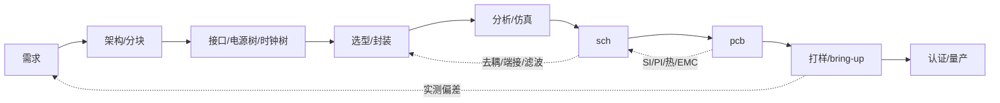

# TextEDA — Agent 工作指南

> **本文件怎么读（2026-10-21 起）**：这里混了三类东西，效力不同：
> - **不变量**（§2）——少而硬，破坏要写 ADR 并说明为什么值得破坏。
> - **方向**（§1、§3、§4、§5）——设计意图，**可被 ADR 推翻**；推翻时改本文件，不算"违反规矩"。
> - **实现现状**——**以代码、测试、ADR、backlog 为准**，本文件只标注"已落地 / 只有设计 / 未落地"，不复制细节。细节过期不算违规，但标注错了要改。
>
> 状态（2026-10-21）：**工具链起步**。已落地：`packages/ir`（IR 与契约，10 份 schema）、`packages/parser`（`footprint` / `symbol` 解析 + 对应 `fmt`；`pcb` 解析（12 段 → `pcb` IR，`texteda compile --pcb`）+ `pcb` canonical formatter（`fmt --check` 已覆盖）+ sch↔pcb 绑定校验（`packages/core`）；`schematic` 解析（实例、net、port、约束、bus；板内不再有 `page` 类型，语言 0.7 撤销，见 [ADR-0025](docs/adr/0025-flat-board-and-print-pages.md)）+ 对应 `fmt`（连通性 ERC 已移出，见 `packages/core`）；`view` 解析（S1 打印页：摆位、走线、标签、端口、注释 → `schematic-view` IR）+ 对应 `fmt`（板 ↔ 打印页交叉校验与可读性检查未落地，见 `spec/schematic-view.md` §9）；`module` 解析（板内层次：模块文件 + 板级 `modules` 段 + 端口绑定 → 展平进板级 IR，IR 契约不变，[ADR-0026](docs/adr/0026-modules-compose-boards.md)、`spec/module.md`）+ 对应 `fmt`；`component` 只有只读事实读取 `readComponentFacts`）、`packages/core`（纯规则：连通性 ERC，不碰 fs，解析器与 LSP 共用）、`packages/exporter`（封装/符号 → KiCad `.kicad_mod` / `.kicad_sym`；网表 = IR 的连通性投影）、`packages/renderer`（符号/封装/原理图打印页 → SVG，[ADR-0014](docs/adr/0014-reference-renderer.md)）、`packages/cli`（`texteda init` / `compile` / `check` / `netlist` / `ir`，[ADR-0019](docs/adr/0019-agent-contract-reference-and-check-entry.md)、[ADR-0023](docs/adr/0023-ir-layer-on-disk.md)）、**IR 分片树**（`texteda ir` 写 `dist/ir/`：每片 canonical JSON + `manifest.json` + 每片 sha256 + 工程哈希 / 板哈希；`project` / `component` / `system` 三种分片还没有生产者）、**诊断错误码注册表**（`域.slug`，[ADR-0016](docs/adr/0016-diagnostic-error-codes.md)；真源 `packages/ir/src/diagnostics/codes.ts`，文档 `docs/error-codes.md` 由 `bun run gen` 生成，双向完整性检查见 `packages/ir/test/codes.test.ts`）。**未落地**：`system` 的解析器、`project.toml` 解析、BOM 导出、KiCad 原理图导出、sch 规范文件（`spec/` 现只有 `symbol` / `footprint` / `pcb` / `schematic-view` / `module`）、**原理图视图层 S1**（描述类型 `view` 的规范 + IR 契约 + 解析 + `fmt` 已落地；板 ↔ 打印页交叉校验、可读性检查、sch 的 round-trip 反解、评审 GUI 未落地，[ADR-0021](docs/adr/0021-schematic-view-layer.md)）、**评审 GUI**（浏览器优先的本地 web app，桌面壳延后，同上 ADR）、层次（模块参数、模块嵌套、跨工程模块库）、`fab` 描述、conformance / binding / 十用例语料。**仓库已公开**（`luffffyz/TextEDA`，2026-10-21），**CI 已落地**（`.github/workflows/ci.yml` 必过段零外部依赖；KiCad 互操作段是独立可选 workflow）。
> 标记约定：**已定** = 不再讨论；**提议** = 默认按此执行，可被 ADR 推翻；**待定** = 未决定，不要擅自选边。**未落地** = 只有设计，没有实现。

---

## 0. TL;DR

给**整个硬件项目**造一套人写的文本描述语言、一个类型化 IR、和一组校验器。

- 项目 = 需求 / 分块 / 接口 / 板 / 原理图 / PCB / 制造 / 变体，语言描述的是这个整体，不是单块 PCB。
- **原理图（sch）与 PCB 是两个独立描述**，互为兄弟，不互为父子：共享身份空间，各自可单独存在。
- 第一阶段只做 sch；PCB 描述晚于 sch，且不要求由 sch 派生。
- 语法只占 10%，真正的工作是语义、约束、错误模型、跨描述一致性。
- IR 是唯一真源；源码语法和任何渲染结果都是派生物。
- 渲染可以自由、可以非确定，但**不得改变连通性**，且必须能被反解校验。
- 不自研布局布线内核、不自研器件库、不自研制造出口（项目可自带**自建封装与符号**，但不做通用库；见 `docs/adr/0010-footprint-and-3d-model-ownership.md`）。
- 目标用户是 agent，但产出物要人读得懂：**Agent 优先，人来评审**。机器负责读设计、查错误、改设计；人负责在东西交付前读一遍。所有东西都是纯文本——包括错误本身，会指到具体哪个文件、哪一行。

---

## 1. 项目是什么 / 不是什么

**是**：

- 一套面向硬件项目的领域语言：`project`、`board`、`schematic`、`pcb`、`fab`、`variant`；需求/分块/分析证据为可选的轻量实体。
- 一个类型化中间表示（IR）及其 schema。
- 一个检查器：单位/量纲、引脚存在性、电气类型、net 完整性、约束断言、**sch↔pcb 一致性**。**现状：只有契约层校验（Ajv + schema），还没有检查器**；单位/量纲与引脚存在性的检查在库级校验里各有一部分。
- 一个参考渲染器和一个导出器（KiCad，见 `docs/adr/0005-manufacturing-output.md`）。**现状：渲染器覆盖符号、封装与原理图打印页（打印页从 `view` 描述 + 符号事实画，[ADR-0014](docs/adr/0014-reference-renderer.md)、[ADR-0021](docs/adr/0021-schematic-view-layer.md)），板 ↔ 打印页交叉校验与可读性检查未落地（F3）；导出器只出 `.kicad_mod` / `.kicad_sym`，网表与 BOM 未落地。**
- 一套一致性测试（conformance），让别人能独立实现渲染器。

**不是**：

- 不是 EDA GUI，不做画布、拖拽、交互式布线。**评审 GUI 是导航器 + 批注器**：画布只做「跟随鼠标的高亮指针」与「点击跳进源码」，不做画布编辑——三种模式 `review` / `placement` / `edit`，`edit` 也是在文本里改，画布只负责定位。见 [ADR-0021](docs/adr/0021-schematic-view-layer.md) 的 2026-10-22 附录。
- 不是布局布线求解器（借 freerouting / KiCad / tscircuit）。
- 不是器件库维护者（借 KiCad 符号库、嘉立创料号）；项目自己的封装可以自建，但那是项目产物，不是库产品。
- 不是 KiCad 的替代品；KiCad 降级为**库 + DRC 引擎 + 制造出口**。
- 不是制造工具：不自研 CAM 级 DFM 判定（那是规则工程，不是格式工程），也不做工艺规则库；**但格式层的写出器自研**——Gerber / Excellon 是派生层图像，RS-274X 是行式文本格式，工作量已知（[ADR-0018](docs/adr/0018-zero-dependency-and-manufacturing-target.md)、backlog F15）。派生层 policy（铜皮填充、阻焊与锡膏开窗规则、丝印 policy）由我们定规则、判定交给专业 CAM。路径见 `docs/adr/0005-manufacturing-output.md`（当前实现路径）与 `docs/adr/0018-zero-dependency-and-manufacturing-target.md`（目标形态与依赖边界）。**`fab` 的默认产物是制造中立的数据**（描述层：装配意图、BOM、坐标），不是 Gerber 本身，见 backlog F14。
- 不描述固件、外壳结构、供应链流程（后续可作为引用/接口，不进入第一阶段）。

### 1.1 实现路线（工具侧）

| 阶段 | 内容 | 说明 |
|---|---|---|
| P0 | `schematic` | 器件、引脚、net、约束、ERC；先跑通 |
| P1 | 渲染 + 导出 | sch SVG、netlist、KiCad 原理图 |
| P2 | `pcb` | 叠层、放置、走线、物理专属件 + 与 sch 的绑定校验 |
| P3 | `fab` / BOM / 变体 | 制造出口、DNP、装配变体 |
| P4 | 多板系统 | 板间连接器、系统级 net、共享 BOM |

原则：**每一步都能单独使用**。只有 sch 也要能完成设计、评审、导出网表。

### 1.2 设计流程（用户侧，提议）

工程实际流程不是瀑布，而是带反馈的环：



| 阶段 | 产物 | 出口准则 |
|---|---|---|
| 需求 | 可测的需求列表 + 验收条件 | 每条有判据，含环境/合规/成本 |
| 架构 | 功能块图 + 接口表 + 电源树 + 时钟树 | 每个接口有电平/速率/方向/端接 |
| 选型 | MPN + 封装 + 生命周期 + 替代料 | 可采购、非 EOL、参数有裕量 |
| 分析 | 仿真报告 + 假设 + 结论 | 最坏情况通过，或显式接受风险 |
| sch | 网表 + ERC + 评审记录 | ERC 零错误，关键 net 有约束 |
| pcb | 叠层 + 放置 + 走线 + DRC | DRC 零错误，SI/PI/热复检 |
| 打样 | 测试计划 + 实测数据 | 关键指标达标 |
| 认证/量产 | 合规报告 + DFM/DFA | 通过 |

四条与直觉不同的判断：

1. **流程是环，不是线**。PCB 的 SI/PI/热/EMC 结论会打回 sch（端接、去耦、滤波），sch 又打回选型。成本随阶段上升，所以前期分析是省钱，不是形式。
2. **数字分两层**。逻辑不用板级仿真（有 FPGA/ASIC 则另做 RTL 仿真）；物理层必须算：接口时序预算、SI、PI、复位与电源序列。高速数字（DDR/USB/PCIe/以太网）本质是模拟问题。
3. **尺寸不是到 PCB 才出现**。封装、引脚间距、散热焊盘、电流/电压额定、爬电距离在选型与 sch 阶段就锁定；PCB 阶段定的是坐标、外形、间距、可装配性。机械/外壳可能更早锁定板框与连接器位置。
4. **仿真不“定”电路**。它用来排除拓扑、量化裕量、找最坏角；模型有误差，最终由样机实测闭环。

常被跳过但必须补的一步：**接口表**。块与块之间的电平、方向、端接、电源序列是集成 bug 的主要来源；没有接口表，分块只是画方框。

---

## 2. 不可协商的不变量

1. **IR 是唯一真源**。语法可以换、渲染器可以换、导出器可以换，IR 语义不变。
2. **连通性只由逻辑模型决定**，绝不允许从几何反推连通性作为权威结果。几何反解只用于**校验**渲染是否失真。
3. **渲染器只读**。渲染器输入 IR，输出几何/图片；不得增删器件、引脚、net。
4. **渲染必须可校验**：存在 `extract(render(ir)) == ir` 的检查路径。做不到就不要提交该渲染器。**现状：符号与封装已成立**（按"语义投影"两端对比，覆盖整个参考库，[ADR-0014](docs/adr/0014-reference-renderer.md) decision 5）。
5. **每个元素有稳定 ID**。显示名（`R1`、`VCC`）可以改，ID 不变；diff 与增量更新依赖这一点。**现状：未兑现**——当前身份是展平后的名字，改名即换身份。这条**已定方向**：IR 里的身份键就是展平后的名字，"改名不换身份"要靠语言层加显式 `id` 列来实现（`AGENTS.md` §11 Q15 已定，决策见 `docs/adr/0008-ir-shard-identity-and-hash.md` decision 3 与 [ADR-0023](docs/adr/0023-ir-layer-on-disk.md) decision 6）。这是待兑现的目标，不是现状描述。
6. **没有隐式类型、没有有效缩进**。`no` 不是布尔，缩进不表达层级。这一条直接排除了 YAML 作为语言层。
7. **未知构造默认报错**，不静默忽略。需要放宽时用显式开关（`--allow-unknown`）。
8. **单位进字面量**（`3.3V`、`100nF`、`90Ω`）；语义位置上没有单位来源的数字必须报错。
9. **默认值必须写进规范**，并且可以省略。不允许“必须显式写默认值”的设计。
10. **版本化**：语言和 IR 都有版本号；破坏性变更必须附迁移脚本与迁移说明。版本号是 `MAJOR.MINOR[.PATCH]`：**MAJOR** = 老文件不再合法，**MINOR** = 加了描述类型/段/字段，**PATCH** = 不改变“哪些文件合法”的改动（加诊断码、改文案、澄清规则）——PATCH 永不破坏兼容性，判定时忽略。**0.x 阶段每种描述类型一条版本线、只走 PATCH 位**（加段加字段也不抬 MINOR；安全依据是“未知构造默认报错”）：全局号停在 `0.9`（新描述类型也诞生在 `0.9`），号码按类型独立、彼此不可比；**`1.0` 是保留号**，只能由显式决策产生（收敛条件：所有类型没有待做的表面变更 + 十用例语料存在），之后全语言一个号、只出 PATCH；**`1.0` 之后要改表面是新的 MAJOR（`2.0`）**，所以不会有 `1.1`–`1.9`。`0.x` 期间号码可以重新给（那条线不承诺任何东西），`1.0` 之后不行。决策见 [ADR-0022](docs/adr/0022-language-versioning.md) 及其 2026-10-22 / 2026-10-22b 附录。
11. **产物可追溯**：导出的 Gerber/图/网表携带 `source_hash + tool_version`（+ 渲染 seed，如适用）。
12. **sch 与 pcb 是两个独立描述**，共享同一身份空间（`component_id`、`pin_number`、`net_id`）。
13. **pcb 不得隐式增删逻辑连接**。任何偏差（net tie、测试点、缝合孔、分地）必须显式声明，并出现在校验报告里。
14. **逻辑专属 / 物理专属元素必须显式标记**（`logical_only` / `physical_only`），不得靠“缺省即某一边”推断。
15. **板间连接只在 `system` 描述里声明**。`sch` 不引用别的板，`system` 也不改写板内连通性；删掉 `system` 后各板依然独立成立。决策见 `docs/adr/0001-board-linking.md`。
16. **一块板 = 一份原理图描述、一个 BOM、一个 PCB**。板内不再有 `page` 描述类型与 `pages` 段（语言 0.7 撤销）；评审时的分块由 S1 视图层的**打印页**承担——它只画板级 net，不产生独立 BOM，也不改写连通性。决策见 `docs/adr/0025-flat-board-and-print-pages.md`。
17. **pcb 描述只存物理事实与规则意图**。不存绘图参数、丝印排版、编辑器状态与派生缓存（铜皮填充、量测文本、UUID、net 序号）；连通性由 `connect` 段与 sch 决定，不由几何反推。人在 KiCad 里的改动**不回写** IR。决策见 `docs/adr/0003-agent-first-pcb-ir.md`。
18. **IR 的对外表示是 canonical JSON，契约是 JSON Schema**。数值只用整数（长度 nm、角度毫度、比例 ppm…完整换算表见 [ADR-0008](docs/adr/0008-ir-shard-identity-and-hash.md)），不写浮点；缺省字段省略而不是写 `null`；落盘必须字节可复现，`source_hash` = SHA-256(canonical 字节)。决策见 `docs/adr/0004-ir-representation.md`；分片、身份键与哈希粒度见 `docs/adr/0008-ir-shard-identity-and-hash.md`（**已接受**）；分片树落在 `dist/ir/`、谁写、怎么哈希见 [ADR-0023](docs/adr/0023-ir-layer-on-disk.md)；契约在 `schemas/ir/v0.2/`。
19. **契约层永久开源**。`teda.md`、`spec/**`、`schemas/ir/**`、`examples/**`、`tests/**` 永远公开、可实现、可再分发，**不得改为闭源或加附加限制**；实现层（`packages/**`）可另行许可，但不得把"只有官方实现能读"的私有扩展混进契约层。项目按**纯开源技术规范**定位：**没有商业计划与收入模型**，没有付费服务、没有咨询或培训，也没有要加的打算——一切实现契约所需的东西都免费且不受限制，且不会变。回报方式只有一种：**被采用**（规范被引用、被实现、被别人的工具链依赖）。决策见 `docs/adr/0015-licensing-and-open-standard.md`。
20. **核心链路零外部依赖**。装 TextEDA 就能走完"描述 → 校验 → 渲染 → 制造包"，**不得要求用户安装 KiCad 或任何其他外部工具**。KiCad 降级为**可选后端**：互操作导出、对照验证、制造出口兜底。**任何门禁都不得依赖外部工具**——KiCad 的读入与 DRC 是"第三方接受我们"的**观测**，不是我们的正确性定义。边界：**格式与描述自己写，判定与工艺规则借专业工具**。决策见 `docs/adr/0018-zero-dependency-and-manufacturing-target.md`。

---

## 3. 分层：哪一层能自由

| 层 | 内容 | 能否自由/交给 AI | 原因 |
|---|---|---|---|
| PRJ | 项目：系统、板、变体、元数据（原记号 P0，与 §1.1 的阶段 P0 冲突，改用 PRJ） | **不能** | 结构化程度低，但身份与版本必须精确 |
| S0 | 原理图逻辑：器件、引脚、net、约束 | **不能** | 唯一逻辑真源，必须精确可校验 |
| S1 | 原理图视图：符号位置、走线、标签 | **可以**，不进构建身份（但文件必须留） | 给人评审用。**独立描述类型** `view`（`views/<board_id>/<page_id>.view.teda`，打印页，**独立根目录**，不进 `design/`）+ 独立 IR 分片；它是**手写的源文件、进仓库**（渲染器只画不摆，生成不出来），但**不参与构建身份**（分片是附注类，移动标签不改工程哈希与板哈希），决策见 [ADR-0021](docs/adr/0021-schematic-view-layer.md) 与 [ADR-0032](docs/adr/0032-view-is-a-drawing-not-a-build-input.md) |
| B0 | PCB 物理：叠层、坐标、层、过孔、走线 | **不能**自由 | 决定阻抗、串扰、回流、散热、爬电 |
| B1 | PCB 预览/3D/走线检查视图 | **可以** | 派生 |
| M0 | 制造：Gerber/钻孔/BOM/贴片 | **不能** | 校验后冻结，带版本与哈希 |

推论：讨论“渲染自由”时先问是哪一层。S1 随便画，B0 不行；S0 与 B0 之间的一致性由校验器保证，不由渲染器保证。

---

## 4. 语义模型（IR）

### 4.1 项目层

- `Project`：名称、版本、许可证、状态、所属板列表、变体列表、库引用（含版本锁定）。
- `Board`：一块物理板，挂 `schematic`（可选）、`pcb`（可选）、`fab`（可选）。
- `Variant`：DNP / 不贴 / 替代料的具名集合；只覆盖“装不装/装什么”，不改变连通性。作用域：引用 `component_id` 作用于该型号的所有实例，引用稳定 id 只作用于该实例；不影响 ERC 结果（§11 Q8 已定，决策见 `docs/adr/0002-board-pages-and-bom.md`）。
- `System`（P4）：板在 `sch` 的 `ports` 段声明对外暴露的节点；独立的 `system` 描述把两块板以上的 `port` 对成系统级 net。板内 `net` 名不参与跨板对齐，跨板只靠 `port`。决策见 `docs/adr/0001-board-linking.md`，语法见 `teda.md` §7.5、§8。**现状：无规范文件、无解析器、无实现**（只有 schema 与 `teda.md` 的一段）。
- `Procurement`（P3）：采购层——**一块板的「族 → 买哪颗」**。每块板两个文件（`assets/procurement/primary/<board_id>.teda` 规范、`alternatives/<board_id>.teda` 附注），行是 `<族> <参数…> -> <件>`；主料进工程哈希与板哈希，备料只进 `advisory_hash`（换第二货源不作废制造包）。决策见 `docs/adr/0030-procurement-layer.md`，语法见 `spec/procurement.md`（语言 0.9 新增）。**现状：格式已定并落档，无解析器、无 IR 分片、无 BOM 输出**（backlog F35）。
- `fab`（P3）：制造出口描述。**现状：连形态都没有**——无 spec、无 schema、无类型、无例子，只在 §1 / §4 / §9 与 ADR 里被提到。是否进语言见 §11。

**流程相关实体（提议，是否一等公民见 §11）**：

- `Requirement`：`id`、文本、验收条件、优先级、`links`（到 block/component/constraint/test）。
- `Block`：`id`、名称、父块、接口（power/clock/bus/analog）、关键器件；块是 sch 层次的骨架。
- `Analysis`：工具与版本、模型/工艺角/温度、假设、`source_hash`、结论、产物路径。结论必须绑定到它验证的那个设计版本，否则视为未验证。

**关键决定**：`schematic` 和 `pcb` 都是 `Board` 的可选子描述，**平级**。允许：

| 组合 | 场景 |
|---|---|
| sch only | 逻辑设计阶段、评审、出网表给别人布线 |
| pcb only | 逆向工程、射频/结构驱动布局、从外部网表导入 |
| sch + pcb | 常规；校验器检查一致性 |

### 4.2 原理图（S0）

**ComponentInstance**（放置实例）
- `id`（稳定）、`ref`（可改名）、`part`（MPN）、`symbol`、`footprint`（可选，逻辑阶段可缺）
- `dnp`、`unit`（多单元器件）、`logical_only`（如 power flag）、`properties`

**Pin**
- `number`（与 pad 对应的键）、`name`（功能名）、`electrical_type`
- `unit`、`alternates`（复用功能，如 `GPIO0/BOOT`）
- **必须同时有 number 和 name**：只有 name 会在复用功能上歧义，只有 number 人不可读。

**Net**
- `id`、`name`（可自动生成）、`members`（pin 引用列表）
- `class`（power/signal/diff/bus）、`attributes`（电压、电流、阻抗、等长）
- 显式区分三种“没连”：**floating（漏连，错误） / no_connect（有意悬空） / dnp（不贴）**。

**Constraint / Assertion**
- 量纲比较（`in 3.0V..3.6V`）、差分、等长、去耦距离、最大压降。

**Hierarchy（模块，源码层）**
- **现状：模块层已落地**（语言 0.8）：板文件用 `modules` 段实例化模块（`M1 charger-power`），模块文件 `modules/<module_id>.teda` 声明自己的 `ports` / `instances` / `nets`；解析时展平进板级 IR——实例 id 带模块前缀（`M1.R1`），模块内部 net 带前缀（`M1.VFB`），端口按板级 net 绑定合并。**IR 契约不变**（IR 仍是平表，没有层次字段），层次只存在于源码层。规范见 `spec/module.md`，决策见 [ADR-0026](docs/adr/0026-modules-compose-boards.md)。
- **没落地的部分**：模块参数（只做字面量替换）、模块嵌套（模块引用模块）、跨工程模块库（`use` / `import`）、版本锁定与循环检测。参数化结构不藏事实、参数化取值藏事实（所以不做），触发条件见 `docs/backlog.md` F13。
- **id 形状**：模块实例用 `M` 开头（`M1.R1`）；`P`（页面）随页面机制一起撤销，`MOD` 不用（[ADR-0024](docs/adr/0024-level-tags-in-flattened-names.md)、[ADR-0025](docs/adr/0025-flat-board-and-print-pages.md) decision 5）。

**Print page（打印页，S1）**
- 一块板可以拆成多个**打印页**（画布放不下、评审要分块看）。打印页是**绘制/打印单元**，不是逻辑划分：不产生独立 PCB，不产生独立 BOM，也不改变连通性。
- 打印页文件 `views/<board_id>/<page_id>.view.teda`（`view` 描述类型，**独立根目录**：画不进 `design/`，因为 `design/` 是电路真源），画的是**板级**实例与网名——与板文件逐字对齐，不需要名字解析。名字的**形状**也照搬板级：`instance_id` / `net_id` 是什么形状就写什么形状（模块实例是 `M1.R1` / `M1.VCC`）。
- **板内只有一套命名空间**：板 = 一份 `sch/<board_id>.teda`，`refdes` 与 net 名在板内唯一；跨"页"的 net 就是板 net，只声明一次。决策见 [ADR-0025](docs/adr/0025-flat-board-and-print-pages.md)。
- 旧的页面机制（`page` 描述类型、`pages` 段、页面端口、页内 net 命名）已在语言 0.7 撤销，迁移说明见 `teda.md` §13.4；机械迁移用 `bun run migrate:0.7 <项目目录>`（重名由作者决定，脚本不替人命名）。
- **实例 id** = 板内唯一的 `refdes`（`R1`）；模块实例用 `M1.R1`（[ADR-0024](docs/adr/0024-level-tags-in-flattened-names.md)）。
- **BOM 计数**：BOM 行 = (`component_id`, 参数字典, 变体状态)，聚合键不含 `refdes`；数量 = 板级实例表的实物数。

**View（原理图视图，S1）**
- 原理图的"画"（符号位置、走线、标签）**不在 S0 IR 里**——`schematic` IR 只有实例 / net / 端口 / 约束，没有任何坐标。因此**没有视图文件就没有图**。
- S1 是**独立描述类型**：文件 `views/<board_id>/<page_id>.view.teda`，独立 IR 分片（**附注类**：不进工程哈希与板哈希；渲染出的页面盖该分片自己的 `sha256`），独立 schema 与 spec。决策与理由见 [ADR-0021](docs/adr/0021-schematic-view-layer.md)；它与板的关系（打印页、引用板级 id）见 [ADR-0025](docs/adr/0025-flat-board-and-print-pages.md) decision 4。
- 视图只记"画"的事：符号摆在哪、走线怎么走、标签与端口在哪。**不重复电气事实**——引脚电气类型、net 成员、器件身份仍在 S0，视图按同样的身份键（`instance_id` / `pin_number` / `net_id`）引用**板级** id；视图与逻辑不一致是缺陷，要报出来，不是第二个真源。
- **视图用的是板的身份语言，不是它的一部分**：板级 `instance_id` / `net_id` 是什么形状，视图里就是什么形状——模块实例是 `M1.R1`、模块内部 net 是 `M1.VCC`，视图直接写这些名字（引脚引用 `M1.R1.5`）。视图只**引用**身份，不定义身份。
- **渲染器只画不摆**：没有视图文件就没有图，评审界面要如实报"此页无视图"，不能自己排一张。**画布只导航不编辑**：hover 给出跟随鼠标的高亮（CSS/SVG 层，不重绘不重排），点击按「身份 → 定义它的所有位置」跳转源码（需要 span 侧车表与身份索引，见 `docs/backlog.md` F11 / F34）。每次渲染的图不同 → 人无法把重叠的标签挪开 → §6 的可读性检查（文字重叠、线压引脚、标签碰撞、越界）就检查不出任何东西。
- **有逻辑、无视图**是合法状态：逻辑仍然可校验、可导网表，只是不可画。
- **有视图就必须留**：视图是人写的源文件，进仓库；它不可按需生成、不可当缓存丢弃——人挪开标签的功夫只存在那一个文件里。损坏了由人重做：工具只报不一致（板 ↔ 打印页交叉校验，`docs/backlog.md` F3），**不得用重绘覆盖 view 文件**。决策见 [ADR-0032](docs/adr/0032-view-is-a-drawing-not-a-build-input.md) 的 2026-10-22 附录。

### 4.3 PCB（B0）

- `Stackup`：层数、厚度、材料、阻抗目标。
- `Placement`：**稳定实例 ID** → 坐标、旋转、面；可带布局约束（区域、邻接、禁布；v0.4 未表达）。
- `Routing`：net → 走线几何、层、线宽、过孔；差分对**不是几何对象**，由规则声明。
- `Connect`：**显式声明**哪两个 pad 之间有连续铜箔。连通性的真源是它与 sch，不是几何。
- `Rules`：默认间距/线宽/过孔、按 net 的覆盖、差分对、等长。规则必须进 IR——KiCad 把它们放在工程文件里，只拿 `.kicad_pcb` 的 agent 无法自查。
- `PhysicalOnly`：安装孔、基准点、测试点、屏蔽罩、缝合孔、丝印图形。
- `Deviation`：`net_tie` / `split_ground` 等受控逻辑偏差。
- `Pad/Pin` 绑定：pad 号来自封装，必须与 sch pin `number` 对上。

段与语法见 `spec/pcb.md`；取舍与决策见 `docs/adr/0003-agent-first-pcb-ir.md`。

**pcb 可以声明 net，但只能引用已有的 `net_id`**；不能创建新的逻辑连接。pcb-only 模式下，则必须先由 pcb 显式声明完整 net 集合，等价于承担 S0 的职责。

### 4.4 绑定与一致性（核心）

身份键：

- 器件：`component_id`（不是 refdes；refdes 可改名，由映射表维护）
- 引脚：`(component_id, pin_number)`
- net：`net_id`（不是网络名）

校验规则（sch + pcb 同时存在时）：

1. 每个 pcb 器件必须绑定到一个 sch 器件，或标记 `physical_only`。
2. 每个 sch 器件的 pin 必须能映射到封装 pad，或显式 `no_connect` / `dnp`。
3. pcb 中每个 net 的成员集合，必须等于 sch net 成员集合在“已放置器件”上的投影，**除非**声明了受控偏差。
4. pcb 的 `connect` 段显式声明哪两个 pad 之间有连续铜箔：每一对必须落在 sch 的同一 net 内（除非声明了受控偏差）；sch 每个 net 的每个成员 pad 至少出现在一个 `connect` 对里，否则报“该 net 未布线”。
5. 受控偏差只有白名单类型：`net_tie`、`test_point`、`stitching`、`split_ground`、`fiducial`。偏差进入报告，不隐藏。
6. 缺 sch 或 pcb 时跳过对应检查，并在报告里说明“未校验”。

### 4.5 器件描述（`components/`）

> **已定方向（未落地）**：[ADR-0027](docs/adr/0027-device-parts-families-and-library-dependencies.md) 把 `component` 拆成两种显式种类——`kind: part`（具体料，`mpn` 必填，身份闭合）与 `kind: family`（器件族，`mpn` 必省，`value` 等取值落在实例行，id 不带值）；族另加 `construction` / `polarized` 两个事实字段。**引脚表是身份分界**：引脚表变了就是另一个器件，只有不改引脚表/引脚行为的属性才允许进 `params`；`footprint` 是固定属性，不是参数（`package` 字段已删除，代号下沉到 footprint）；同一 die 的多个封装 = 多个 part 文件，各写完整引脚表（不合成引脚表、不做多封装 part）。**`die` 不进语言**：die 是硅的事实，不是可采购器件的事实；ERC / BOM / 布局 / 网表都不读它，它只对生成器与库自身的封装一致性检查有用（都在语言之外）。工程若要写"U1 与 U2 是同一 die"，那是 `docs/` 里的装配说明，不是 IR 里的断言。决策见 [ADR-0027](docs/adr/0027-device-parts-families-and-library-dependencies.md) 的 2026-10-22 附录。目录改为**按归属分组**（[ADR-0031](docs/adr/0031-project-tree-ownership-model.md)）：本工程自有的器件资产放 `assets/`（`symbols/` `footprints/` `families/` `components/`，`components/` 与 `families/` 同级），外部库是**依赖**且**vendored 进树**（`external/libs/<name>/` + 独立的 `libref` 声明 `source`/`rev`/`content_hash`/`channel`，不再放 `project.toml`），库内件必须写 `lib:id` 限定名，本工程自有的件可裸写。采购绑定（厂商 / MPN）只出现在项目本地的 `assets/procurement/` 层（**语法初稿见 [ADR-0030](docs/adr/0030-procurement-layer.md)，状态 Proposed，未定稿**）。**`package` 字段删除**（封装代号下沉到 footprint 的 `package_code`），**3D 模型改挂 part**（land pattern 与厂商无关、body 与厂商有关），**不做装配约束**（限高要配合外壳，外壳不在项目里）——见 [ADR-0029](docs/adr/0029-package-code-footprint-and-3d-model-ownership.md)。库的信任模型（`provenance`、免责条款、派生覆盖 `overrides`）见 [ADR-0028](docs/adr/0028-library-trust-and-derived-overrides.md)。**下面各条描述的是当前已落地的现状**，迁移尚未开始。

- 一块料一个文件，可放子目录；`component_id` 取文件名（去掉 `.teda`），不取相对路径：`components/passives/r-0402.teda` ↔ `r-0402`。同一 `component_id` 在 `components/` 树内必须唯一；文件头 `component <id>` 必须与文件名一致，否则报错。
- 具体料号至少声明：`mpn`、`package`、`symbol`、`footprint`；通用无源件（如 `r-0402`）没有单一 `mpn`，可省略，用 `params` 的 `value` 区分。`pins` 对指向**自建符号**的器件必填（自建 `symbol` 只存视图，[ADR-0012](docs/adr/0012-symbol-description.md)）；只有 `symbol` 指向自带引脚事实的第三方库（KiCad `.kicad_sym`）时才能省略、由库展开。两种来源同时存在时**内联优先**，用于修正库里的错误或描述库外器件。
- `params` 声明该器件在 `instances` 行里允许的额外列（名称、类型、required/optional）。`instances` 行的列语义由被引用器件决定。
- `sch` 不得内联定义器件，只能引用 `components/` 中的 id；找不到即报错，不自动联网、不静默降级。
- 通用无源件同样是器件文件（如 `r-0402`），用 `params` 承载 value/tolerance/power，封装只写在文件里，不写在 `instances` 行。
- 引脚列至少包含：编号、名称、电气类型；多单元器件用 `unit` 区分，复用功能用 `alt` 标注。
- **封装几何与 3D 模型不进语言**：`footprint` 是几何的唯一引用点（`lib:name`）；焊盘尺寸、courtyard、3D 尺寸属于器件库而非板描述，写进板里就是每块板抄一份库（§7 重复描述坑）。项目可自建封装库（agent 从 datasheet 生成），见 `docs/adr/0010-footprint-and-3d-model-ownership.md` 与 `docs/footprint-authoring.md`。**3D 模型挂在 part 上**（厂商件）；**通用身体挂在 land pattern 上**（`envelope` = 封装标准外形，IPC/JEDEC 通用件），但只在"身体由封装决定"时允许——MLCC、贴片电阻电感、标准封装的集成电路可以；钽电解薄膜电容、模压屏蔽电感、连接器不行（身体随额定值变，通用身体等于什么都没说），后者由 part 自己带模型。`family` **不再**挂通用身体：一个族只有一个 land pattern，身体写两处就是两个源。决策见 [ADR-0029](docs/adr/0029-package-code-footprint-and-3d-model-ownership.md) 的 2026-10-22 附录。**KiCad 输出是给板厂的派生产物**（最多给人 review，不当工作环境——KiCad 自己的 footprint 也不绑 part），所以导出的 `.kicad_mod` 是**纯 2D land pattern**：不带 3D 模型、一个 land pattern 一个文件、**没有封装变体**，导出器保持 footprint IR 的纯函数；身体信息只在有 part 上下文的地方用（我们自己的 3D 预览与装配层、板级导出的实例）。
- **自建封装库用 `.teda` 写**（`footprint` 描述类型，语法见 `spec/footprint.md`），编译成 IR（`schemas/ir/v0.2/footprint.schema.json`），`.kicad_mod` 是导出产物（`packages/exporter`）。决策见 `docs/adr/0011-library-format-and-footprint-ir.md`，流程见 `docs/footprint-authoring.md`。
- **自建符号库同样用 `.teda` 写**（`symbol` 描述类型，语法见 `spec/symbol.md`），编译成 IR（`schemas/ir/v0.2/symbol.schema.json`），`.kicad_sym` 是导出产物。**引脚的电学事实（号、名字、电气类型）只写在 `component` 里**——符号只写"画在哪、怎么画"；导出时按引脚号合并，两边引脚号集合必须对齐（少一个报错，多一个警告）。决策见 `docs/adr/0012-symbol-description.md`，流程见 `docs/symbol-authoring.md`。
- **参考工程全部自建**：22 个器件的 `symbol` / `footprint` 全部指向项目自有的资产（目标路径 `examples/reference-project/assets/symbols/`、`assets/footprints/`，`project:` 前缀作历史写法保留），**不引用任何外部库**，所以它没有 `external/` 目录；库级校验 `bun run lib:verify` 是门槛（引用可解析、无孤儿、引脚号与焊盘号对齐、KiCad 能读能渲染、合并板 DRC 0 违规）。决策见 `docs/adr/0013-reference-project-self-built-libraries.md`。

---

### 4.6 评审记录（`docs/reviews/`）

- **评审是工程里的一等产物，不只是库的事**。库里复核一件料，在器件文件里写 `provenance` / `verified_by` / `verified_on`；**评审一块设计**，在 `docs/reviews/` 留下一轮记录：**谁看了什么、什么时候、说了什么、谁定的、定的什么**。决策见 [ADR-0033](docs/adr/0033-review-records-and-attribution.md)。
- **评审不是一种描述类型**：意见是散文，一个工程可能有几百条——不进语言、不进 IR、无 schema、无分片、**不改任何哈希**。约定见 `docs/review-records.md`。
  - **意见 = Markdown**：一轮一个文件 `docs/reviews/<round_id>.md`，一行一条（作者 + 日期 + 观察）。**工具不解析散文**。
  - **处置 = 一份小 TOML**：`docs/reviews/<round_id>.decision.toml`（`target` / `owner` / `date` / `verdict`）。机器只需要这几个事实。
- **一个工程只有一个责任人**：创建者，或半路接手的人。记在 `project.toml` 的 `[project] owner`；**换人 = 改这个字段**（不改任何哈希——责任人是工程的事实，不是设计的事实）。
- **别人评审只写意见，接受与否由责任人决定**：意见**不带 verdict**；`verdict` ∈ `accepted` / `declined` / `deferred`，只由责任人写（理由也是责任人自己写的一条意见）。工具不替任何人拍板。
- **闭环 = 这一轮有了 decision**：有意见没有处置就是**未闭环**；处置之后再来意见，另起一轮。`check` 报两条 warning：**未闭环**（带 target、作者、日期、意见）与**处置人不是当前责任人**（要么越权，要么换人没更新 `project.toml`）。**不让构建失败**。
- **不签名**：归属由版本控制给出，作者与责任人字段是给读者看的。签名至多在**库分发**里有意义（库级、覆盖 `content_hash`），现在不做。

## 5. Surface syntax（**提议**，未冻结）

具体格式见 `teda.md`；本节只记录决策与边界。

### 5.1 硬规则

1. 一行一个事实；禁止需要跨行阅读的结构。
2. **表格优先，但不是纯表格**：事实（器件、net 成员、引脚绑定）用表；组合（module/实例）用带端口的块；规则归检查器。边界见 5.3。
3. 只保留最少的符号：`:` 分隔名字与成员，`.` 访问引脚，`=` 绑定类型/值。其余靠空格与列。**冒号与续行同域**：只有“名字 + 不定长列表”的行（`nets`、`bus` 成员）才用冒号，也只有它们支持续行（首列是裸 `:`）；列固定的段（`instances`/`ports`/`constraints`）与成对坐标的段（`trace`/`zone`/`keepout`/`outline`，拆行会断配对）都不用。
4. 列的含义由器件类型定义，因此不用写 `value=`、`package=`。
5. 必须有 canonical formatter。列对齐、排序、空行规则写进规范；没有规范格式就没有有意义的 diff。
6. 运算符尽量 ASCII（`+-5%`），单位允许 Unicode（`Ω`、`±`）。
7. 每种描述有独立的文件类型和 `version` 头；跨文件引用只走显式 `use`/`import`。**现状：未落地**——现有引用机制是 `component_id` + 限定名（`lib:id`）与内容哈希锚点（`libref`，见 [ADR-0031](docs/adr/0031-project-tree-ownership-model.md)）；`use`/`import` 属层次设计的一部分（§4.2 Hierarchy），仓库里尚无此语法。

### 5.2 语法特性准入规则

每个新特性必须满足**全部**三条，否则不加：

1. 在 `examples/` 的十个困难用例中至少有一个必须用它；
2. 能用一段 EBNF + 一段语义说明 + 一个正例 + 一个反例说清；
3. 有明确的错误信息文案（含行列与修复建议）。

**现状：第 1 条目前不可评估**——十个困难用例语料**尚未存在**（`examples/` 下只有 `reference-project/`，无用例目录、无期望 IR）。在语料补齐前，本规则要么先补语料，要么临时以 ADR 代替（把"这个特性解决什么问题"写进 ADR 代替用例证据）。补语料见 `docs/backlog.md`。

### 5.3 表格的边界（提议）

表格只负责“事实”，不负责“组合”和“规则”：

| 内容 | 记法 | 理由 |
|---|---|---|
| 器件清单、net 成员、引脚绑定、变体 | 表 | 二分图/映射；一行一事实，diff 最干净 |
| 层次与复用 | `module` 定义 + 实例表（**已落地**，见 §4.2 Hierarchy） | 表能列实例，但表达不了端口契约——端口是模块自己的 `ports` 段 |
| 计算值 | **不进语言**（值必须是终值字面量） | 表达式属于生成器，而生成器在语言之外、产物是表；`10k * 2` 这样的过程值会让评审从"读"变成"验算"。判据与修订条件见 `docs/backlog.md` F9 / ADR-0017 |
| 量词规则（“所有去耦电容距引脚 <2mm”） | 检查器规则 | 是断言，不是设计事实 |
| 生成器/循环 | v0.1 不支持 | 显式重复优于隐式生成；后续生成层输出表 |

不同描述可以用不同记法：`project` 用 TOML，`sch` 用表，`pcb` 用几何记录；共享的是 IR 与校验，不是同一套标点。

表格的两个已知风险：

- **宽行**（例如 40 个 GND 引脚）。**已定**：net 行按 80 列折行，续行的首列是裸 `:`（延续上一行命名的 net）；同名 net 行仍可重复出现并合并成员。折行只影响排版——同一份描述无论写成几行，编译出的 IR 相同（成员按引脚引用自然序排序，见 `teda.md` §7.2 / §12）。标志是显式符号而不是缩进，因为缩进在本语言里不表达任何含义（§2 不变量 6）。
- **稀疏元数据**。不要给主表加十几个空列；放旁表（`props`），主表只保留每个类型都有的列。

---

## 6. 渲染与确定性

三种“确定性”必须分开，别混为一谈：

| 性质 | 要求 | 手段 |
|---|---|---|
| 语义确定性（渲染不改变连通性） | **必需** | `extract(render(ir)) == ir` |
| 布局稳定性（小改动 → 小移动） | **强烈建议** | 锚定未变器件、增量布局 |
| 像素可复现（同输入同输出） | 可选 | 保存已接受的渲染 + seed + 版本 |

策略：

- 接受的渲染存为产物，记录 `source_hash + renderer_version + seed`，只读。
- 重新渲染不得覆盖人工调整；需要人工编辑时走显式 patch/merge，不靠“重画一遍”。
- sch 视图与 pcb 视图是**两个独立的渲染目标**，可以分别实现、分别替换。
- 可读性检查自动化：文字重叠、线压引脚、标签碰撞、越界、连线穿过符号。可测；“好看”不可测。
- AI 渲染的三种形态：
  - AI 写渲染器代码（人审后固化）→ **推荐**；
  - AI 在若干确定性候选里挑选/调样式 → 可用；
  - AI 每次运行时生成坐标 → 允许，但产物必须冻结并校验，且不得回写 S0/B0。

---

## 7. 已知坑（按出现顺序）

| 坑 | 表现 | 对策 |
|---|---|---|
| 语义不足 | 只有 pins+nets，没有电气类型/net class/NC | 第四节的最小模型，第一天就上 |
| 器件身份断裂 | symbol ↔ footprint ↔ pad 号对不上 | 强制 `part` 引用 + 引脚映射校验 |
| 器件描述漂移 | `components/` 内联的引脚与库符号不一致 | 内联优先；校验时输出差异报告（自建符号没有这份重复：引脚事实只在 `component`） |
| 逻辑/几何混淆 | 图上看连着，实际不连 | 连通性只由逻辑模型判定 |
| **sch/pcb 漂移** | 两份描述各自演化，谁对说不清 | 明确权威（S0 定逻辑），偏差白名单 + 报告 |
| **重复描述** | 同一个连接写两遍，改一处漏一处 | pcb 只引用 `net_id`，不重写成员表 |
| 非确定性渲染 | 每版图都变，评审失效 | 冻结产物 + 锚定布局 |
| 回写覆盖 | 重渲染冲掉手工调整 | 稳定 ID + patch 模型 |
| 规模 | >100 器件后上下文爆炸 | 层次化（模块）+ 生成器；分块只归 S1 打印页，不进逻辑 |
| **绘制分块被当成逻辑分块** | 评审要分块看，于是给逻辑加了页面、端口与限定名，源码比不分块更难读 | 分块归 S1 打印页（可丢弃）；逻辑只有一份板文件，层次留给模块（[ADR-0025](docs/adr/0025-flat-board-and-print-pages.md)） |
| **pcb 变成 KiCad 的翻版** | 段集照抄 `.kicad_pcb`，继承绘图参数、丝印排版、填充缓存 | 丢弃清单与段集见 `docs/adr/0003-agent-first-pcb-ir.md`；规则必须进 IR |
| 假验证 | “图好看”当成“电路对” | 机器校验等价是硬门槛 |
| 导出边界 | 非网格坐标导入 KiCad 后断网 | 导出前量化/吸附，导出后跑连通性比对 |
| 同一器件两个源 | 项目派生覆盖库的件，等于同一个器件有两份描述，BOM / ERC / 导出器都要回答"这个件到底是哪一份" | 覆盖是最后手段：首选上游修好 + 抬 pin；派生件**遮蔽**库件（项目里只留一个源，被遮蔽的库件不得再被引用），几何（symbol / footprint）不覆盖——共享几何的爆炸半径太大。决策见 [ADR-0028](docs/adr/0028-library-trust-and-derived-overrides.md) 的 2026-10-22 附录 |
| 库缺失 | 第一颗 BGA 就卡住 | 通用库借 KiCad + 嘉立创；**项目自建库是另一条路且是一等产物**（[ADR-0010](docs/adr/0010-footprint-and-3d-model-ownership.md) / 0011 / 0012 / 0013），两者不是二选一 |

---

## 8. 造 vs 借

| 层 | 自己造 | 说明 |
|---|---|---|
| 语法、parser、IR | ✅ | 这是产品本体 |
| 类型/量纲/约束求解 | ✅ | 差异化在这里 |
| ERC / 规则检查 / 绑定校验 | ✅ | 规则自己写；可用 `kicad-cli` 交叉验证 |
| 参考渲染器 | ✅ | **符号 / 封装 / 原理图打印页 SVG 已落地**（[ADR-0014](docs/adr/0014-reference-renderer.md)、[ADR-0021](docs/adr/0021-schematic-view-layer.md)，自带 Hershey 笔画字体、不依赖 KiCad）；打印页从 `view` 描述画，板 ↔ 打印页交叉校验与可读性检查未落地（`docs/backlog.md` F3），pcb SVG 排在后面 |
| 3D 预览与几何导入 | ❌ | 运行时只留 three.js（MIT）：STEP 离线转 glTF、KiCad `.wrl` 直读；必须实时转 STEP 时才用 `occt-import-js`（LGPL-2.1，7.3 MB，动态加载）；快照用 `kicad-cli pcb render` |
| IDE 集成 | ✅ 薄壳 | LSP over stdio；图与 3D 走 webview，不复制语义 |
| 布局 / 布线 | ❌ | freerouting、KiCad、tscircuit 授权器 |
| 器件库 / 封装 / 符号 | 通用库 ❌，**项目自建库 ✅** | 通用库借 KiCad + 嘉立创，不做库产品；但**项目自带的封装库与符号库是一等产物**（我们的格式描述，导出成 `.kicad_mod` / `.kicad_sym`），几何不进语言，只引用；符号的引脚事实归 `component`。[ADR-0010](docs/adr/0010-footprint-and-3d-model-ownership.md)、0011、0012、0013 |
| Gerber / 贴片 / BOM | 格式 ✅，**判定 ❌** | Gerber/Excellon 是物理图像，但 RS-274X 是行式文本格式，**写出器自研**（P3，F15）；"制造与装配意图"（BOM、坐标、层叠规则、装配说明）是**描述**，是本项目该做的那一层（契约层的一部分）。**不自研 CAM 级 DFM 判定**——格式自己写，判定借专业工具。[ADR-0018](docs/adr/0018-zero-dependency-and-manufacturing-target.md) |

最小闭环：`parser → typed IR → ERC → netlist 导出 → sch SVG → KiCad 导出`。pcb 描述与布局布线排在后面。

---

## 9. 仓库结构（目标）

```
texteda/
├── AGENTS.md
├── teda.md           # `.teda` 格式规范
├── README.md
├── LICENSE           # Apache-2.0（NOTICE 记归属）；契约层永久开源，见 ADR-0015
├── docs/            # 设计决策（ADR）、语言教程、评审流程
│   ├── adr/
│   ├── skills/      # **skill：给 agent 的操作手册**（每步 = 命令 + 预期输出 + 出错看哪个诊断码；**英文**）。现只有 `skills/new-project.md`（从零建工程到网表 / KiCad 库；可执行形态待做，见 `docs/backlog.md` F23）
│   └── error-codes.md # 诊断错误码注册表（**生成的**，真源在 `packages/ir/src/diagnostics/codes.ts`，ADR-0016）
├── spec/            # 分描述规范。**现只有 6 个文件**：`symbol` / `footprint` / `pcb` / `schematic-view` / `module` / `procurement`；`project` / `schematic` / `system` / `fab` 的规范尚未成文（`project` / `schematic` / `system` 目前只在 `teda.md` 里，`fab` 还没有任何形态）
├── schemas/ir/v0.2/ # IR 的契约：JSON Schema 2020-12（唯一契约；TS 类型由 schema 生成，不引入 zod）。现 10 份：common / project / component / footprint / manifest / pcb / schematic / schematic-view / symbol / system
├── examples/        # 参考工程 reference-project/。**十个困难用例与期望 IR 尚未存在**（§10 / §5.2 的门槛因此不可评估）
├── packages/        # **已落地 6 个**：`ir`（IR 与契约校验）/ `parser`（footprint / symbol / schematic / module / pcb / view 解析 + fmt；component 只读事实）/ `core`（纯规则：连通性 ERC，ADR-0019）/ `exporter`（封装与符号 → KiCad）/ `renderer`（符号与封装 → SVG）/ `cli`（`texteda init` / `compile` / `check` / `netlist` / `ir`）。**计划未建**：`lsp` / `vscode` / `viewer`（见 docs/adr/0009-implementation-stack.md、docs/adr/0021-schematic-view-layer.md）
└── tests/           # 现只有 `tests/schemas/`（IR 契约正反例，由 `packages/ir/test/contract.test.ts` 驱动）。单元与 round-trip 测试在各包自己的 `test/` 目录；**conformance / binding / 十用例尚未存在**
```

一个**使用**本语言的工程由 `texteda init <dir>` 生成，结构已定（**按归属分组**，决策见 [ADR-0031](docs/adr/0031-project-tree-ownership-model.md)；**未落地**）：

```
examples/reference-project/
├── project.toml        # 项目入口：name / version / format
├── assets/             # 本工程自有：器件资产 + 选料决定
│   ├── symbols/        # 符号视图（.teda 源码，见 spec/symbol.md）
│   ├── footprints/     # 封装几何（.teda 源码，见 spec/footprint.md）
│   ├── families/       # 器件族（无料号）
│   ├── components/     # 具体料（有料号）
│   └── procurement/    # 选料：primary/<board_id>.teda（规范）+ alternatives/<board_id>.teda（附注）
├── external/           # 引用但不自有
│   ├── libs/           # vendored 库：<name>.toml（libref）+ <name>/（库资产）
│   ├── simulation/     # 仿真模型（vendored，看许可）
│   └── cache/          # 本地缓存（厂商数据手册 PDF 等），gitignore，不进 IR
├── design/             # 电路
│   ├── sch/            # 原理图描述：一板一份 design/sch/<board_id>.teda
│   ├── modules/        # 模块描述：一个模块一份 design/modules/<module_id>.teda（板内层次，见 spec/module.md）
│   ├── pcb/            # PCB 描述，可后置，可为空
│   └── system/         # 多板连接描述，一份系统一个文件
├── views/              # 画（打印页 S1）：views/<board_id>/<page_id>.view.teda
│                      # 手写、进仓库、不参与构建身份（见 ADR-0021 / ADR-0032）
├── docs/               # 设计意图、评审记录、仿真证据
└── dist/               # 派生产物（导出时创建，gitignore）
```

**已定方向（未落地）**：目录**按归属分组**——本工程自有的器件资产与选料放 `assets/`；引用但不自有的材料放 `external/`（库 vendored 进树并用 `libref` 钉版本；数据手册只留引用，本体在 `external/cache/`，不入库不进 IR）；电路描述收进 `design/`。器件按 `kind` 分 `families/` 与 `components/`（同级）。库的信任模型见 [ADR-0028](docs/adr/0028-library-trust-and-derived-overrides.md)，器件语义拆分见 [ADR-0027](docs/adr/0027-device-parts-families-and-library-dependencies.md)，树模型见 [ADR-0031](docs/adr/0031-project-tree-ownership-model.md)，打印页的地位与位置见 [ADR-0032](docs/adr/0032-view-is-a-drawing-not-a-build-input.md)。工作项见 `docs/backlog.md` F25 / F26 / F29 / F30。

IR 落在 `dist/ir/`，按描述分片，每片一份 canonical JSON（决策见 `docs/adr/0004-ir-representation.md`）。**现状：已实现**——`bun run texteda ir <工程目录>` 写出整棵分片树、manifest 与哈希（决策见 `docs/adr/0023-ir-layer-on-disk.md`）：

```
dist/ir/
├── manifest.json                          # 分片路径 + 每片 sha256 + 工程哈希
├── boards/<board_id>/schematic.json
├── boards/<board_id>/pcb.json
├── boards/<board_id>/view/<page_id>.json
├── symbols/<lib>/<symbol_id>.json
└── footprints/<lib>/<footprint_id>.json
```

**分片布局按种类固定，不镜像源码树**（[ADR-0031](docs/adr/0031-project-tree-ownership-model.md) decision 9）：源码树是给人看的，分片布局是给工具的接口；两者的映射由每片自带的 `source.file` 承担（[ADR-0008](docs/adr/0008-ir-shard-identity-and-hash.md) decision 1）。所以挪动源码目录不改分片路径，也不改工程哈希。

`project.json`、`components/<component_id>.json`、`systems/<system_id>.json` 三种分片**还没有生产者**（`project.toml` / `component` / `system` 的解析未落地），所以现在不出现；布局已定，缺的只是生产者（backlog F24）。哈希规则：每片 `sha256` 取**落盘那份 canonical 字节**；**分片分两类：规范（normative，进工程哈希）与附注（advisory，进 `advisory_hash`）**，manifest 逐片记录；工程哈希 = 规范分片按路径排序后 `<path>:<sha256>\n` 拼接再 `sha256`；`advisory_hash` = 附注分片的同样聚合；板哈希 = 该板分片的同样聚合（只打印、不落盘）。**哈希标识的是构建，不是工程文件集合**——只差附注的两个工程是同一个构建。见 [ADR-0023](docs/adr/0023-ir-layer-on-disk.md) decision 4 与 [ADR-0030](docs/adr/0030-procurement-layer.md) decision 12（**未落地**）。**工程有 error 时一分片都不写**，并且输出目录里树不拥有的文件会被删掉（陈旧分片会改哈希）。

**init 契约（已定，**已落地**：`bun run texteda init <dir>`，见 `packages/cli`）**

- `texteda init <dir>` 创建目录，且仅创建：`project.toml`、`components/`、`sch/`、`pcb/`、`system/`、`modules/`、`docs/`、`docs/README.md`；`components/`、`sch/`、`pcb/`、`system/` 与 `modules/` 放 `.gitkeep` 以保留空目录。**目标布局**（按归属分组，见 [ADR-0031](docs/adr/0031-project-tree-ownership-model.md) decision 10，**未落地**）：`assets/{symbols,footprints,families,components}`、`assets/procurement/{primary,alternatives}`、`external/{libs,simulation}`、`design/{sch,pcb,modules,system}`、`views/`、`docs/`；`external/cache/` 不创建（本地缓存，gitignore）。
- `project.toml` 必含 `[project].name`、`version`、`format`；`name` 默认取目录名。
- 目标目录非空时拒绝执行（`--force` 才覆盖），不合并、不猜测。
- 不联网、不拉模板、不生成 `dist/`；`dist/` 由导出命令创建。
- 输出确定性：同一 name 得到逐字节相同的文件（不写时间戳、不写随机 ID）。
- `examples/reference-project/` 是参考工程：init 裸输出只有 `name/version/format`，demo 额外展示可选元数据。

多板：`design/sch/` 与 `design/pcb/` 按**描述类型**分目录，板按文件名区分（`design/sch/hub.teda` / `design/pcb/hub.teda`），不按板建子目录；打印页是独立描述类型、独立根目录，放 `views/<board_id>/<page_id>.view.teda`（绘制单元，见 §4.2 Print page）。`design/system/` 同理放多板连接描述（`design/system/<system_id>.teda`），不放板。`design/modules/` 放模块定义（`design/modules/<module_id>.teda`，见 `spec/module.md`）。扩展名统一 `.teda`，由目录与首行（`schematic`/`module`/`pcb`/`component`/`system`/`view`）区分描述类型；`.comp` 与 Blackmagic Fusion 合成文件、GLSL compute shader 冲突，`.sch`/`.pcb` 与 Eagle/KiCad/PADS 重叠，均不再使用。

`project.toml` 只承载项目元数据（名称、版本、格式版本、板列表、变体），**不承载电路**，**也不承载库引用**（库引用是独立的 `libref` 描述，见 [ADR-0031](docs/adr/0031-project-tree-ownership-model.md) decision 5）；电路描述仍走专用语法，板间连接走 `system` 描述而不是 `project.toml`。

**project.toml 允许的键（提议）**

| 表 | 键 | 何时用 |
|---|---|---|
| `[project]` | `name` `version` `format` | 必填；`version` 是项目版本，`format` 是文件格式版本 |
| `[project]` | `description` `license` `status` | 可选；`license` 用 SPDX，`status` ∈ draft/prototype/frozen/production/deprecated |
| `[project]` | `owner` | 可选，但**存在评审记录时必填**：项目责任人（创建者或接手人）的姓名；只有责任人能处置评审意见。决策见 [ADR-0033](docs/adr/0033-review-records-and-attribution.md) |
| `[project]` | `default_variant` | 有多个变体时；必须指向已定义的 `[variants.<id>]` |
| `[[project.authors]]` | `name` `email` | 可选 |
| `[project.links]` | `repository` `homepage` `issues` | 可选 |
| `[boards.<id>]` | `revision` `title` | 多板/改版时；v0.1 可无 |
| `[variants.<id>]` | `dnp` `nofit` `alternates` | P3；器件引用用稳定 `component_id`，不用 refdes |
| ~~`[libs.<name>]`~~ | — | **已移走**：库引用是独立的 `libref` 描述（`external/libs/<name>.toml`），见 [ADR-0031](docs/adr/0031-project-tree-ownership-model.md) decision 5 |
| ~~`[libs.<name>]`（自建库）~~ | — | **已移走**：本工程自有的资产不再是库，在 `assets/` 下裸 id 引用 |
| `[compliance]` | `standards` `operating_temp` | 合规目标 |
| `[ext]` | 自由 | 唯一允许未知键的位置 |

规则：未知顶层键报错；不放时间戳、绝对路径、随机 ID、密钥、派生数据（BOM/Gerber/校验和）；`init` 只写 `name/version/format`，其余按需添加。

板级工程结构不是本仓库的职责；本仓库只规定语言与 IR。

---

## 10. 验证与验收

- **十用例语料**（先于实现写）：BGA 200 脚、双运放多单元、20 路电源域、差分对、DNP 变体、net tie、总线、层次复用、参数化分压、NC 引脚。**现状：未存在，且已决定延后**（`examples/` 下只有 `reference-project/`）——§5.2 的语法准入规则因此暂不可评估，**延后期间用 ADR 代替用例证据**（ADR 里写清"这个特性解决哪个具体硬件问题"并给最小片段）。见 `docs/backlog.md` F12。
- **conformance**：`source → IR → netlist` 的黄金文件；任何实现必须通过。**现状：未存在**（netlist 导出也未实现）。
- **binding**：`sch + pcb` 一致性用例，含 5 类受控偏差的正反例。**现状：未存在**（pcb 解析未实现）。
- **components**：id/文件名一致、pin 编号与封装一致、`params` 列解析、文件缺失报错。**现状：部分**——前两项在 `lib:verify` 里（符号引脚号集合与器件一致、封装焊盘号覆盖器件引脚）；`params` 列解析已随 sch 解析器落地（按器件 `params` 段声明的顺序取值，单位按 [ADR-0008](docs/adr/0008-ir-shard-identity-and-hash.md) decision 4 换算成整数）。
- **评审记录**：约定见 `docs/review-records.md`；`check` 报未闭环的轮次（有意见无处置，warning 不阻断）与「处置人不是责任人」的警告。**评审不进 IR**（无分片、无哈希影响）。**现状：未落地**（[ADR-0033](docs/adr/0033-review-records-and-attribution.md)，`docs/backlog.md` F33）。
- **打印页**：`view` 解析与 canonical fmt、渲染器只画不摆、打印页与板级 id 的逐字对齐。**现状：解析与 fmt 已落地**；**板 ↔ 打印页交叉校验未落地**（归 `packages/core`，`docs/backlog.md` F3）。
- **sch 编译**：`bun run compile:schematic <项目目录> <board_id>` 把板文件编译成板级 IR 分片（canonical JSON）；参考工程两块板（`mcu-board`、`charger-buck`）都要编译通过且满足 `schematic` 契约。**现状：已落地并通过**。
- **工程校验**：`bun run check <项目目录>` 校验工程里全部板（语义层 ERC + 契约层 schema 校验），`--json` 输出 [ADR-0016](docs/adr/0016-diagnostic-error-codes.md) 的诊断载荷，有 error 退出码非零。**现状：已落地**（[ADR-0019](docs/adr/0019-agent-contract-reference-and-check-entry.md)）。
- **契约参考**：`docs/ir-reference.md`（IR 字段 → 类型/单位/说明）与 `docs/error-codes.md`（诊断码 → 含义）由 `bun run gen` 生成，不手改；schema 字段的 `description` 覆盖率清单在参考文档文末。**现状：已落地**（[ADR-0019](docs/adr/0019-agent-contract-reference-and-check-entry.md)）。
- **round-trip**：每个渲染器都要过 `extract(render(ir)) == ir`。已落地：符号与封装渲染器按"语义投影"两端对比，覆盖**整个参考库**（[ADR-0014](docs/adr/0014-reference-renderer.md) decision 5）；**sch 打印页渲染器只落了绘制，反解（`extractSchematic`）尚未实现**（`docs/backlog.md` F3）。
- **格式化幂等**：`fmt(fmt(x)) == fmt(x)`；`fmt --check` 是 CI 门槛（`bun run fmt:teda --check <dir>`）。**现状：覆盖 `footprint`、`symbol`、`schematic`、`pcb` 与 `view`**（`component` 的 fmt 未实现，脚本会跳过）。
- **库闭环**：`bun run lib:verify` 要求每个 `component.symbol` / `footprint` 都解析到项目内文件（无外部前缀、无孤儿库文件）、符号引脚号集合与器件一致、封装焊盘号覆盖器件引脚、每个库文件可导出且 KiCad 能读入、全部封装合并板 DRC 0 违规。**现状：已落地并通过**。
- **IR 分片树**：`bun run texteda ir <项目目录>` 把工程里所有有生产者的描述编译成分片树（`dist/ir/`：每片一份 canonical JSON + `manifest.json`），每片 `sha256` 取落盘字节，工程哈希 = **规范分片**按路径排序后 `<path>:<sha256>\n` 的 `sha256`（附注分片另聚合成 `advisory_hash`，**未落地**），板哈希 = 该板分片的同样聚合；同一工程两次编译必须**逐字节相同**，工程有 error 时**一分片都不写**，输出目录里树不拥有的文件要被删掉。**现状：已落地并通过**（[ADR-0023](docs/adr/0023-ir-layer-on-disk.md)，测试见 `packages/cli/test/ir-tree.test.ts`）。
- **IR 只依赖语义**：打乱行序、换单位写法、换键序的同一描述，编译出的 IR 必须与 canonical 源**字节相同**。
- **交叉引用可解析**：`bun run check:links` 校验全部 Markdown 链接目标存在、ADR 编号能解析到文件、链接文字与目标一致、`docs/adr/README.md` 索引与磁盘上的决策记录一一对应、ADR 头部格式统一。**现状：已落地并通过**。
- **错误质量**：每条诊断含文件、行列、期望/实际、修复建议；提供 `--json` 输出供 agent 消费。**现状：部分**——parser 层已有 `file:line:col:severity:code:message`（码是无注册表的 `C001`/`F110`/`S202` 式临时编号）；**缺**期望/实际/修复建议与 `--json` 输出；**schema 层诊断只有 IR 路径**（`{path, keyword, message}`），没有文件与行列。完整口径见 `docs/backlog.md` F7（错误码注册表与载荷）与 F11（span 机制）。
- 提交前必须跑完整检查；不允许"只跑单测"。**现状：CI 已落地**（`.github/workflows/ci.yml`，push 与 PR 到 `main` 都触发）：`bun test`、`bun run typecheck`、`bun run gen:check`、`bun run lib:verify`、`bun run check:links`、`bun run check:public`、`bun run fmt:teda --check .`。**必过段全部零外部依赖**（不需要 KiCad）；KiCad 互操作段是**独立的可选 workflow**（`.github/workflows/ci-kicad.yml`，定时 + 手动触发），因为门禁不得依赖外部工具（不变量 20 / [ADR-0018](docs/adr/0018-zero-dependency-and-manufacturing-target.md)）。
- **公开仓库的每次 push 前要跑 `bun run check:public`**（[ADR-0015](docs/adr/0015-licensing-and-open-standard.md) decision 1 / `docs/backlog.md` F6）。仓库**已于 2026-10-21 公开**（`luffffyz/TextEDA`），所以这条是**当前生效的**门禁，不是将来的打算。公开就是**单向门**：进过历史的文件永久可读，fork 已经存在就收不回来。所以这一项查的是**历史**而不只是工作区——厂商 datasheet PDF、凭据、维护者机器的绝对路径、邮箱，都不能出现在任何可达提交里。检查项：① 历史里没有 PDF；② 没有凭据形状的字符串（私钥、GitHub/AWS/Slack token、API key 赋值）；③ 没有 `/home/<user>`、`/Users/<user>` 这类绝对路径（`/tmp` 通用临时目录不算）；④ 没有邮箱（提交者用的 AI 工具 noreply 邮箱也算邮箱；且 commit trailer 里的模型名必须与实际 provider/model 一致，写错了要立刻改历史，别等公开后再改——那时可能已有 fork）；⑤ 每个 `package.json` 有 `license` 与 `private: true`；⑥ `NOTICE` 附上被内置的第三方组件的许可正文（内置 Hershey 字形数据 → 必须有 MIT 正文）。**往 `docs/` 里放厂商文档前先想一次"是不是受版权保护的材料"——默认不入库**；真需要时放 `examples/reference-project/docs/datasheets/`，该目录已被 gitignore。**commit message 里的 `Co-Authored-By` trailer 同样要核对**：署名错了要立刻改历史，别等公开后再改（那时可能已有 fork）。

---

## 11. 待定问题（不要擅自决定）

工作项（不是待定问题）见 `docs/backlog.md`。

1. 语法形态：表格化（instances/nets 两表）还是链式（`A -- B -- C`）？两者可以共存，但主形式只能有一个。**现状：主形式事实上已经是表格**（`teda.md` 的 schematic 段就是 `instances` / `nets` / `ports` 表）；本条现在只剩"要不要引入链式作为辅助形式"的余地。边界与判据见 `docs/backlog.md` F9。
2. 表达式/参数化到什么程度（是否需要一门小表达式语言来算阻值）？**方向已定**：事实层不用表达式，值是终值字面量，生成器在语言之外、产物是表（`docs/backlog.md` F9 / ADR-0017 待写）。本条现在只剩"什么条件下允许受限表达式"的判据问题——触发条件是 §10 十用例里的"20 路电源域"证明表宽到不可用。
3. ~~器件库来源：解析 KiCad `.kicad_sym`，还是自带紧凑格式？~~ **已定**：自建库（封装与符号）都用 `.teda` 描述，KiCad 格式是导出产物；借来的库照旧消费，引用形式一致。封装见 [ADR-0011](docs/adr/0011-library-format-and-footprint-ir.md)、`spec/footprint.md`；符号见 [ADR-0012](docs/adr/0012-symbol-description.md)、`spec/symbol.md`（引脚的电学事实归 `component`，符号只写视图）。
4. ~~导出优先：KiCad `.kicad_sch/.kicad_pcb` 还是 Circuit JSON？~~ **已定**：KiCad；制造链走 `kicad-cli`，Circuit JSON 撤回，见 `docs/adr/0005-manufacturing-output.md`。
5. sch/pcb 的权威边界：pcb 能否声明“sch 里没有但物理上必须存在”的连接？白名单够不够？
6. pcb-only 模式是否正式支持（逆向工程、外部网表导入）？（v0.4 的 pcb 描述假定存在 sch，见 `docs/adr/0003-agent-first-pcb-ir.md`）
7. ~~多板系统的连接器建模放在 project 层还是 board 层？~~ **已定**：板在 `sch` 的 `ports` 段暴露节点，跨板连接放在独立的 `system` 描述；见 `docs/adr/0001-board-linking.md`。
8. ~~变体（DNP/替代料）只作用于 BOM，还是也影响 sch/pcb 的校验？~~ **已定**：变体只影响 BOM 与制造，**不改变连通性**，不影响 ERC 结果。引用 `component_id` 作用于该型号的所有实例，引用稳定 id 只作用于该实例。见 `docs/adr/0002-board-pages-and-bom.md`。
9. 是否需要从现有 KiCad 工程反向导入（增量迁移路径）。
10. `Requirement` / `Block` / `Analysis` 是否进入语言（一等公民），还是只作为文档引用？
11. 追溯粒度：需求 → 块 → 器件 → net → 测试，追到哪一层为止？
12. 仿真证据的权威性：用什么规则判定“这个结论仍适用于当前版本”？
13. ~~实现语言与运行时：Rust 还是 Python/TS？~~ **已定**：TypeScript（strict、ESM）+ Bun 作为工具链/CLI/测试；`core` 必须能同时跑在 Node ≥ 20（IDE 扩展宿主）与浏览器（webview）；**不引入 zod**，TS 类型由 JSON Schema 生成。见 `docs/adr/0009-implementation-stack.md`。
14. ~~`components/` 是否需要家族/继承（同封装不同阻值共用一个文件），还是严格一料一号一文件？~~ **已定**：两者都要，但用显式种类区分而不是继承——`kind: part`（具体料，一料一文件，`mpn` 必填）与 `kind: family`（器件族，同封装不同取值共用一个文件，`mpn` 必省，取值落在实例行）；族另加 `construction` / `polarized` 事实字段，族 id 不带值。器件资产在本工程自有的 `assets/` 下按种类分（`families/` 与 `components/` 同级），见 [ADR-0031](docs/adr/0031-project-tree-ownership-model.md)。决策见 [ADR-0027](docs/adr/0027-device-parts-families-and-library-dependencies.md)。**未落地**（迁移待做，见 `docs/backlog.md` F25）。
15. ~~实例与 net 是否在源码里加显式 `id` 列（改名不换身份）？~~ **已定**：IR 的身份键就是展平后的名字——改名即换身份，等于"旧件消失、新件出现"，所有哈希随之改变；"改名不换身份"要落地就得在语言层加显式 `id` 列（v0.5 候选），而不是在 IR 里加映射层。决策见 `docs/adr/0008-ir-shard-identity-and-hash.md` decision 3 与 [ADR-0023](docs/adr/0023-ir-layer-on-disk.md) decision 6。
16. **层次（`module` 定义 / 实例化 / 参数）要不要进语言？** **已定并已落地模块层**（语言 0.8，`spec/module.md`、[ADR-0026](docs/adr/0026-modules-compose-boards.md)）：层次只在源码层、IR 存展平结果（IR 契约不变，仍是平表）；参数只做字面量替换、不参与运算；参数化结构不藏事实、参数化取值藏事实（所以不做）。触发条件是出现真实的"同构重复 ≥ 15 行、实例 ≥ 3 次、取值各不相同"。**没落地的**：模块参数、模块嵌套、跨工程模块库（`use` / `import`）——见 `docs/backlog.md` F13。
17. **`fab` 描述要不要进语言？** **方向已定，实现延后**（`docs/backlog.md` F14 / F15、[ADR-0018](docs/adr/0018-zero-dependency-and-manufacturing-target.md)）：**KiCad 是兼容方案，不是目标形态**。`fab` 的默认产物应是**制造中立的数据**（BOM、贴片坐标与朝向、层叠与规则意图、装配说明）；Gerber/Excellon 的**写出器自研**（P3），但**CAM 级 DFM 判定不自研**。先把制造中立数据的形状想清楚，再决定 `fab` 描述进不进步语言。
18. **十用例语料谁来写、什么时候写？** **已决定延后**（`docs/backlog.md` F12）：sch 的 IR 与展平口径定版之后再写。**延后期间用 ADR 代替用例证据**（§5.2 第 1 条暂不可评估）。

**近期已定（不再讨论，细节见对应 backlog / ADR）**：

- 诊断错误码形式 = `域.slug`（封闭域词表），不用 `E+数字`；码冻结、只增不改；注册表由代码生成；`--json` 载荷分机器与人两侧。`docs/backlog.md` F7（[ADR-0016](docs/adr/0016-diagnostic-error-codes.md) 待写）。
- 事实层不使用表达式；生成器在语言之外、产物是表。`docs/backlog.md` F9（ADR-0017 待写）。
- 契约层永久开源；项目是纯开源技术规范，无商业计划。`docs/adr/0015-licensing-and-open-standard.md`（不变量 19）。
- 核心链路零外部依赖；KiCad 是可选后端；Gerber 写出器自研、CAM 判定不自研；门禁不得依赖外部工具。`docs/adr/0018-zero-dependency-and-manufacturing-target.md`（不变量 20）。

---

## 12. Agent 工作方式

- **先改 spec，再改实现。** 规范与 conformance 用例同一次提交。
- **改 IR 语义要同时改 `schemas/` 与 conformance 用例。** JSON Schema 是唯一契约；zod 只是 TS 侧实现，两者必须由同一批用例驱动并有一致性测试。改完跑 `bun test packages/ir`（契约正反例；夹具在 `tests/schemas/valid` 与 `tests/schemas/invalid`）与 `bun run gen`（重新生成类型）。**注意：`tests/schemas/` 下没有独立的 runner，那条 `cd tests/schemas && node run.mjs` 是过时写法。**
- **不要加规范里没有的“顺手功能”**。需要就先写 ADR。
- **不要为了通过测试而放宽语义**（例如把未知字段当警告）。
- **不要给契约层加许可限制**（§2 不变量 19）：`spec/`、`schemas/`、`examples/`、`tests/`、`teda.md` 的开放性不可交易——**没有商业计划，开放性不是可交易的东西**。
- **错误信息是产品**：写实现时同时写诊断文案与 `--json` 结构。诊断码用 `域.slug`，码表是唯一真源、发出即冻结（[ADR-0016](docs/adr/0016-diagnostic-error-codes.md)、backlog F7 已关闭）。
- **改任何文件前先声明它属于哪一层**（project / sch / pcb / fab / view）；不要把派生层的东西写回真源。
- **仿真结论不得只写成注释或散文**；作为 `Analysis` 证据绑定 `source_hash` 与假设，否则视为未验证。
- **sch 不内联器件**；新增料号先落 `components/**/<id>.teda`，再在 `instances` 引用。
- **源码只允许英文**：`.ts` 的注释、文档字符串、字符串字面量（诊断文案、CLI 输出、错误消息）都是源码，一律英文；`schemas/ir/**` 的 `description` / `title` 同样英文（它会流进生成产物与 `docs/ir-reference.md`）；`examples/**` 的 `.teda` 注释与 `project.toml` 注释、`title`、`manufacturer` 等值也一律英文。检查口径：`git grep -lP '[\x{4e00}-\x{9fff}]' -- packages schemas examples` 应为空（用 `git grep` 而不是 `grep -r`，因为 `examples/reference-project/docs/datasheets/` 是 gitignore 的本地厂商 PDF，不属于仓库内容）。**根 README 双语**：`README.md` 英文（对外入口），`README_cn.md` 中文。
- **项目名的写法分层**（2026-10-21 定）：品牌与散文一律写 `TextEDA`（大写 T）；命令行、包名、域名一律小写 `texteda`（`bun run texteda check`、`@texteda/ir`、`texteda.dev`）；**仓库名例外，用 `TextEDA`**（GitHub 上是 `luffffyz/TextEDA`——GitHub 仓库名大小写敏感且不重定向，改名即旧 URL 失效，所以按品牌写法走）；文件扩展名 `.teda` 不变。**不写 `textEDA`**。检查口径：`git grep -n 'textEDA' -- . ':!AGENTS.md'` 应无输出（`packages/ir/src/generated/` 里的 `TextEDAIRV01*` 类型名是代码标识符，不算品牌写法）。
- **文档默认英文**（2026-10-21 定）：`docs/`、`spec/`、`teda.md`、ADR、根 README 一律英文；`docs/skills/**` 同理（skill 是给 agent 读的操作手册：每步 = 命令 + 预期输出 + 出错看哪个诊断码）。**需要中文时先问**——若觉得某份文档用中文更合适，先提问再写，不要自行决定。本规则之前写下的中文文档保持原样，不做迁移。**生成的文档**（`docs/error-codes.md`、`docs/ir-reference.md`）跟着生成源走——源是英文，这两份就是英文，不要手工改回中文（改生成器模板才是正解）。检查口径：新建文档用 `git grep -lP '[\x{4e00}-\x{9fff}]' -- <新文件路径>` 自查应为空；`docs/adr/` 的口径见下一条。根 README 双语是文件定位不是语言选择：`README.md` 英文（对外入口），`README_cn.md` 中文镜像。
- **`docs/adr/` 用英文**：ADR 是契约层的一部分——`spec/`、`schemas/` 与 `teda.md` 按编号引用它的决策（`ADR-00NN decision N`），第三方实现者要读得懂。ADR 编号与文件名永不改（外部靠文件名链接），标题与正文用英文，引用它的文档按编号引用，不按标题引用。检查口径：正文不得有中文，**唯一例外是外部专有名词与官方文档标题的括注**（`JLC (嘉立创)`、`official *JLC BOM and Coordinate Format Specification* (嘉立创BOM&坐标相关格式规范)`）——读者要靠原名去找原始资料。可执行检查（应无输出）：
  ```bash
  python3 - <<'PY'
  import re, pathlib
  for p in sorted(pathlib.Path('docs/adr').glob('*.md')):
      t = re.sub(r'\([^)]*[一-鿿]+[^)]*\)', '', p.read_text(encoding='utf-8'))
      hits = re.findall(r'[一-鿿]+', t)
      if hits: print(p.name, hits)
  PY
  ```
- **引用要可解析**：文档里提到某条决策时写成 `[ADR-0016](docs/adr/0016-diagnostic-error-codes.md)` 这样的链接——**链接文字是编号**（编号稳定，标题会改），**链接目标是文件名**（文件名永不改，外部靠它链接）。编号不能光秃秃地出现在正文里：读者要能一键跳到决策本身。链接路径相对于所在文件（`docs/adr/` 内写 `0005-manufacturing-output.md`，`docs/` 下写 `adr/...`，根目录写 `docs/adr/...`）。
- **ADR 索引与头部格式**：`docs/adr/README.md` 是全部决策记录的完整索引（编号 → 文件 → 标题 → 状态 → 日期），加一张"已预留编号"表（决策已定但记录还没写，如 ADR-0017）。每个 ADR 的头部固定为 `# ADR-NNNN: Title` + `Status:` + `Date:` +（可选）`Related:` + `Impact:`，状态词封闭在 `Accepted` / `Proposed`。这些都由 `bun run check:links` 机器校验：链接目标是否存在、ADR 编号能否解析到文件、链接文字与目标文件是否一致、索引与磁盘上的 ADR 文件是否一一对应、头部格式是否统一。**新增或改名 ADR 后必须跑它**；CI 把它当门禁。
- **提交信息英文**。
- **新增依赖需要 ADR**；默认零运行时依赖的 parser 是目标。
- **改完 schema 必须重生成**：`bun run gen`（产物在 `packages/ir/src/generated/`，不手改），CI 用 `bun run gen:check` 挡住漂移；`bun test` + `bun run typecheck` 必过。
- **`ir` / `parser` / `exporter` / `renderer` 禁止 `Bun.*` 与 `process.env`**（`core` 包尚未建立，规则对它同样适用）：这些包要能跑在 Node 扩展宿主与浏览器里；文件系统只允许出现在 CLI / 导出层（见 `docs/adr/0009-implementation-stack.md` decision 1）。

---

## 13. 背景数据（动机，别重复测量）

- KiCad `.kicad_sch` 实测：1 个电阻 + 2 个 label = 3746 B；纯语义值约 25 B（0.7%）。
  - 空白/缩进 35.4%，结构关键字 25.1%，坐标 10.1%，UUID 8.1%，样式关键字 1.3%。
  - `lib_symbols` 占 47.5%，其中引脚定义 528 B、图形 186 B、属性样板 852 B。
- 结论：KiCad 格式存的是**成稿**，不是设计。它是导出目标，不是 IR 的参照物。
- 同类项目定位：SKiDL（网表优先）、schematizer（网表→原理图，随机布局，另有 labels-only 确定性模式）、atopile（约束+选型→KiCad）、tscircuit（TSX→Circuit JSON→Gerber；其 schema 与写出器可参考，但本项目不采用该制造链，见 `docs/adr/0005-manufacturing-output.md`）、wire-lang（文本→SVG，确定性布局）、Polymorphic Blocks（生成器库→网表）。
- **cohdl**（`conol-ai/cohdl`，Rust 实现的**原理图编程语言**：traits / devices / `fn` / 泛型 / 单位即类型 / 引脚连接义务穷尽检查 / 错误码注册表 + 双向 completeness 检查 / `registry.cohdl.org` 包生态 / LSP / VS Code 扩展 / repair harness）。它与 tscircuit 一起代表"**把硬件设计写成程序**"这一路：结构用符号、值是裸字符串、程序语义进语言。**本项目取其诊断工程（错误码注册表、按错误种类分域、码冻结），不取其语言形态**（见 `docs/backlog.md` F7 / F9）。
