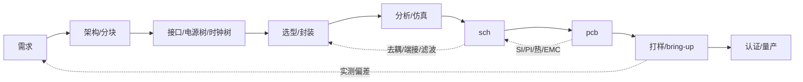

# textEDA — Agent 工作指南

> 状态：**工具链起步**：`packages/ir`（IR 与契约）、`packages/parser`（`.teda` → IR，含 `fmt`）、`packages/exporter`（封装/符号 → KiCad）、`packages/renderer`（参考渲染器：符号/封装 → SVG，ADR-0014）已落地；板级描述（`sch` / `pcb`）尚未实现。本文件是决策记录 + 工作约束，不是完成后的文档。
> 标记约定：**已定** = 不再讨论；**提议** = 默认按此执行，可被 ADR 推翻；**待定** = 未决定，不要擅自选边。

---

## 0. TL;DR

给**整个硬件项目**造一套人写的文本描述语言、一个类型化 IR、和一组校验器。

- 项目 = 需求 / 分块 / 接口 / 板 / 原理图 / PCB / 制造 / 变体，语言描述的是这个整体，不是单块 PCB。
- **原理图（sch）与 PCB 是两个独立描述**，互为兄弟，不互为父子：共享身份空间，各自可单独存在。
- 第一阶段只做 sch；PCB 描述晚于 sch，且不要求由 sch 派生。
- 语法只占 10%，真正的工作是语义、约束、错误模型、跨描述一致性。
- IR 是唯一真源；源码语法和任何渲染结果都是派生物。
- 渲染可以自由、可以非确定，但**不得改变连通性**，且必须能被反解校验。
- 不自研布局布线内核、不自研器件库、不自研制造出口（项目可自带**自建封装与符号**，但不做通用库；见 `docs/adr/0010-footprint-and-3d-model-ownership.md`）。
- 目标用户是 agent：机器可解析、可校验、错误可定位；人只负责评审。

---

## 1. 项目是什么 / 不是什么

**是**：

- 一套面向硬件项目的领域语言：`project`、`board`、`schematic`、`pcb`、`fab`、`variant`；需求/分块/分析证据为可选的轻量实体。
- 一个类型化中间表示（IR）及其 schema。
- 一个检查器：单位/量纲、引脚存在性、电气类型、net 完整性、约束断言、**sch↔pcb 一致性**。
- 一个参考渲染器（先 sch 的 SVG）和一个导出器（KiCad，见 `docs/adr/0005-manufacturing-output.md`）。
- 一套一致性测试（conformance），让别人能独立实现渲染器。

**不是**：

- 不是 EDA GUI，不做画布、拖拽、交互式布线。
- 不是布局布线求解器（借 freerouting / KiCad / tscircuit）。
- 不是器件库维护者（借 KiCad 符号库、嘉立创料号）；项目自己的封装可以自建，但那是项目产物，不是库产品。
- 不是 KiCad 的替代品；KiCad 降级为**库 + DRC 引擎 + 制造出口**。
- 不是制造工具：不自研 Gerber / Excellon 写出器，也不自研 CAM 级 DFM 判定；自研的只是派生层（铜皮填充、阻焊与锡膏开窗规则、丝印 policy）。路径见 `docs/adr/0005-manufacturing-output.md`。
- 不描述固件、外壳结构、供应链流程（后续可作为引用/接口，不进入第一阶段）。

### 1.1 实现路线（工具侧）

| 阶段 | 内容 | 说明 |
|---|---|---|
| P0 | `schematic` | 器件、引脚、net、约束、ERC；先跑通 |
| P1 | 渲染 + 导出 | sch SVG、netlist、KiCad 原理图 |
| P2 | `pcb` | 叠层、放置、走线、物理专属件 + 与 sch 的绑定校验 |
| P3 | `fab` / BOM / 变体 | 制造出口、DNP、装配变体 |
| P4 | 多板系统 | 板间连接器、系统级 net、共享 BOM |

原则：**每一步都能单独使用**。只有 sch 也要能完成设计、评审、导出网表。

### 1.2 设计流程（用户侧，提议）

工程实际流程不是瀑布，而是带反馈的环：



| 阶段 | 产物 | 出口准则 |
|---|---|---|
| 需求 | 可测的需求列表 + 验收条件 | 每条有判据，含环境/合规/成本 |
| 架构 | 功能块图 + 接口表 + 电源树 + 时钟树 | 每个接口有电平/速率/方向/端接 |
| 选型 | MPN + 封装 + 生命周期 + 替代料 | 可采购、非 EOL、参数有裕量 |
| 分析 | 仿真报告 + 假设 + 结论 | 最坏情况通过，或显式接受风险 |
| sch | 网表 + ERC + 评审记录 | ERC 零错误，关键 net 有约束 |
| pcb | 叠层 + 放置 + 走线 + DRC | DRC 零错误，SI/PI/热复检 |
| 打样 | 测试计划 + 实测数据 | 关键指标达标 |
| 认证/量产 | 合规报告 + DFM/DFA | 通过 |

四条与直觉不同的判断：

1. **流程是环，不是线**。PCB 的 SI/PI/热/EMC 结论会打回 sch（端接、去耦、滤波），sch 又打回选型。成本随阶段上升，所以前期分析是省钱，不是形式。
2. **数字分两层**。逻辑不用板级仿真（有 FPGA/ASIC 则另做 RTL 仿真）；物理层必须算：接口时序预算、SI、PI、复位与电源序列。高速数字（DDR/USB/PCIe/以太网）本质是模拟问题。
3. **尺寸不是到 PCB 才出现**。封装、引脚间距、散热焊盘、电流/电压额定、爬电距离在选型与 sch 阶段就锁定；PCB 阶段定的是坐标、外形、间距、可装配性。机械/外壳可能更早锁定板框与连接器位置。
4. **仿真不“定”电路**。它用来排除拓扑、量化裕量、找最坏角；模型有误差，最终由样机实测闭环。

常被跳过但必须补的一步：**接口表**。块与块之间的电平、方向、端接、电源序列是集成 bug 的主要来源；没有接口表，分块只是画方框。

---

## 2. 不可协商的不变量

1. **IR 是唯一真源**。语法可以换、渲染器可以换、导出器可以换，IR 语义不变。
2. **连通性只由逻辑模型决定**，绝不允许从几何反推连通性作为权威结果。几何反解只用于**校验**渲染是否失真。
3. **渲染器只读**。渲染器输入 IR，输出几何/图片；不得增删器件、引脚、net。
4. **渲染必须可校验**：存在 `extract(render(ir)) == ir` 的检查路径。做不到就不要提交该渲染器。
5. **每个元素有稳定 ID**。显示名（`R1`、`VCC`）可以改，ID 不变；diff 与增量更新依赖这一点。
6. **没有隐式类型、没有有效缩进**。`no` 不是布尔，缩进不表达层级。这一条直接排除了 YAML 作为语言层。
7. **未知构造默认报错**，不静默忽略。需要放宽时用显式开关（`--allow-unknown`）。
8. **单位进字面量**（`3.3V`、`100nF`、`90Ω`）；语义位置上没有单位来源的数字必须报错。
9. **默认值必须写进规范**，并且可以省略。不允许“必须显式写默认值”的设计。
10. **版本化**：语言和 IR 都有版本号；破坏性变更必须附迁移脚本与迁移说明。
11. **产物可追溯**：导出的 Gerber/图/网表携带 `source_hash + tool_version`（+ 渲染 seed，如适用）。
12. **sch 与 pcb 是两个独立描述**，共享同一身份空间（`component_id`、`pin_number`、`net_id`）。
13. **pcb 不得隐式增删逻辑连接**。任何偏差（net tie、测试点、缝合孔、分地）必须显式声明，并出现在校验报告里。
14. **逻辑专属 / 物理专属元素必须显式标记**（`logical_only` / `physical_only`），不得靠“缺省即某一边”推断。
15. **板间连接只在 `system` 描述里声明**。`sch` 不引用别的板，`system` 也不改写板内连通性；删掉 `system` 后各板依然独立成立。决策见 `docs/adr/0001-board-linking.md`。
16. **页面（`page`）是板内划分单元，不是独立的板**。页面不产生独立 PCB，不产生独立 BOM；一块板 = 一份 BOM、一个 PCB。板级网表与 BOM 都是展平（板根 + 各页面实例化一次）的结果。决策见 `docs/adr/0002-board-pages-and-bom.md`。
17. **pcb 描述只存物理事实与规则意图**。不存绘图参数、丝印排版、编辑器状态与派生缓存（铜皮填充、量测文本、UUID、net 序号）；连通性由 `connect` 段与 sch 决定，不由几何反推。人在 KiCad 里的改动**不回写** IR。决策见 `docs/adr/0003-agent-first-pcb-ir.md`。
18. **IR 的对外表示是 canonical JSON，契约是 JSON Schema**。数值只用整数（长度 nm、角度毫度、比例 ppm…完整换算表见 ADR-0008），不写浮点；缺省字段省略而不是写 `null`；落盘必须字节可复现，`source_hash` = SHA-256(canonical 字节)。决策见 `docs/adr/0004-ir-representation.md`；分片、身份键与哈希粒度见 `docs/adr/0008-ir-shard-identity-and-hash.md`；契约在 `schemas/ir/v0.1/`。
19. **契约层永久开源**。`teda.md`、`spec/**`、`schemas/ir/**`、`examples/**`、`tests/**` 永远公开、可实现、可再分发，**不因商业理由改为闭源或加附加限制**；实现层（`packages/**`）可另行许可，但不得把"只有官方实现能读"的私有扩展混进契约层。项目按**标准提案**定位（回报来自声誉 / 咨询 / 招聘溢价 / 生态位，不来自 SaaS 订阅）：契约免费且不设限，实现可以是收费的可选实现。决策见 `docs/adr/0015-licensing-and-open-standard.md`。

---

## 3. 分层：哪一层能自由

| 层 | 内容 | 能否自由/交给 AI | 原因 |
|---|---|---|---|
| P0 | 项目：系统、板、变体、元数据 | **不能** | 结构化程度低，但身份与版本必须精确 |
| S0 | 原理图逻辑：器件、引脚、net、约束 | **不能** | 唯一逻辑真源，必须精确可校验 |
| S1 | 原理图视图：符号位置、走线、标签 | **可以**，可丢弃 | 派生、给人评审用 |
| B0 | PCB 物理：叠层、坐标、层、过孔、走线 | **不能**自由 | 决定阻抗、串扰、回流、散热、爬电 |
| B1 | PCB 预览/3D/走线检查视图 | **可以** | 派生 |
| M0 | 制造：Gerber/钻孔/BOM/贴片 | **不能** | 校验后冻结，带版本与哈希 |

推论：讨论“渲染自由”时先问是哪一层。S1 随便画，B0 不行；S0 与 B0 之间的一致性由校验器保证，不由渲染器保证。

---

## 4. 语义模型（IR）

### 4.1 项目层

- `Project`：名称、版本、许可证、状态、所属板列表、变体列表、库引用（含版本锁定）。
- `Board`：一块物理板，挂 `schematic`（可选）、`pcb`（可选）、`fab`（可选）。
- `Variant`：DNP / 不贴 / 替代料的具名集合；只覆盖“装不装/装什么”，不改变连通性。作用域：引用 `component_id` 作用于该型号的所有实例，引用稳定 id 只作用于该实例；不影响 ERC 结果（§11 Q8 已定，决策见 `docs/adr/0002-board-pages-and-bom.md`）。
- `System`（P4）：板在 `sch` 的 `ports` 段声明对外暴露的节点；独立的 `system` 描述把两块板以上的 `port` 对成系统级 net。板内 `net` 名不参与跨板对齐，跨板只靠 `port`。决策见 `docs/adr/0001-board-linking.md`，语法见 `teda.md` §7.5、§8。

**流程相关实体（提议，是否一等公民见 §11）**：

- `Requirement`：`id`、文本、验收条件、优先级、`links`（到 block/component/constraint/test）。
- `Block`：`id`、名称、父块、接口（power/clock/bus/analog）、关键器件；块是 sch 层次的骨架。
- `Analysis`：工具与版本、模型/工艺角/温度、假设、`source_hash`、结论、产物路径。结论必须绑定到它验证的那个设计版本，否则视为未验证。

**关键决定**：`schematic` 和 `pcb` 都是 `Board` 的可选子描述，**平级**。允许：

| 组合 | 场景 |
|---|---|
| sch only | 逻辑设计阶段、评审、出网表给别人布线 |
| pcb only | 逆向工程、射频/结构驱动布局、从外部网表导入 |
| sch + pcb | 常规；校验器检查一致性 |

### 4.2 原理图（S0）

**ComponentInstance**（放置实例）
- `id`（稳定）、`ref`（可改名）、`part`（MPN）、`symbol`、`footprint`（可选，逻辑阶段可缺）
- `dnp`、`unit`（多单元器件）、`logical_only`（如 power flag）、`properties`

**Pin**
- `number`（与 pad 对应的键）、`name`（功能名）、`electrical_type`
- `unit`、`alternates`（复用功能，如 `GPIO0/BOOT`）
- **必须同时有 number 和 name**：只有 name 会在复用功能上歧义，只有 number 人不可读。

**Net**
- `id`、`name`（可自动生成）、`members`（pin 引用列表）
- `class`（power/signal/diff/bus）、`attributes`（电压、电流、阻抗、等长）
- 显式区分三种“没连”：**floating（漏连，错误） / no_connect（有意悬空） / dnp（不贴）**。

**Constraint / Assertion**
- 量纲比较（`in 3.0V..3.6V`）、差分、等长、去耦距离、最大压降。

**Hierarchy**
- module 定义/实例化、参数、`import` 路径解析、版本锁定、循环检测。

**Page（板内页面）**
- 一块板可以拆成多个页面（画布放不下、评审要分块看）。页面是**划分单元**，不是独立板：不产生独立 PCB，不产生独立 BOM。
- 页面文件 `sch/<board_id>/<page_id>.teda`，描述类型 `page`；板根 `sch/<board_id>.teda` 用 `pages` 段声明页面（`<page_instance_id> <page_id>`）。
- 页面内的 `net`、`refdes` 是局部的：只在页面内唯一。跨出页面只靠 `ports`；板根 net 用 `M1.SYS_OUT` 引用页面端口。
- 展平后没被板根引用的页内 `net` 仍在展平结果里，名字是 `<page_instance_id>.<net>`（如 `M2.BOOT`）——不同页面可以有同名页内 net。决策见 `docs/adr/0007-page-internal-net-naming.md`。
- **展平**：板 = 板根实例 + 每个页面实例化一次后的实例。ERC 与 BOM 都在展平结果上跑。
- **稳定 id**：页内实例 = `<page_instance_id>.<refdes>`，板根实例 = `<refdes>`。`refdes` 只是显示名，跨页可重复；导出时重编为板级唯一。
- **BOM 计数**：BOM 行 = (`component_id`, 参数字典, 变体状态)，聚合键不含 `refdes`；数量 = 展平后的实物数。

### 4.3 PCB（B0）

- `Stackup`：层数、厚度、材料、阻抗目标。
- `Placement`：**稳定实例 ID** → 坐标、旋转、面；可带布局约束（区域、邻接、禁布；v0.4 未表达）。
- `Routing`：net → 走线几何、层、线宽、过孔；差分对**不是几何对象**，由规则声明。
- `Connect`：**显式声明**哪两个 pad 之间有连续铜箔。连通性的真源是它与 sch，不是几何。
- `Rules`：默认间距/线宽/过孔、按 net 的覆盖、差分对、等长。规则必须进 IR——KiCad 把它们放在工程文件里，只拿 `.kicad_pcb` 的 agent 无法自查。
- `PhysicalOnly`：安装孔、基准点、测试点、屏蔽罩、缝合孔、丝印图形。
- `Deviation`：`net_tie` / `split_ground` 等受控逻辑偏差。
- `Pad/Pin` 绑定：pad 号来自封装，必须与 sch pin `number` 对上。

段与语法见 `spec/pcb.md`；取舍与决策见 `docs/adr/0003-agent-first-pcb-ir.md`。

**pcb 可以声明 net，但只能引用已有的 `net_id`**；不能创建新的逻辑连接。pcb-only 模式下，则必须先由 pcb 显式声明完整 net 集合，等价于承担 S0 的职责。

### 4.4 绑定与一致性（核心）

身份键：

- 器件：`component_id`（不是 refdes；refdes 可改名，由映射表维护）
- 引脚：`(component_id, pin_number)`
- net：`net_id`（不是网络名）

校验规则（sch + pcb 同时存在时）：

1. 每个 pcb 器件必须绑定到一个 sch 器件，或标记 `physical_only`。
2. 每个 sch 器件的 pin 必须能映射到封装 pad，或显式 `no_connect` / `dnp`。
3. pcb 中每个 net 的成员集合，必须等于 sch net 成员集合在“已放置器件”上的投影，**除非**声明了受控偏差。
4. pcb 的 `connect` 段显式声明哪两个 pad 之间有连续铜箔：每一对必须落在 sch 的同一 net 内（除非声明了受控偏差）；sch 每个 net 的每个成员 pad 至少出现在一个 `connect` 对里，否则报“该 net 未布线”。
5. 受控偏差只有白名单类型：`net_tie`、`test_point`、`stitching`、`split_ground`、`fiducial`。偏差进入报告，不隐藏。
6. 缺 sch 或 pcb 时跳过对应检查，并在报告里说明“未校验”。

### 4.5 器件描述（`components/`）

- 一块料一个文件，可放子目录；`component_id` 取文件名（去掉 `.teda`），不取相对路径：`components/passives/r-0402.teda` ↔ `r-0402`。同一 `component_id` 在 `components/` 树内必须唯一；文件头 `component <id>` 必须与文件名一致，否则报错。
- 具体料号至少声明：`mpn`、`package`、`symbol`、`footprint`；通用无源件（如 `r-0402`）没有单一 `mpn`，可省略，用 `params` 的 `value` 区分。`pins` 对指向**自建符号**的器件必填（自建 `symbol` 只存视图，ADR-0012）；只有 `symbol` 指向自带引脚事实的第三方库（KiCad `.kicad_sym`）时才能省略、由库展开。两种来源同时存在时**内联优先**，用于修正库里的错误或描述库外器件。
- `params` 声明该器件在 `instances` 行里允许的额外列（名称、类型、required/optional）。`instances` 行的列语义由被引用器件决定。
- `sch` 不得内联定义器件，只能引用 `components/` 中的 id；找不到即报错，不自动联网、不静默降级。
- 通用无源件同样是器件文件（如 `r-0402`），用 `params` 承载 value/tolerance/power，封装只写在文件里，不写在 `instances` 行。
- 引脚列至少包含：编号、名称、电气类型；多单元器件用 `unit` 区分，复用功能用 `alt` 标注。
- **封装几何与 3D 模型不进语言**：`footprint` 是几何的唯一引用点（`lib:name`）；焊盘尺寸、courtyard、3D 尺寸属于器件库而非板描述，写进板里就是每块板抄一份库（§7 重复描述坑）。项目可自建封装库（agent 从 datasheet 生成），见 `docs/adr/0010-footprint-and-3d-model-ownership.md` 与 `docs/footprint-authoring.md`。
- **自建封装库用 `.teda` 写**（`footprint` 描述类型，语法见 `spec/footprint.md`），编译成 IR（`schemas/ir/v0.1/footprint.schema.json`），`.kicad_mod` 是导出产物（`packages/exporter`）。决策见 `docs/adr/0011-library-format-and-footprint-ir.md`，流程见 `docs/footprint-authoring.md`。
- **自建符号库同样用 `.teda` 写**（`symbol` 描述类型，语法见 `spec/symbol.md`），编译成 IR（`schemas/ir/v0.1/symbol.schema.json`），`.kicad_sym` 是导出产物。**引脚的电学事实（号、名字、电气类型）只写在 `component` 里**——符号只写"画在哪、怎么画"；导出时按引脚号合并，两边引脚号集合必须对齐（少一个报错，多一个警告）。决策见 `docs/adr/0012-symbol-description.md`，流程见 `docs/symbol-authoring.md`。
- **参考工程全部自建**：22 个器件的 `symbol` / `footprint` 全部指向项目内的 `project:` 库（`examples/reference-project/symbols/project/`、`footprints/project/`），不引用任何外部库；库级校验 `bun run lib:verify` 是门槛（引用可解析、无孤儿、引脚号与焊盘号对齐、KiCad 能读能渲染、合并板 DRC 0 违规）。决策见 `docs/adr/0013-reference-project-self-built-libraries.md`。

---

## 5. Surface syntax（**提议**，未冻结）

具体格式见 `teda.md`；本节只记录决策与边界。

### 5.1 硬规则

1. 一行一个事实；禁止需要跨行阅读的结构。
2. **表格优先，但不是纯表格**：事实（器件、net 成员、引脚绑定）用表；组合（module/实例）用带端口的块；规则归检查器。边界见 5.3。
3. 只保留最少的符号：`:` 分隔名字与成员，`.` 访问引脚，`=` 绑定类型/值。其余靠空格与列。
4. 列的含义由器件类型定义，因此不用写 `value=`、`package=`。
5. 必须有 canonical formatter。列对齐、排序、空行规则写进规范；没有规范格式就没有有意义的 diff。
6. 运算符尽量 ASCII（`+-5%`），单位允许 Unicode（`Ω`、`±`）。
7. 每种描述有独立的文件类型和 `version` 头；跨文件引用只走显式 `use`/`import`。

### 5.2 语法特性准入规则

每个新特性必须满足**全部**三条，否则不加：

1. 在 `examples/` 的十个困难用例中至少有一个必须用它；
2. 能用一段 EBNF + 一段语义说明 + 一个正例 + 一个反例说清；
3. 有明确的错误信息文案（含行列与修复建议）。

### 5.3 表格的边界（提议）

表格只负责“事实”，不负责“组合”和“规则”：

| 内容 | 记法 | 理由 |
|---|---|---|
| 器件清单、net 成员、引脚绑定、变体 | 表 | 二分图/映射；一行一事实，diff 最干净 |
| 层次与复用 | `module` 定义 + 实例表 | 表能列实例，但表达不了端口契约 |
| 计算值 | 单元格内表达式 | 只允许表达式，不允许语句/控制流 |
| 量词规则（“所有去耦电容距引脚 <2mm”） | 检查器规则 | 是断言，不是设计事实 |
| 生成器/循环 | v0.1 不支持 | 显式重复优于隐式生成；后续生成层输出表 |

不同描述可以用不同记法：`project` 用 TOML，`sch` 用表，`pcb` 用几何记录；共享的是 IR 与校验，不是同一套标点。

表格的两个已知风险：

- **宽行**（例如 40 个 GND 引脚）。暂定：同名 net 行可重复出现并合并成员；同一行内重复引脚报错。是否改为“一行一引脚”的规范形式，由十用例验证。
- **稀疏元数据**。不要给主表加十几个空列；放旁表（`props`），主表只保留每个类型都有的列。

---

## 6. 渲染与确定性

三种“确定性”必须分开，别混为一谈：

| 性质 | 要求 | 手段 |
|---|---|---|
| 语义确定性（渲染不改变连通性） | **必需** | `extract(render(ir)) == ir` |
| 布局稳定性（小改动 → 小移动） | **强烈建议** | 锚定未变器件、增量布局 |
| 像素可复现（同输入同输出） | 可选 | 保存已接受的渲染 + seed + 版本 |

策略：

- 接受的渲染存为产物，记录 `source_hash + renderer_version + seed`，只读。
- 重新渲染不得覆盖人工调整；需要人工编辑时走显式 patch/merge，不靠“重画一遍”。
- sch 视图与 pcb 视图是**两个独立的渲染目标**，可以分别实现、分别替换。
- 可读性检查自动化：文字重叠、线压引脚、标签碰撞、越界、连线穿过符号。可测；“好看”不可测。
- AI 渲染的三种形态：
  - AI 写渲染器代码（人审后固化）→ **推荐**；
  - AI 在若干确定性候选里挑选/调样式 → 可用；
  - AI 每次运行时生成坐标 → 允许，但产物必须冻结并校验，且不得回写 S0/B0。

---

## 7. 已知坑（按出现顺序）

| 坑 | 表现 | 对策 |
|---|---|---|
| 语义不足 | 只有 pins+nets，没有电气类型/net class/NC | 第四节的最小模型，第一天就上 |
| 器件身份断裂 | symbol ↔ footprint ↔ pad 号对不上 | 强制 `part` 引用 + 引脚映射校验 |
| 器件描述漂移 | `components/` 内联的引脚与库符号不一致 | 内联优先；校验时输出差异报告（自建符号没有这份重复：引脚事实只在 `component`） |
| 逻辑/几何混淆 | 图上看连着，实际不连 | 连通性只由逻辑模型判定 |
| **sch/pcb 漂移** | 两份描述各自演化，谁对说不清 | 明确权威（S0 定逻辑），偏差白名单 + 报告 |
| **重复描述** | 同一个连接写两遍，改一处漏一处 | pcb 只引用 `net_id`，不重写成员表 |
| 非确定性渲染 | 每版图都变，评审失效 | 冻结产物 + 锚定布局 |
| 回写覆盖 | 重渲染冲掉手工调整 | 稳定 ID + patch 模型 |
| 规模 | >100 器件后上下文爆炸 | 层次化 + 分页 + 生成器，不靠单页 |
| **板内分页被当成多块板** | 明明是一块板，却拆出两份 BOM、两套 Gerber | 板根 + `pages` 段；页面不产生独立 BOM，展平后只有一份 |
| **pcb 变成 KiCad 的翻版** | 段集照抄 `.kicad_pcb`，继承绘图参数、丝印排版、填充缓存 | 丢弃清单与段集见 `docs/adr/0003-agent-first-pcb-ir.md`；规则必须进 IR |
| 假验证 | “图好看”当成“电路对” | 机器校验等价是硬门槛 |
| 导出边界 | 非网格坐标导入 KiCad 后断网 | 导出前量化/吸附，导出后跑连通性比对 |
| 库缺失 | 第一颗 BGA 就卡住 | 借 KiCad 符号/封装库，别自建 |

---

## 8. 造 vs 借

| 层 | 自己造 | 说明 |
|---|---|---|
| 语法、parser、IR | ✅ | 这是产品本体 |
| 类型/量纲/约束求解 | ✅ | 差异化在这里 |
| ERC / 规则检查 / 绑定校验 | ✅ | 规则自己写；可用 `kicad-cli` 交叉验证 |
| 参考渲染器（sch SVG，后 pcb SVG） | ✅ | 先自己写一个，证明 IR 足够表达 |
| 3D 预览与几何导入 | ❌ | 运行时只留 three.js（MIT）：STEP 离线转 glTF、KiCad `.wrl` 直读；必须实时转 STEP 时才用 `occt-import-js`（LGPL-2.1，7.3 MB，动态加载）；快照用 `kicad-cli pcb render` |
| IDE 集成 | ✅ 薄壳 | LSP over stdio；图与 3D 走 webview，不复制语义 |
| 布局 / 布线 | ❌ | freerouting、KiCad、tscircuit 授权器 |
| 器件库 / 封装 / 符号 | ❌ | 库本身不做：借 KiCad + 嘉立创；`components/` 只做项目内绑定与覆盖。**但项目可自带封装库与符号库**（我们的格式描述，导出成 `.kicad_mod` / `.kicad_sym`），几何不进语言，只引用；符号的引脚事实归 `component`。ADR-0010、0011、0012 |
| Gerber / 贴片 / BOM | ❌ | 现成工具链；制造出口路径见 `docs/adr/0005-manufacturing-output.md` |

最小闭环：`parser → typed IR → ERC → netlist 导出 → sch SVG → KiCad 导出`。pcb 描述与布局布线排在后面。

---

## 9. 仓库结构（目标）

```
textEDA/
├── AGENTS.md
├── teda.md           # `.teda` 格式规范
├── README.md
├── LICENSE           # Apache-2.0（NOTICE 记归属）；契约层永久开源，见 ADR-0015
├── docs/            # 设计决策（ADR）、语言教程、评审流程
│   └── adr/
├── spec/            # 分描述规范：project / components / schematic / pcb / system / footprint / symbol / fab
├── schemas/ir/v0.1/ # IR 的契约：JSON Schema 2020-12（唯一契约；TS 类型由 schema 生成，不引入 zod）
├── examples/        # 参考工程 reference-project/ + 十个困难用例与期望 IR（conformance 输入）
├── packages/        # ir（已落地）/ parser（已落地：.teda → IR，含 fmt）/ exporter（已落地：封装与符号 → KiCad）/ renderer（已落地：参考渲染器，符号与封装 → SVG）/ core / lsp / cli / vscode（见 docs/adr/0009-implementation-stack.md）
└── tests/           # 单元 + conformance + binding + round-trip + schemas（IR 契约正反例）
```

一个**使用**本语言的工程由 `textEDA init <dir>` 生成，结构已定：

```
examples/reference-project/
├── project.toml        # 项目入口：name / version / format
├── symbols/project/    # 自建符号库（.teda 源码，见 spec/symbol.md）
├── footprints/project/ # 自建封装库（.teda 源码，见 spec/footprint.md）
├── components/         # 器件描述，一块料一个文件
├── sch/                # 原理图描述：板根 sch/<board_id>.teda，板内页面 sch/<board_id>/<page_id>.teda
├── pcb/                # PCB 描述，可后置，可为空
├── system/             # 多板连接描述，一份系统一个文件
├── docs/               # 设计意图、评审记录、仿真证据
└── dist/               # 派生产物（导出时创建，gitignore）
```

IR 落在 `dist/ir/`，按描述分片，每片一份 canonical JSON（决策见 `docs/adr/0004-ir-representation.md`）：

```
dist/ir/
├── project.json
├── components/<component_id>.json
├── boards/<board_id>/schematic.json
├── boards/<board_id>/pcb.json
└── systems/<system_id>.json
```

**init 契约（已定）**

- `textEDA init <dir>` 创建目录，且仅创建：`project.toml`、`components/`、`sch/`、`pcb/`、`system/`、`docs/`、`docs/README.md`；`components/`、`sch/`、`pcb/` 与 `system/` 放 `.gitkeep` 以保留空目录。
- `project.toml` 必含 `[project].name`、`version`、`format`；`name` 默认取目录名。
- 目标目录非空时拒绝执行（`--force` 才覆盖），不合并、不猜测。
- 不联网、不拉模板、不生成 `dist/`；`dist/` 由导出命令创建。
- 输出确定性：同一 name 得到逐字节相同的文件（不写时间戳、不写随机 ID）。
- `examples/reference-project/` 是参考工程：init 裸输出只有 `name/version/format`，demo 额外展示可选元数据。

多板：`sch/` 与 `pcb/` 按**描述类型**分目录，板按文件名区分（`sch/hub.teda` / `pcb/hub.teda`），不按板建子目录；板内页面例外，放 `sch/<board_id>/<page_id>.teda`（板内划分单元，见 §4.2 Page）。`system/` 同理放多板连接描述（`system/<system_id>.teda`），不放板。扩展名统一 `.teda`，由目录与首行（`schematic`/`pcb`/`component`/`system`/`page`）区分描述类型；`.comp` 与 Blackmagic Fusion 合成文件、GLSL compute shader 冲突，`.sch`/`.pcb` 与 Eagle/KiCad/PADS 重叠，均不再使用。

`project.toml` 只承载项目元数据（名称、版本、格式版本、板列表、变体、库引用），**不承载电路**；电路描述仍走专用语法，板间连接走 `system` 描述而不是 `project.toml`。

**project.toml 允许的键（提议）**

| 表 | 键 | 何时用 |
|---|---|---|
| `[project]` | `name` `version` `format` | 必填；`version` 是项目版本，`format` 是文件格式版本 |
| `[project]` | `description` `license` `status` | 可选；`license` 用 SPDX，`status` ∈ draft/prototype/frozen/production/deprecated |
| `[project]` | `default_variant` | 有多个变体时；必须指向已定义的 `[variants.<id>]` |
| `[[project.authors]]` | `name` `email` | 可选 |
| `[project.links]` | `repository` `homepage` `issues` | 可选 |
| `[boards.<id>]` | `revision` `title` | 多板/改版时；v0.1 可无 |
| `[variants.<id>]` | `dnp` `nofit` `alternates` | P3；器件引用用稳定 `component_id`，不用 refdes |
| `[libs.<name>]` | `source` `rev` / `version` | 借来的库锁定，可复现性要求 |
| `[libs.<name>]` | `source`="project" `symbols`+`footprints`（或旧写法 `path`）`content_hash` | 项目自建库；版本锚点用内容哈希（`bun run lib:hash <dir>...`），见 ADR-0010 及其补充 |
| `[compliance]` | `standards` `operating_temp` | 合规目标 |
| `[ext]` | 自由 | 唯一允许未知键的位置 |

规则：未知顶层键报错；不放时间戳、绝对路径、随机 ID、密钥、派生数据（BOM/Gerber/校验和）；`init` 只写 `name/version/format`，其余按需添加。

板级工程结构不是本仓库的职责；本仓库只规定语言与 IR。

---

## 10. 验证与验收

- **十用例语料**（先于实现写）：BGA 200 脚、双运放多单元、20 路电源域、差分对、DNP 变体、net tie、总线、层次复用、参数化分压、NC 引脚。
- **conformance**：`source → IR → netlist` 的黄金文件；任何实现必须通过。
- **binding**：`sch + pcb` 一致性用例，含 5 类受控偏差的正反例。
- **components**：id/文件名一致、pin 编号与封装一致、`params` 列解析、文件缺失报错。
- **页面**：`pages` 段解析、页面端口绑定、展平后网表与 BOM 计数（跨页 refdes 重名不合并错误）、跨页约束相容。
- **round-trip**：每个渲染器都要过 `extract(render(ir)) == ir`。已落地：符号与封装渲染器按"语义投影"两端对比，覆盖**整个参考库**（ADR-0014 决策 5）；sch 渲染器落地时照同样的口径补上。
- **格式化幂等**：`fmt(fmt(x)) == fmt(x)`；`fmt --check` 是 CI 门槛（`bun run fmt:teda --check <dir>`）。
- **库闭环**：`bun run lib:verify` 要求每个 `component.symbol` / `footprint` 都解析到项目内文件（无外部前缀、无孤儿库文件）、符号引脚号集合与器件一致、封装焊盘号覆盖器件引脚、每个库文件可导出且 KiCad 能读入、全部封装合并板 DRC 0 违规。
- **IR 只依赖语义**：打乱行序、换单位写法、换键序的同一描述，编译出的 IR 必须与 canonical 源**字节相同**。
- **错误质量**：每条诊断含文件、行列、期望/实际、修复建议；提供 `--json` 输出供 agent 消费。
- 提交前必须跑完整检查；不允许“只跑单测”。

---

## 11. 待定问题（不要擅自决定）

工作项（不是待定问题）见 `docs/backlog.md`。

1. 语法形态：表格化（instances/nets 两表）还是链式（`A -- B -- C`）？两者可以共存，但主形式只能有一个。
2. 表达式/参数化到什么程度（是否需要一门小表达式语言来算阻值）？
3. ~~器件库来源：解析 KiCad `.kicad_sym`，还是自带紧凑格式？~~ **已定**：自建库（封装与符号）都用 `.teda` 描述，KiCad 格式是导出产物；借来的库照旧消费，引用形式一致。封装见 ADR-0011、`spec/footprint.md`；符号见 ADR-0012、`spec/symbol.md`（引脚的电学事实归 `component`，符号只写视图）。
4. ~~导出优先：KiCad `.kicad_sch/.kicad_pcb` 还是 Circuit JSON？~~ **已定**：KiCad；制造链走 `kicad-cli`，Circuit JSON 撤回，见 `docs/adr/0005-manufacturing-output.md`。
5. sch/pcb 的权威边界：pcb 能否声明“sch 里没有但物理上必须存在”的连接？白名单够不够？
6. pcb-only 模式是否正式支持（逆向工程、外部网表导入）？（v0.4 的 pcb 描述假定存在 sch，见 `docs/adr/0003-agent-first-pcb-ir.md`）
7. ~~多板系统的连接器建模放在 project 层还是 board 层？~~ **已定**：板在 `sch` 的 `ports` 段暴露节点，跨板连接放在独立的 `system` 描述；见 `docs/adr/0001-board-linking.md`。
8. ~~变体（DNP/替代料）只作用于 BOM，还是也影响 sch/pcb 的校验？~~ **已定**：变体只影响 BOM 与制造，**不改变连通性**，不影响 ERC 结果。引用 `component_id` 作用于该型号的所有实例，引用稳定 id 只作用于该实例。见 `docs/adr/0002-board-pages-and-bom.md`。
9. 是否需要从现有 KiCad 工程反向导入（增量迁移路径）。
10. `Requirement` / `Block` / `Analysis` 是否进入语言（一等公民），还是只作为文档引用？
11. 追溯粒度：需求 → 块 → 器件 → net → 测试，追到哪一层为止？
12. 仿真证据的权威性：用什么规则判定“这个结论仍适用于当前版本”？
13. ~~实现语言与运行时：Rust 还是 Python/TS？~~ **已定**：TypeScript（strict、ESM）+ Bun 作为工具链/CLI/测试；`core` 必须能同时跑在 Node ≥ 20（IDE 扩展宿主）与浏览器（webview）；**不引入 zod**，TS 类型由 JSON Schema 生成。见 `docs/adr/0009-implementation-stack.md`。
14. `components/` 是否需要家族/继承（同封装不同阻值共用一个文件），还是严格一料一号一文件？
15. 实例与 net 是否在源码里加显式 `id` 列（改名不换身份）？当前身份 = 展平后的名字，改名即换身份，见 `docs/adr/0008-ir-shard-identity-and-hash.md` 决策 3。

---

## 12. Agent 工作方式

- **先改 spec，再改实现。** 规范与 conformance 用例同一次提交。
- **改 IR 语义要同时改 `schemas/` 与 conformance 用例。** JSON Schema 是唯一契约；zod 只是 TS 侧实现，两者必须由同一批用例驱动并有一致性测试。改完跑 `cd tests/schemas && bun install && node run.mjs`（schema 编译 + 正反例）。
- **不要加规范里没有的“顺手功能”**。需要就先写 ADR。
- **不要为了通过测试而放宽语义**（例如把未知字段当警告）。
- **不要给契约层加许可限制**（§2 不变量 19）：`spec/`、`schemas/`、`examples/`、`tests/`、`teda.md` 的开放性不可交易；要商业化只能动实现层或另开描述。
- **错误信息是产品**：写实现时同时写诊断文案与 `--json` 结构。
- **改任何文件前先声明它属于哪一层**（project / sch / pcb / fab / view）；不要把派生层的东西写回真源。
- **仿真结论不得只写成注释或散文**；作为 `Analysis` 证据绑定 `source_hash` 与假设，否则视为未验证。
- **sch 不内联器件**；新增料号先落 `components/**/<id>.teda`，再在 `instances` 引用。
- **文档中文，代码/标识符/提交信息英文**。
- **新增依赖需要 ADR**；默认零运行时依赖的 parser 是目标。
- **改完 schema 必须重生成**：`bun run gen`（产物在 `packages/ir/src/generated/`，不手改），CI 用 `bun run gen:check` 挡住漂移；`bun test` + `bun run typecheck` 必过。
- **`core` / `ir` 禁止 `Bun.*` 与 `process.env`**：这两个包要能跑在 Node 扩展宿主与浏览器里；文件系统只允许出现在 CLI / 导出层（见 `docs/adr/0009-implementation-stack.md` 决策 1）。

---

## 13. 背景数据（动机，别重复测量）

- KiCad `.kicad_sch` 实测：1 个电阻 + 2 个 label = 3746 B；纯语义值约 25 B（0.7%）。
  - 空白/缩进 35.4%，结构关键字 25.1%，坐标 10.1%，UUID 8.1%，样式关键字 1.3%。
  - `lib_symbols` 占 47.5%，其中引脚定义 528 B、图形 186 B、属性样板 852 B。
- 结论：KiCad 格式存的是**成稿**，不是设计。它是导出目标，不是 IR 的参照物。
- 同类项目定位：SKiDL（网表优先）、schematizer（网表→原理图，随机布局，另有 labels-only 确定性模式）、atopile（约束+选型→KiCad）、tscircuit（TSX→Circuit JSON→Gerber；其 schema 与写出器可参考，但本项目不采用该制造链，见 `docs/adr/0005-manufacturing-output.md`）、wire-lang（文本→SVG，确定性布局）、Polymorphic Blocks（生成器库→网表）。
