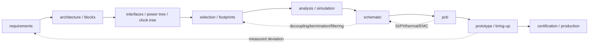

# The hardware design flow the language serves

Status: proposal, user-side · referenced by [ADR-0139](../adr/process/0139-process-entities-outside-the-language.md)
Impact: none — this describes the process the language is embedded in, not the language

This is the workflow TextEDA is built for. It is **not** a specification: nothing in `spec/` or
`schemas/` reads this file. It lives here because it explains *why* the model has the shape it has
(why `Requirement` / `Block` / `Analysis` stay outside the language, why the schematic and the PCB
are siblings, why `fab` is a description and not a Gerber).

## The flow is a loop, not a line

| Stage | Product | Exit criterion |
|---|---|---|
| Requirements | testable requirement list + acceptance conditions | every item has a criterion, incl. environment / compliance / cost |
| Architecture | functional block diagram + interface table + power tree + clock tree | every interface has level / rate / direction / termination |
| Selection | MPN + footprint + lifecycle + alternates | purchasable, not EOL, parameters have margin |
| Analysis | simulation report + assumptions + conclusion | worst case passes, or the risk is explicitly accepted |
| Schematic | netlist + ERC + review record | ERC zero errors, critical nets carry constraints |
| PCB | stackup + placement + routing + DRC | DRC zero errors, SI/PI/thermal re-checked |
| Prototype | test plan + measured data | key metrics met |
| Certification / production | compliance report + DFM/DFA | pass |

## Four judgments that go against intuition

1. **The flow is a loop, not a line.** PCB conclusions on SI/PI/thermal/EMC send work back to the
   schematic (termination, decoupling, filtering), and the schematic sends work back to selection.
   Cost rises with each stage, so analysis up front saves money rather than being ceremony.
2. **Numbers live on two levels.** Logic does not need board-level simulation (with an FPGA/ASIC,
   run RTL simulation separately); the physical layer must be computed — interface timing budget,
   SI, PI, reset and power sequencing. High-speed digital (DDR/USB/PCIe/Ethernet) is an analog
   problem in disguise.
3. **Size does not appear only at the PCB.** Package, pin pitch, thermal pad, current/voltage
   ratings and creepage are fixed during selection and the schematic. What the PCB stage fixes is
   coordinates, outline, spacing and assemblability. Mechanics or an enclosure may fix the board
   outline and connector positions even earlier.
4. **Simulation does not "settle" a circuit.** It rules out topologies, quantifies margin and finds
   the worst corner; models carry error, and the prototype closes the loop with measurements.

## The step most often skipped

**The interface table.** Level, direction, termination and power sequencing between blocks are the
main source of integration bugs. Without an interface table, "blocks" are just boxes.
